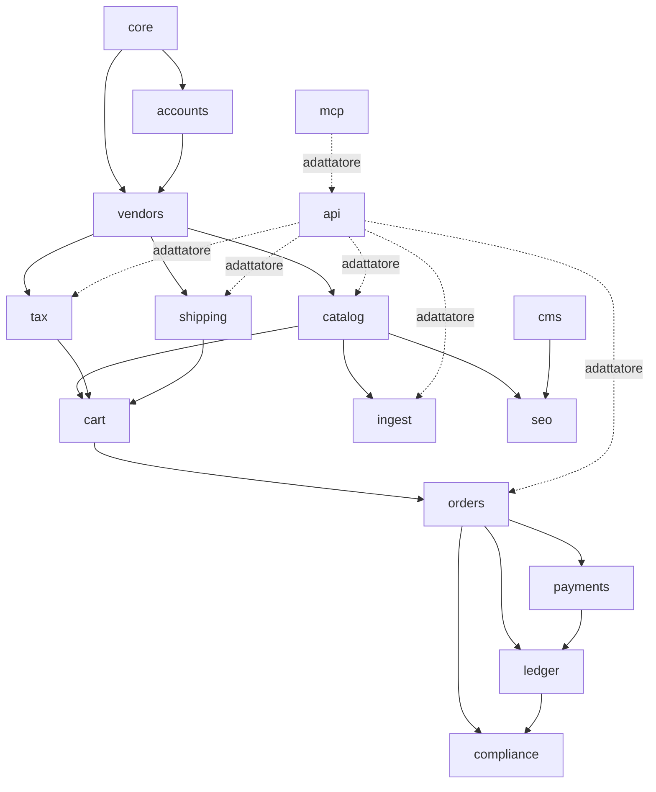

# 01 — Stack e architettura

## 1.1 Valutazione delle alternative Python

Criteri: aderenza al dominio (multivendor, IVA per vendor, spedizioni per zona/peso, preventivi,
split payment), costo di gestione (componenti da tenere in esercizio, aggiornamenti), velocità di
sviluppo, CMS e SEO multilingua.

| Opzione | Pro | Contro | Verdetto |
|---|---|---|---|
| **A. Django + commerce custom + Wagtail (contenuti e backoffice)** | Controllo totale sul dominio; un solo linguaggio e un solo deploy; Wagtail dà CMS, StreamField, immagini con rendition, i18n delle pagine, admin moderno; Postgres per tutto | Il commerce (carrello, ordini, pagamenti) va scritto, ma è la parte piccola | **Raccomandata** |
| B. Saleor (headless GraphQL) | Commerce completo, multi-canale, ben mantenuto | Nessun multivendor nativo; serve un frontend separato (Next.js): **due stack**; IVA e spedizioni custom vanno comunque scritte come plugin o app esterne; componenti in più (Celery, Redis) | Sovradimensionato e più costoso da gestire |
| C. django-oscar | Commerce Django maturo, concetto di "partner" | Personalizzazione tramite fork delle app; architettura datata; il multivendor è parziale; tasse e spedizioni da riscrivere comunque | Il costo di adattamento supera il beneficio |
| D. Wagtail come centro (piano di agosto) | Un'unica admin | Modellare prodotti e ordini come pagine Wagtail è innaturale; legare il dominio al CMS complica test e API | Wagtail sì, ma ai margini |
| E. Framework multivendor Python "chiavi in mano" | — | Nessuno maturo e mantenuto nel 2026 (es. Shuup di fatto fermo) | Scartata |

**Raccomandazione.** Il dominio difficile (IVA, spedizioni, preventivi, split) è già custom oggi e
lo resterebbe con qualunque framework. Alla scala del marketplace (decine di vendor, migliaia di prodotti,
decine di ordini al giorno) un core commerce snello in Django costa meno di un framework generico
da piegare. Wagtail si usa dove eccelle: pagine, blog, landing per tassonomia, vetrine vendor,
gestione immagini e backoffice staff.

## 1.2 Stack proposto

| Livello | Scelta | Note |
|---|---|---|
| Linguaggio | Python 3.13+ | Le pipeline attuali girano su 3.11: allineamento facile |
| Framework | **Django 6.x**, con aggiornamento alla **6.2 LTS** (attesa aprile 2027) prima del go-live | In alternativa partire da 5.2 LTS. Da 6.0 sono nativi il task framework e la CSP |
| CMS e backoffice | **Wagtail** (ultima LTS) | Pagine, blog, immagini, snippet; ViewSet per l'admin staff |
| DB | **PostgreSQL 16+** | Unico datastore: dati, code, ricerca full-text e trigram, cache sessioni |
| API | **django-ninja** (schemi Pydantic) | Le pipeline usano già Pydantic: contratti condivisi |
| Task asincroni e cron | Task framework Django + worker su DB (`django-tasks` con backend DB, oppure Procrastinate) | Niente Redis né Celery. Decisione in ADR-0004 (ARC.2) |
| Frontend | Template Django + **HTMX** + Alpine.js minimale; CSS con build leggera | Niente SPA; accessibile (EAA) e veloce |
| Ricerca | Postgres FTS + `pg_trgm` (prefisso SKU, refusi) | Backend di ricerca Wagtail su Postgres |
| Media | Object storage S3-compatibile UE + CDN (Cloudflare già in uso) | Rendition WebP/AVIF generate in piattaforma |
| Pagamenti | Stripe Connect (Express), dietro interfaccia `PaymentGateway` | Vedi [07](07-carrello-ordini-pagamenti.md) |
| Email | Provider transazionale UE via API (SMTP come fallback) | Template per lingua |
| Antibot | Cloudflare Turnstile | Già in uso |
| Container | Immagini OCI da `Containerfile`; in locale **Apple `container`** (Containerization framework, macOS 26), niente Docker Desktop | `container` 1.0 non ha compose: orchestrazione locale via script/Makefile |
| Deploy | Stesse immagini OCI su VPS UE Linux (app, worker, Postgres, Caddy) o PaaS UE | Immagini versionate, rollback per tag; runtime Linux da scegliere in ARC.5 (D-12) |
| Qualità | ruff, mypy, pytest-django, coverage, pip-audit, secret scanning | Vedi [12](12-sicurezza-infra-operativita.md) |
| Osservabilità | Log JSON + error tracking (Sentry o GlitchTip self-hosted) + healthcheck | |

## 1.3 Architettura: monolite modulare

Un solo progetto Django, un'app per *bounded context*. La logica sta nei **servizi** (`services.py`)
e nelle **funzioni pure** (`engine.py`). Le view, le API, i comandi e il server MCP sono adattatori
sottili sopra gli stessi servizi.

```
piac/                     # settings (base/dev/stage/live), urls, asgi/wsgi
apps/
  core/                   # base model, Money, Country, PlatformOperator, AuditLog, FeatureFlag
  accounts/               # User, ruoli, MFA, sessioni
  vendors/                # Vendor, VendorMember, VendorPlan, documenti KYC/DAC7, policy
  catalog/                # Product, Variant, traduzioni, tassonomie di navigazione, attributi, media, redirect
  tax/                    # TaxRate, VendorTaxProfile, motore fiscale (resolve_tax)
  shipping/               # Carrier, Zone, VendorRate, fasce peso, calcolatore, health, simulatore
  cart/                   # Cart, CartLine, checkout service
  orders/                 # Order, VendorOrder, righe, snapshot, macchina a stati, preventivi
  payments/               # interfaccia gateway, Stripe Connect, webhook
  ledger/                 # LedgerEntry, commissioni, payout, riconciliazione
  ingest/                 # sorgenti fornitore, adapter, staging, upsert catalogo
  cms/                    # pagine Wagtail: Home, Standard, Blog, Landing di tassonomia, Vetrina vendor, Legal
  seo/                    # sitemap, JSON-LD, feed Google/Meta, llms.txt, robots
  compliance/             # DAC7, GPSR, richieste GDPR, segnalazioni DSA, recesso
  api/                    # router django-ninja /api/v1
  mcp/                    # server MCP: tool sopra i servizi
```

### Regole di dipendenza tra app



- Una freccia `A → B` significa che **B può importare A**, mai il contrario.
- `tax` e `shipping` non conoscono `orders`: ricevono un *contesto* (dataclass) e restituiscono una
  *decisione*. Così restano testabili in isolamento.
- `api` e `mcp` non contengono logica: chiamano i servizi.
- Una regola di import-linter in CI fa rispettare il grafo.

### Convenzioni trasversali

| Tema | Regola |
|---|---|
| Denaro | `Decimal` con 2 decimali in DB (`MoneyField` = `DecimalField(12,2)`), calcoli interni a 4 decimali, arrotondamento `ROUND_HALF_UP` **per riga**; valuta EUR esplicita |
| Paesi | ISO 3166-1 alpha-2 (`GR`, non `EL`); territori speciali UE modellati (vedi [05](05-fiscale.md)) |
| Identificativi | PK interna `bigint`; `public_id` UUID per API e URL tecnici; chiave naturale `(vendor, sku)` |
| Storicità | Tabelle di configurazione con `valid_from` / `valid_to`; gli ordini salvano snapshot, non riferimenti vivi |
| Dry-run | Ogni servizio mutativo accetta `dry_run=True` e restituisce un `ChangeSet` (diff) |
| Audit | Ogni mutazione sensibile scrive `AuditLog` (chi, cosa, prima/dopo, da dove) |
| Lingue | `en` base, `it` seconda, `de` pronta; nessun testo hardcoded nei template |
| Tempo | UTC in DB; Europe/Rome per i cron e i documenti |

## 1.4 Esempio del pattern servizio + funzione pura

```python
# apps/tax/engine.py  — nessun I/O, nessun ORM
@dataclass(frozen=True)
class TaxContext:
    vendor_regime: VendorRegime        # OSS | DOMESTIC_ONLY | EXEMPT
    vendor_country: str
    product_fiscal_category: FiscalCategory
    destination_country: str
    destination_territory: str | None  # es. "ES-CN" Canarie
    customer: CustomerTaxStatus        # B2C | B2B_VALIDATED(vat_country)
    rates: RateTable                   # aliquote valide alla data dell'ordine

def resolve_tax(ctx: TaxContext) -> TaxDecision: ...

# apps/tax/services.py — legge DB, costruisce il contesto, chiama il motore
def tax_for_cart_line(line: CartLine, checkout: CheckoutData, on: date) -> TaxDecision: ...
```

## 1.5 Task

| ID | Micro-task | Pri | Ore | Dipende da | Done quando |
|---|---|---|---|---|---|
| ARC.1 | ADR-0001 stack (`docs/adr/`) approvato, versioni fissate | P1 | 4 | — | ADR firmato nel repo |
| ARC.2 | ADR-0003 confini del commerce custom (cosa non si scrive in casa); ADR-0004 coda task (django-tasks vs Procrastinate) | P1 | 4 | ARC.1 | ADR nel repo |
| ARC.3 | Bootstrap repo: struttura app, settings per ambiente, env, pre-commit, Makefile | P1 | 8 | ARC.1 | `make check` e `make test` verdi in locale |
| ARC.4 | CI: ruff, mypy, pytest, coverage, import-linter (grafo dipendenze), pip-audit, secret scan | P1 | 8 | ARC.3 | Pipeline verde su PR |
| ARC.5 | Container: `Containerfile` OCI, stack locale con Apple `container` (rete, volumi, app, worker, Postgres), runtime Linux per STAGE/LIVE, immagini versionate | P1 | 10 | ARC.3 | `make dev` con `container`; deploy STAGE da tag con rollback |
| ARC.6 | `core`: base model, `MoneyField`, Country, `ChangeSet`/dry-run, `AuditLog` | P1 | 12 | ARC.3 | Test su arrotondamenti e audit |
| ARC.7 | `PlatformOperator` (paese, P.IVA, regime, canale e-invoice, autorità DAC7) come config | P1 | 4 | ARC.6 | Nessuna costante "IT" nel codice fiscale |
| ARC.8 | Feature flag per ambiente e per vendor + kill-switch (checkout, import, pagamenti) | P2 | 6 | ARC.6 | Flag gestibili da admin |
| ARC.9 | Worker task + scheduler cron su Postgres, con lock e retry | P1 | 8 | ARC.2 | Job di prova schedulato e osservabile |
| ARC.10 | Seed dati sintetici: vendor con tutti i regimi, prodotti EN/IT, zone, ordini | P1 | 10 | CAT.1, TAX.1, SHP.1 | `make seed` riproducibile, usato dai test |
