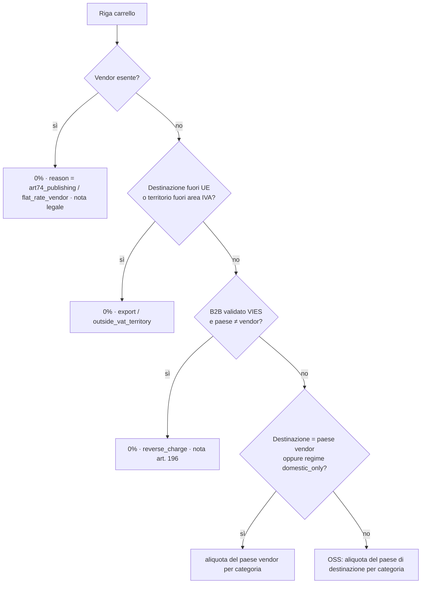

# 05 — Motore fiscale (IVA)

## 5.1 Come funziona oggi

Plugin `mp-vendor-tax-override` v2.4.1 (~2.100 righe) sopra le tax class WooCommerce e il plugin
EU VAT di WPFactory (validazione VIES).

| Classe PHP | Ruolo |
|---|---|
| `MP_VTO_Tax_Handler` | Filtra la tax class di ogni prodotto (`override_product_tax_class`) e riscrive l'IVA delle rate di spedizione (`override_shipping_tax_for_package`, priorità 300) |
| `MP_VTO_Vendor_Settings` | Unico punto di lettura/scrittura delle meta fiscali del vendor; storia (30 voci), revisione con email all'admin, suggerimento di regime, calcolo vendite a distanza UE per la soglia 10.000 € |
| `MP_VTO_WCFM_Integration` | Campi fiscali nel form vendor WCFM |
| `MP_VTO_Admin` | Colonna e filtro "VAT Regime", avviso revisioni pendenti |
| `MP_VTO_Country_Helpers` | Solo testi d'aiuto per paese (forfettario IT, §19 UStG, art. 293 B CGI…) |

Meta vendor: `_mp_vendor_tax_exempt`, `_mp_vendor_vat_regime` (`oss` | `domestic_only`),
`_mp_vendor_tax_rate`, `_mp_vendor_tax_label`, `_mp_vendor_oss_since`, `_mp_vendor_tax_history`,
`_mp_vendor_tax_review`.

Stato LIVE: i vendor coprono i regimi `domestic_only`, `oss` ed esente (art. 74 c.1 lett. c DPR 633/72);
uno non ha ancora un profilo fiscale.

**Debolezza di fondo:** il plugin non applica aliquote, **sceglie una tax class** (`zero-rate`,
`reduced-rate`, standard, `iva-fissa-domestica`) e lascia che WooCommerce cerchi l'importo nella sua
tabella. Ne derivano export, reverse charge ed editoria indistinguibili (tutti `zero-rate`), il
fallback silenzioso su `reduced-rate` vuota e l'IVA sulla spedizione assente quando il calcolatore crea
rate senza tasse.

### Albero decisionale attuale (merce)

1. Vendor esente → 0% (copre forfettari ed editoria art. 74).
2. Paese di fatturazione extra UE → 0% (export).
3. B2B con P.IVA validata VIES e paese diverso dal vendor → 0% (reverse charge).
4. B2C UE con vendor `domestic_only` → 22% IT per qualsiasi paese UE.
5. B2C UE con vendor OSS e paese diverso → aliquota standard del paese di destinazione.
6. Altrimenti aliquota del vendor o classe originale del prodotto.

Spedizione: stessa logica a livello di package; con merce mista l'IVA della spedizione si ripartisce
in proporzione all'imponibile per aliquota; il flag carrier `force_vat` applica sempre l'IVA del
paese del vendor.

## 5.2 Come funzionerà

### Modelli

```python
class TaxRate(Model):                          # tabella aliquote con validità
    country; territory (null, es. "ES-CN", "IT-LIVIGNO")
    category = CharField(choices=["standard", "reduced", "super_reduced", "zero", "books"])
    rate = DecimalField(5,2); valid_from; valid_to; source ("EC TEDB", "manuale")

class Territory(Model):                        # territori fuori dal territorio IVA UE
    code; country; postcode_patterns; vat_status ("outside_vat_area")
    # Canarie, Ceuta/Melilla, Livigno, Campione, Åland, Monte Athos, Büsingen, Helgoland…

class VendorTaxProfile(Model):                 # storicizzato: nuova riga a ogni modifica approvata
    vendor; regime = CharField(choices=["oss", "domestic_only", "exempt"])
    exempt_reason = CharField(choices=["art74_publishing", "flat_rate_forfettario", "other"], null=True)
    legal_note (tradotta)                      # es. dicitura art. 74 bilingue
    oss_registered_since; valid_from; valid_to; approved_by; requested_by

class VatValidation(Model):                    # cache esiti VIES
    vat_number; country; valid; name; address; checked_at; request_id
```

### Contratto del motore

```python
@dataclass(frozen=True)
class TaxContext:
    on: date
    vendor_country: str
    vendor_profile: VendorTaxProfileSnapshot
    platform: PlatformOperatorSnapshot
    destination_country: str
    destination_postcode: str | None          # per i territori speciali
    customer: Literal["b2c"] | B2BValidated   # B2BValidated(vat_country, vat_number, checked_at)
    rates: RateTable

@dataclass(frozen=True)
class TaxDecision:
    rate: Decimal                             # percentuale effettiva, mai una "classe"
    reason: Literal["standard_destination", "domestic_vendor_country", "export",
                    "reverse_charge", "art74_publishing", "flat_rate_vendor",
                    "outside_vat_territory"]
    country_of_taxation: str | None
    legal_note_key: str | None                # testo sul documento d'ordine

def resolve_goods_tax(ctx: TaxContext, category: FiscalCategory) -> TaxDecision
def resolve_shipping_tax(ctx: TaxContext, goods: list[tuple[Decimal, TaxDecision]]) -> list[TaxPortion]
    """Ripartisce la spedizione del vendor in proporzione all'imponibile per aliquota della merce."""
def distance_sales_eu(vendor, year) -> Decimal  # dal ledger, al netto dei rimborsi, per vendor FK
def suggest_regime(vendor, year) -> Suggestion  # soglia 10.000 € (da PlatformOperator, non costante)
```

### Albero decisionale nuovo (merce)



Differenze volute rispetto a oggi:

- L'aliquota è un **numero** con `reason`: report OSS, fatture e diciture si generano senza ambiguità.
- La **categoria fiscale** del prodotto (`standard`, `reduced`, `books`) sceglie l'aliquota per paese;
  nessuna mappa "sotto 15% = ridotta".
- **Territori speciali** gestiti per CAP; l'Irlanda del Nord (`XI`) segue le regole merci UE (D-02).
- Base del paese: **paese di consegna** per il B2C a distanza (regola UE sulle vendite a distanza di
  beni), con fatturazione usata solo per il B2B. Oggi si usa la fatturazione: **da confermare col
  commercialista** (D-01).
- Il flag `force_vat` del corriere sparisce, salvo conferma che serva (D-03).
- VIES con fallimento chiuso: VIES non disponibile, numero invalido o prefisso diverso dal paese →
  IVA applicata; esito salvato in `VatValidation` e nello snapshot d'ordine.
- B2B nello stesso paese del vendor (incluso IT→IT) → IVA del paese vendor.
- Le aliquote si aggiornano da fonte ufficiale (TEDB della Commissione) con revisione staff e validità
  temporale; gli ordini passati restano sulle aliquote del loro snapshot.

## 5.3 Casi di regressione obbligatori (dagli audit)

| # | Caso | Atteso |
|---|---|---|
| T1 | B2B DE con P.IVA valida, vendor IT OSS | 0% reverse charge, merce e spedizione |
| T2 | P.IVA `INVALID12345`, VIES giù, prefisso diverso | IVA DE 19% |
| T3 | B2B IT con P.IVA valida, vendor IT | 22% |
| T4 | Vendor esente con aliquota residua 22% | 0%, l'esenzione vince |
| T5 | Aliquote OSS aggiornate (EE 24, FI 25,5, GR 24, LU 17, RO 21, SK 23) | lette da tabella con validità |
| T6 | Categoria ridotta senza aliquota per il paese | errore di configurazione bloccante, mai 0% silenzioso |
| T7 | `domestic_only` B2C verso DE/FR | 22% su merce e spedizione |
| T8 | Vendor OSS, B2C stesso paese: spedizione | IVA presente (ordini #10835, #11770) |
| T9 | Test partono da rate non tassate | il calcolatore spedizioni non produce mai IVA da solo |
| T10 | Carrello misto con vendor esente | spedizione del vendor esente 0%, altre col proprio regime |
| T11 | Package con merce 22% e 10% | IVA spedizione ripartita per imponibile |
| T12 | Cliente esente B2B con vendor `domestic_only` | nessuna IVA IT sulla spedizione |
| T13 | Preventivo misto UE con vendor esente | spedizione quotata dal vendor esente 0% |
| T14 | Export extra UE | 0% merce e spedizione, nota export |
| T15 | Canarie / Livigno / Åland | 0% outside_vat_territory |
| T16 | Soglia 10.000 €: vendite a distanza con rimborsi | rimborsi sottratti, vendor da FK non da autore |
| T17 | Ricalcolo ordine da backoffice | usa lo snapshot, non le regole correnti |
| T18 | Paese cliente mancante | checkout bloccato finché manca, nessun default silenzioso |

## 5.4 Task

| ID | Micro-task | Pri | Ore | Dipende da | Done quando |
|---|---|---|---|---|---|
| TAX.1 | Modelli TaxRate, Territory, VendorTaxProfile storicizzato, VatValidation | P1 | 8 | ARC.7, VEN.1 | Migrazioni + admin |
| TAX.2 | Workflow di modifica regime (richiesta vendor → approvazione staff), storico | P1 | 6 | TAX.1 | Parità con revisione VTO |
| TAX.3 | `resolve_goods_tax` funzione pura + tabella casi T1–T18 come test parametrici | P1 | 12 | TAX.1 | 100% dei casi verdi, coverage 100% del modulo |
| TAX.4 | `resolve_shipping_tax` con ripartizione proporzionale | P1 | 6 | TAX.3 | T8–T13 verdi |
| TAX.5 | Client VIES con cache, timeout, fallimento chiuso | P1 | 6 | TAX.1 | Test con VIES simulato giù |
| TAX.6 | Import aliquote da fonte ufficiale + revisione staff + validità | P2 | 8 | TAX.1 | Aggiornamento simulato senza toccare ordini passati |
| TAX.7 | Territori speciali con CAP (dataset iniziale) | P1 | 4 | TAX.1 | T15 verde |
| TAX.8 | `distance_sales_eu` + `suggest_regime` dal ledger | P2 | 6 | VEN.4 | T16 verde |
| TAX.9 | Simulatore fiscale carrello in admin e API (`/tax/simulate`) | P2 | 6 | TAX.4, SHP.4 | Staff simula un carrello misto |
| TAX.10 | Report OSS trimestrale per paese e report per vendor | P2 | 8 | ORD.4 | Export CSV verificato su ordini seed |
