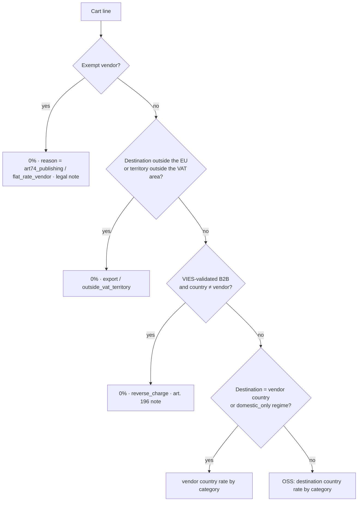

# 05 — Tax engine (VAT)

## 5.1 How it works today

Plugin `legacy-vendor-tax-override` v2.4.1 (~2,100 lines) on top of the WooCommerce tax classes and the
WPFactory EU VAT plugin (VIES validation).

| PHP class | Role |
|---|---|
| `LEGACY_VTO_Tax_Handler` | Filters the tax class of each product (`override_product_tax_class`) and rewrites the VAT of shipping rates (`override_shipping_tax_for_package`, priority 300) |
| `LEGACY_VTO_Vendor_Settings` | Single read/write point for the vendor's tax meta; history (30 entries), review with email to the admin, regime suggestion, computation of EU distance sales for the €10,000 threshold |
| `LEGACY_VTO_WCFM_Integration` | Tax fields in the WCFM vendor form |
| `LEGACY_VTO_Admin` | "VAT Regime" column and filter, pending-review notice |
| `LEGACY_VTO_Country_Helpers` | Per-country help texts only (IT flat-rate regime (forfettario), §19 UStG, art. 293 B CGI…) |

Vendor meta: `_legacy_vendor_tax_exempt`, `_legacy_vendor_vat_regime` (`oss` | `domestic_only`),
`_legacy_vendor_tax_rate`, `_legacy_vendor_tax_label`, `_legacy_vendor_oss_since`, `_legacy_vendor_tax_history`,
`_legacy_vendor_tax_review`.

LIVE state: the vendors cover the `domestic_only`, `oss` and exempt (art. 74 c.1 lett. c DPR 633/72) regimes;
one does not have a tax profile yet.

**Fundamental weakness:** the plugin does not apply rates, it **picks a tax class** (`zero-rate`,
`reduced-rate`, standard, `iva-fissa-domestica`) and lets WooCommerce look up the amount in its own
table. As a result, export, reverse charge and publishing are indistinguishable (all `zero-rate`), there is a
silent fallback to an empty `reduced-rate`, and VAT on shipping is missing when the calculator creates
rates without taxes.

### Current decision tree (goods)

1. Exempt vendor → 0% (covers forfettario vendors and art. 74 publishing).
2. Billing country outside the EU → 0% (export).
3. B2B with a VIES-validated VAT number and a country different from the vendor's → 0% (reverse charge).
4. EU B2C with a `domestic_only` vendor → Italian 22% for any EU country.
5. EU B2C with an OSS vendor and a different country → standard rate of the destination country.
6. Otherwise the vendor's rate or the product's original class.

Shipping: same logic at package level; with mixed goods the shipping VAT is split
in proportion to the taxable amount per rate; the carrier flag `force_vat` always applies the VAT of the
vendor's country.

## 5.2 How it will work

### Models

```python
class TaxRate(Model):                          # rate table with validity periods
    country; territory (null, e.g. "ES-CN", "IT-LIVIGNO")
    category = CharField(choices=["standard", "reduced", "super_reduced", "zero", "books"])
    rate = DecimalField(7,4)                   # percentage, 4 decimals: 25.5 → 25.5000
    valid_from; valid_to; source ("ec_tedb", "manual")

class Territory(Model):                        # territories with a special VAT status
    code; country; postcode_patterns
    vat_status ("outside_vat_area", "own_rates", "special")  # "special": an explicit engine
    # rule decides (e.g. XI, D-02). Canary Islands, Ceuta/Melilla, Livigno, Campione, Åland,
    # Mount Athos, Büsingen, Heligoland…

class VendorTaxProfile(Model):                 # versioned: new row on every approved change
    vendor; regime = CharField(choices=["oss", "domestic_only", "exempt"])
    exempt_reason = CharField(choices=["art74_publishing", "flat_rate_forfettario", "other"], null=True)
    legal_note (translated)                    # e.g. bilingual art. 74 wording
    oss_registered_since; valid_from; valid_to; approved_by; requested_by
    # Consistent with Vendor.fiscal_regime (VEN.12), never duplicating it: RF19 (forfettario)
    # if and only if exempt with reason flat_rate_forfettario.

class VatValidation(Model):                    # cache of VIES results, append-only
    vat_number (without prefix); country (ISO, GR not EL)
    result ("valid", "invalid", "unavailable")
    name; address; checked_at; request_id      # VIES answers only, no staff-recorded rows
```

Rates and vendor tax profiles are versioned like `PlatformOperator`: an exclusion constraint
forbids overlapping periods of the same key, and a change is a new row through an audited
service that closes the current one (TAX.1).

Owner decisions of 2026-11-08:

- **Staff-added profiles (MQ-1).** Staff keep the direct path that gives a vendor a tax profile
  from the admin, for example for a migrated vendor. It runs the same checks as approving a
  vendor's TAX.2 request (reviewer rules, consistency with the declared fiscal regime, the
  exemption country below), and the MFA step-up of the staff member at the moment of the change
  is recorded with the audit entry.
- **Exemption reasons belong to a country (MQ-3).** Every exemption reason is tied to the country
  whose law defines it, and a profile may use it only when that country is the country of the
  vendor's VAT registration. `art74_publishing` and `flat_rate_forfettario` are Italian reasons,
  so only vendors with an Italian VAT number can use them; a reason added later for an Austrian
  law would be for Austrian VAT numbers only. The generic `other` reason carries the country of
  the law its legal note cites (TAX.13).

### Engine contract

```python
@dataclass(frozen=True)
class TaxContext:
    on: date
    vendor_country: str
    vendor_profile: VendorTaxProfileSnapshot
    platform: PlatformOperatorSnapshot
    destination_country: str
    destination_postcode: str | None          # for special territories
    customer: Literal["b2c"] | B2BValidated   # B2BValidated(vat_country, vat_number, checked_at)
    rates: RateTable

@dataclass(frozen=True)
class TaxDecision:
    rate: Decimal                             # effective percentage, never a "class"
    reason: Literal["standard_destination", "domestic_vendor_country", "export",
                    "reverse_charge", "art74_publishing", "flat_rate_vendor",
                    "outside_vat_territory"]
    country_of_taxation: str | None
    legal_note_key: str | None                # text on the order document

def resolve_goods_tax(ctx: TaxContext, category: FiscalCategory) -> TaxDecision
def resolve_shipping_tax(ctx: TaxContext, goods: list[tuple[Decimal, TaxDecision]]) -> list[TaxPortion]
    """Splits the vendor's shipping in proportion to the taxable amount per rate of the goods."""
def distance_sales_eu(vendor, year) -> Decimal  # from the ledger, net of refunds, by vendor FK
def suggest_regime(vendor, year) -> Suggestion  # €10,000 threshold (from PlatformOperator, not a constant)
```

### New decision tree (goods)



The tree has no deemed-supplier branch: at go-live every vendor is established in the EU and
ships from inside the EU (D-21, [11](11-compliance.md) CMP.13). UK consumer consignments of £135
or less never reach the tax engine, because checkout turns them into vendor requests (CMP.14).
CMP.18 adds a `deemed_supplier` outcome before non-EU vendors are admitted.

Intended differences from today:

- The rate is a **number** with a `reason`: OSS reports, non-fiscal documents and legal wordings are generated without ambiguity (the platform issues no invoices, see [00](00-vision-and-review.md)).
- The product's **fiscal category** (`standard`, `reduced`, `books`) selects the rate per country;
  no "below 15% = reduced" mapping.
- **Special territories** handled by postcode; Northern Ireland (`XI`) follows EU goods rules (D-02).
- Country basis: **delivery country** for B2C distance sales (EU rule on distance sales of
  goods), with the billing country used only for B2B. Today the billing country is used: **to be confirmed with the
  tax advisor** (D-01).
- The carrier `force_vat` flag goes away, unless it turns out to be needed (D-03).
- VIES fails closed: VIES unavailable, invalid number or prefix different from the country →
  VAT applied; result saved in `VatValidation` and in the order snapshot.
- B2B in the same country as the vendor (including IT→IT) → VAT of the vendor's country.
- Rates are updated from an official source (the Commission's TEDB) with staff review and validity
  periods; past orders keep the rates in their snapshot.

## 5.3 Mandatory regression cases (from the audits)

| # | Case | Expected |
|---|---|---|
| T1 | B2B DE with valid VAT number, IT OSS vendor | 0% reverse charge, goods and shipping |
| T2 | VAT number `INVALID12345`, VIES down, different prefix | DE VAT 19% |
| T3 | B2B IT with valid VAT number, IT vendor | 22% |
| T4 | Exempt vendor with a leftover 22% rate | 0%, the exemption wins |
| T5 | Updated OSS rates (EE 24, FI 25.5, GR 24, LU 17, RO 21, SK 23) | read from the table with validity periods |
| T6 | Reduced category with no rate for the country | blocking configuration error, never a silent 0% |
| T7 | `domestic_only` B2C to DE/FR | 22% on goods and shipping |
| T8 | OSS vendor, B2C same country: shipping | VAT present (orders #10835, #11770) |
| T9 | Tests start from untaxed rates | the shipping calculator never produces VAT on its own |
| T10 | Mixed cart with an exempt vendor | exempt vendor's shipping 0%, others under their own regime |
| T11 | Package with 22% and 10% goods | shipping VAT split by taxable amount |
| T12 | Exempt B2B customer with a `domestic_only` vendor | no Italian VAT on shipping |
| T13 | Mixed EU quote with an exempt vendor | shipping quoted by the exempt vendor at 0% |
| T14 | Export outside the EU | 0% goods and shipping, export note |
| T15 | Canary Islands / Livigno / Åland | 0% outside_vat_territory |
| T16 | €10,000 threshold: distance sales with refunds | refunds subtracted, vendor from FK not from author |
| T17 | Order recalculation from the back office | uses the snapshot, not the current rules |
| T18 | Missing customer country | checkout blocked while missing, no silent default |

## 5.4 Tasks

| ID | Micro-task | Pri | Hours | Depends on | Done when |
|---|---|---|---|---|---|
| TAX.1 | TaxRate, Territory, versioned VendorTaxProfile, VatValidation models | P1 | 8 | ARC.7, VEN.1 | Migrations + admin |
| TAX.2 | Regime change workflow (vendor request → staff approval), history | P1 | 6 | TAX.1 | Parity with VTO review |
| TAX.3 | `resolve_goods_tax` pure function + T1–T18 case table as parametrized tests | P1 | 12 | TAX.1 | 100% of cases green, 100% module coverage |
| TAX.4 | `resolve_shipping_tax` with proportional split | P1 | 6 | TAX.3 | T8–T13 green |
| TAX.5 | VIES client with cache, timeout, fail-closed | P1 | 6 | TAX.1 | Test with simulated VIES down |
| TAX.6 | Rate import from official source + staff review + validity periods | P2 | 8 | TAX.1 | Simulated update without touching past orders |
| TAX.7 | Special territories by postcode (initial dataset) | P1 | 4 | TAX.1, TAX.11 | T15 green |
| TAX.8 | `distance_sales_eu` + `suggest_regime` from the ledger | P2 | 6 | VEN.4 | T16 green |
| TAX.9 | Cart tax simulator in admin and API (`/tax/simulate`) | P2 | 6 | TAX.4, SHP.4 | Staff simulate a mixed cart |
| TAX.10 | Quarterly OSS report per country and per-vendor report | P2 | 8 | ORD.4 | CSV export verified on seed orders |
| TAX.11 | Shared postcode grammar for tax territories (coherence check 5): `Territory.postcode_patterns` validated and matched with `apps.core.postcodes` (SHP.12), data migration from the `a-b` range form to `a..b`, the tax-only pattern code removed | P1 | 2 | TAX.1, SHP.12 | A `22100-22199` pattern is refused with the `..` hint; stored rows are migrated; `9000..9999` is accepted and matches; Portuguese and Polish postcodes with a dash match as exact postcodes |
| TAX.12 | Consumer price display, go-live gate (Directive 98/6/EC, national consumer codes): B2C prices on cards, product pages, cart and feeds include VAT. The gross amount uses the destination country's rate through the TAX.3 tax engine; before the buyer picks a country, an estimated country (geo or locale) is used with a clear "VAT included, estimated for <country>" note. A net price shows only to business buyers who opt in. The catalog stays free of tax imports: a tax-side adapter or template tag supplies the gross amount. The owner confirmed the destination rate, the estimated country and the business opt-in on 2026-11-08 (MQ-12) | P1 | 6 | TAX.3, CAT.8 | Regression tests for IT, DE and FR consumers (destination rate, estimated-country note); a business buyer's net view after opt-in; `on_request` products never priced; ROUND_HALF_UP per line; the catalog app has no tax import |
| TAX.13 | Exemption reasons per country (owner decision MQ-3): each exemption reason declares the country of the law that defines it (IT for `art74_publishing` and `flat_rate_forfettario`; `other` stores the country of the law cited in its legal note), and the profile consistency check refuses a reason whose country differs from the country of the vendor's VAT registration, on the staff direct path and on TAX.2 approval alike; the check also runs on a VAT number change | P1 | 3 | TAX.2, VEN.12 | An Italian vendor saves `art74_publishing`; a German vendor is refused `art74_publishing` and `flat_rate_forfettario`; a staff-added profile and an approved request give the same refusal; changing an exempt Italian vendor's VAT number to another country is reported; `other` without a country is refused |
