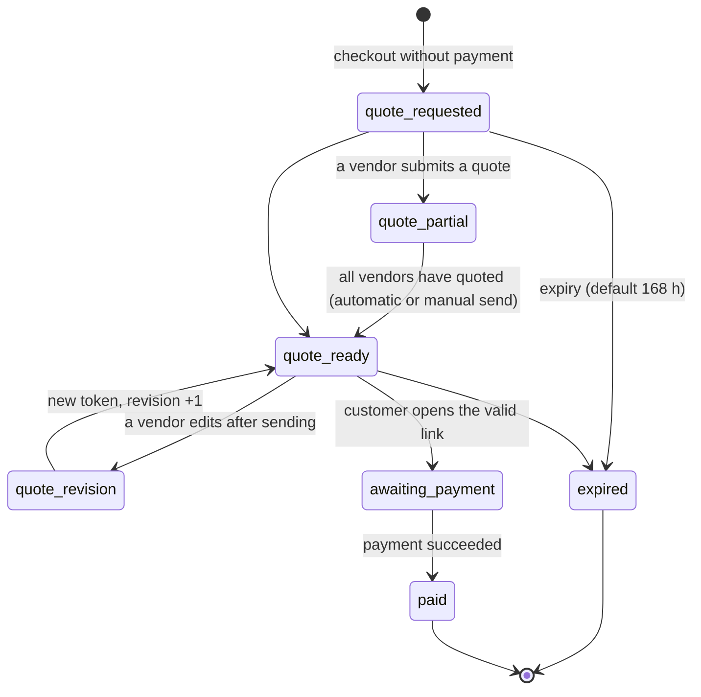

# 06 — Shipping and quotes

## 6.1 How it works today

Plugin `legacy-multicarrier-shipping` v2.4.0 (~7,900 lines). Single source of configuration: the
`custom_shipping_vendors_config_v2` option (JSON). The old `wfcm-price-shipping-weight-wc` plugin has been
inactive since February 2026 and must not be ported.

| PHP class | Role |
|---|---|
| `LEGACY_Shipping_Config` | Reads/saves the config (keeps the last 10 backups), resolves the zone (`find_zone_for_package`), postcode matching (wildcard `BT*`, range, exact ignoring spaces), cost from weight bands |
| `LEGACY_Shipping_Calculator` | `woocommerce_package_rates` filter at P200: one rate per package (= vendor), local pickup, weight in kg |
| `LEGACY_Quote_Request` / `LEGACY_Quote_Workflow` | `quote-pending` / `quote-ready` states, technical gateway, per-vendor quotes, HMAC token, expiry, revisions, emails |
| `LEGACY_Quote_Vendor` / `LEGACY_Quote_Admin` | Quote panel in the WCFM order page and admin metabox |
| `LEGACY_WCFM_Sync` | Copies the zones into the WCFM tables (dual "non-isomorphic" representation) |
| `LEGACY_Shipping_Zone_Editor` | Zone validation, non-overlapping weight bands, diff and hash for optimistic locking |
| `LEGACY_Shipping_Simulator` | Runs the real chain (WCFM → custom shipping → VAT) on a virtual cart |
| `LEGACY_Shipping_Health` | Checks: vendors without zones, products without weight, uncovered EU countries, empty weight bands… |
| `LEGACY_Shipping_API` | REST `legacy-shipping/v1` (`/config`, `/fix-zona6` obsolete) |

LIVE configuration: main carrier for Vendors A, B, C (Italy + numbered European zones, with a
"remote islands" zone defined by postcode); own carrier only for Vendor D (Italy, Europe, non-EU,
World); an aggregator with dedicated zones for Vendor E;
local pickup for some vendors. Prices exclude VAT.

## 6.2 How it will work

### Models

```python
class Carrier(Model):
    code ("main", "vendor_own", "aggregator", "pickup"); label (translated); is_active: bool  # actually honored
    tracking_url_template; supports_api: bool

class ShippingZone(Model):
    code; name; priority (ASC = wins, 1..999)
    countries = ArrayField(CharField(2))       # or ["*"] for "rest of the world"
    postcode_patterns = ArrayField(CharField, default=[])   # "BT*", "70000-74999", "9000-9999"
    states = ArrayField(CharField, default=[])

class VendorZoneRate(Model):                   # vendor × zone × carrier
    vendor; zone; carrier
    UNIQUE(vendor, zone)                        # a single carrier per vendor and zone (today "the first one wins")
    over_max_weight = CharField(choices=["last_band", "quote", "block"])   # D-06
class WeightBand(Model):
    rate = FK(VendorZoneRate); from_kg; to_kg (null = unlimited); cost_net; surcharge_net
    # constraint: no overlaps (exclusion constraint on numrange)
class PickupOption(Model): vendor; key; cost_net; address; label (translated)

class ShippingConfigVersion(Model):            # replaces the option backups
    snapshot (JSON); created_by; created_at; note   # one-click rollback
```

### Algorithm (pure functions)

```python
def resolve_zone(zones: list[ZoneSnap], vendor_id, country, postcode, state) -> ZoneSnap | None:
    """1) zones with postcodes that include the country and the vendor, by priority; first matching pattern
    2) zones with state; 3) country-only zones by priority; 4) "*" only if no other zone matches."""


def match_postcode(pattern: str, postcode: str) -> bool:
    """wildcard 'BT*'; range 'a-b' comparing the first N digits of the bound; exact ignoring spaces and '-'."""


def quote_shipping(
    package: VendorPackage, dest: Address, cfg: ShippingConfigSnap
) -> ShippingOutcome:
    """package = lines of ONE vendor; weight = Σ weight×qty (kg, 3 decimals).
    → Rates([...])         carrier and/or pickup rates
    → NeedsQuote(reason)   country not covered, weight beyond the bands with "quote" policy, weight 0
    → Blocked(reason)      when quotes are disabled
    Never a silent empty list."""
```

Checkout rules:

1. The cart is split into **one package per vendor**; the shipping total is the sum.
2. Rates are **always net**: VAT is added by the tax engine (`resolve_shipping_tax`).
3. Band bounds are inclusive on the right (5.000 kg → band 0–5; 5.001 → 5–10).
4. A `buy` product without weight cannot be published (see [03](03-catalog.md)): the "weight 0" case
   becomes impossible instead of being handled.
5. Local pickup: an alternative offered in addition to the carrier, if configured.
6. Free shipping above a threshold per vendor and zone: an explicit rule (today there is no dedicated logic).

### Quotes (single order)

If a package returns `NeedsQuote`, the whole checkout becomes a **quote request**:
no payment is collected, and the order is created in the `quote_requested` state. Covered vendors keep their rate.



```python
class ShippingQuote(Model):                    # one per VendorOrder under quote
    vendor_order; shipping_net; discount_net; note (≤500); quoted_by; source ("vendor"|"staff"); revision

class QuoteLink(Model):                        # single-use token, only the hash stored in the DB
    order; token_hash (HMAC-SHA256); revision; expires_at; used_at

def submit_vendor_quote(order, vendor, shipping, discount, note, actor) -> QuoteState
def send_quote(order, actor, expires_in_h=168) -> QuoteLink   # recomputes VAT and commissions, sends email
def open_quote_link(token) -> Order                           # validates: hash, expiry, revision, fingerprint
def expire_quotes(now) -> int                                 # hourly job
```

Rules carried over from version 2.4 (all as tests):

- A vendor quotes only its own package; discount ≥ 0 and not above the vendor's goods total; note ≤ 500 characters.
- Editing after sending invalidates the previous link and creates a new revision with a new email.
- **Fingerprint** of address and lines: if they change, the request cannot be paid; the quoted shipping and discount do not invalidate it.
- Anti-spam: honeypot, mandatory email, one request every 10 minutes per session and email, lock released if the checkout fails.
- VAT on the quoted shipping is computed by the tax engine (not "shipping × average rate").
- The discount is distributed proportionally across the vendor's lines; the rounding remainder goes on the last line.
- The "new order" email to the vendor is sent **only after payment**; before that, the vendor receives "quote to be entered".
- A state changed manually by staff does not make an unquoted request payable (bug of 2026-09-23).
- Historical two-phase orders are migrated read-only.

### Management tools

- Zone and rate editor in admin with **diff preview** and impact check (how many sample
  carts change price) before saving; every save creates a `ShippingConfigVersion`.
- Multi-vendor cart **simulator** with VAT (same functions as the checkout).
- Daily **health check** with report: active vendors without zones, uncovered EU countries, weight bands
  that are empty or have gaps, published products without weight, vendors in a zone that are not active vendors.
- Rate export for Google Merchant (shipping per country and band, currently hardcoded in the feed).
- Future (P3): carrier API integration for labels and tracking.

## 6.3 Mandatory regression cases

1. IT postcodes 70123, 28100, 81100, 82100, 83100, 29121, 31100, 37010 → Italy zone, never the remote islands zone.
2. GR 70100 (Crete) and 84600 → GR remote islands zone; GR 10100 (Athens) → GR mainland zone.
3. GB `BT1 1AA` → GB remote islands zone; other GB postcodes → GB zone.
4. PT `9000-001`, `9400-001`, `9500-001` → PT remote islands zone; `1000-001` → PT zone.
5. `846 00` = `84600`; empty postcode → the country's zone.
6. A zone with postcodes applies only to the listed countries.
7. `*` only as a last resort (Vendor D: USA → World).
8. Band bounds; `to = null` unlimited; beyond the last band → explicit policy (Vendor D, World).
9. Vendor D never receives main-carrier rates; a vendor cannot be on two carriers in the same zone (DB constraint).
10. Carrier disabled → none of its rates.
11. Country not covered: quotes enabled → `NeedsQuote`; disabled → `Blocked` with a message, never an empty checkout.
12. Mixed covered + uncovered cart → single order under quote, the covered vendor's rate is kept.
13. Local pickup does not intercept uncovered countries.
14. All cases 22–35 of the quote flow listed in the analysis (token, revisions, expiry, fingerprint, rate limit).

## 6.4 Tasks

| ID | Micro-task | Pri | Hours | Depends on | Done when |
|---|---|---|---|---|---|
| SHP.1 | Carrier, Zone, VendorZoneRate, WeightBand (exclusion constraint), PickupOption, ConfigVersion models | P1 | 10 | VEN.1 | DB constraints tested |
| SHP.2 | `match_postcode` + `resolve_zone` pure functions with cases 1–7 | P1 | 8 | SHP.1 | Cases green |
| SHP.3 | `quote_shipping` with Rates/NeedsQuote/Blocked outcomes, over-band policy, pickup, free-shipping threshold | P1 | 8 | SHP.2 | Cases 8–13 green |
| SHP.4 | Cart integration: package per vendor, VAT via the tax engine | P1 | 6 | SHP.3, TAX.4, ORD.1 | Correct cart totals in mixed tests |
| SHP.5 | Import of the LIVE v2 config (JSON) into the new models with a parity report | P1 | 6 | SHP.1 | Same rates on 200 sample combinations |
| SHP.6 | Admin zone/rate editor with diff, impact and versions/rollback | P2 | 12 | SHP.1, CORE.8 | Rollback to a previous version works |
| SHP.7 | Cart simulator (admin + `/shipping/simulate`) | P2 | 6 | SHP.4 | Parity with the current simulator on seed cases |
| SHP.8 | Daily health check + report | P2 | 6 | SHP.1, ARC.9, ARC.16 | Email report with the 7 checks |
| SHP.9 | Quotes: models, states, `submit_vendor_quote`, `send_quote`, token link, expiry | P1 | 16 | ORD.2, SHP.3 | End-to-end flow with 2 vendors |
| SHP.10 | Quotes: vendor and staff UI, emails (customer, vendor, staff), rate limit and honeypot | P1 | 10 | SHP.9, ARC.16 | Parity with 2.4.0 |
| SHP.11 | Rate export for Google Merchant | P2 | 4 | SHP.1 | Feed without hardcoded rates |
