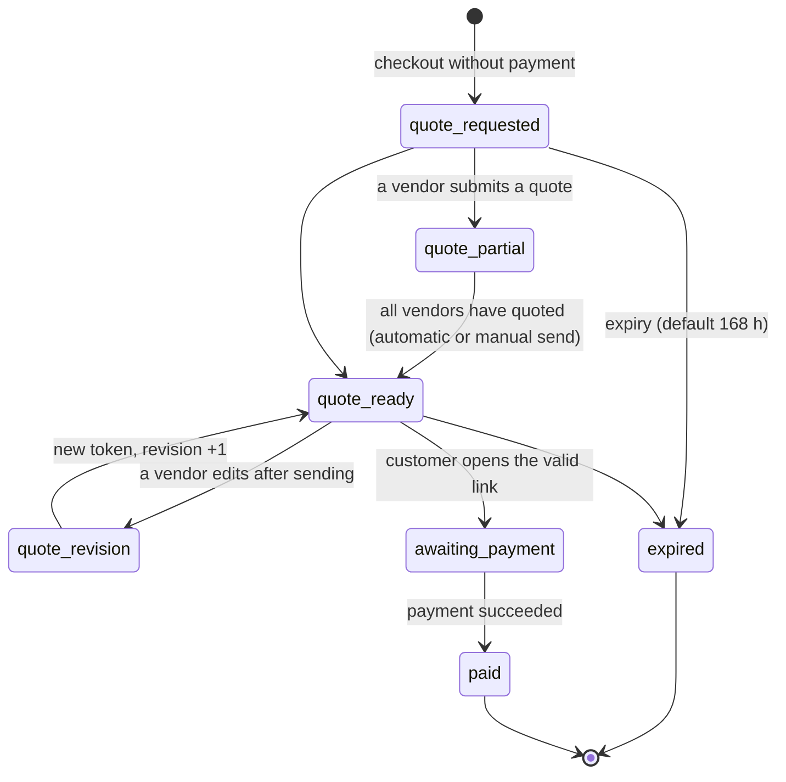

# 06 — Shipping and quotes

## 6.1 How it works today

Plugin `legacy-multicarrier-shipping` v2.4.0 (~7,900 lines). Single source of configuration: the
`custom_shipping_vendors_config_v2` option (JSON). The old `wfcm-price-shipping-weight-wc` plugin has been
inactive since February 2026 and must not be ported.

| PHP class | Role |
|---|---|
| `LEGACY_Shipping_Config` | Reads/saves the config (keeps the last 10 backups), resolves the zone (`find_zone_for_package`), postcode matching (wildcard `BT*`, range, exact ignoring spaces), cost from weight bands |
| `LEGACY_Shipping_Calculator` | `woocommerce_package_rates` filter at P200: one rate per package (= vendor), local pickup, weight in kg |
| `LEGACY_Quote_Request` / `LEGACY_Quote_Workflow` | `quote-pending` / `quote-ready` states, technical gateway, per-vendor quotes, HMAC token, expiry, revisions, emails |
| `LEGACY_Quote_Vendor` / `LEGACY_Quote_Admin` | Quote panel in the WCFM order page and admin metabox |
| `LEGACY_WCFM_Sync` | Copies the zones into the WCFM tables (dual "non-isomorphic" representation) |
| `LEGACY_Shipping_Zone_Editor` | Zone validation, non-overlapping weight bands, diff and hash for optimistic locking |
| `LEGACY_Shipping_Simulator` | Runs the real chain (WCFM → custom shipping → VAT) on a virtual cart |
| `LEGACY_Shipping_Health` | Checks: vendors without zones, products without weight, uncovered EU countries, empty weight bands… |
| `LEGACY_Shipping_API` | REST `legacy-shipping/v1` (`/config`, `/fix-zona6` obsolete) |

LIVE configuration: main carrier for Vendors A, B, C (Italy + numbered European zones, with a
"remote islands" zone defined by postcode); own carrier only for Vendor D (Italy, Europe, non-EU,
World); an aggregator with dedicated zones for Vendor E;
local pickup for some vendors. Prices exclude VAT.

## 6.2 How it will work

### Models

```python
class Carrier(Model):
    code ("main", "vendor_own", "aggregator", "pickup"); label (translated); is_active: bool  # actually honored
    tracking_url_template; supports_api: bool

class CountryGroup(Model):                     # platform data, editable by staff, audited (SHP.12)
    code ("eu", "europe", "africa", "northern-america"…); name (translated)
    countries = ArrayField(CharField(2))       # ISO alpha-2 members, never "*"

class ShippingZone(Model):
    vendor = FK(Vendor, null=True)             # null = platform zone; set = the vendor's own zone (SHP.12)
    code (unique per vendor, and among platform zones); name; priority (ASC = wins, 1..999)
    countries = ArrayField(CharField(2))       # explicit countries, or ["*"] for "rest of the world"
    country_groups = ArrayField(SlugField)     # CountryGroup codes; effective countries = countries ∪ members
    postcode_patterns = ArrayField(CharField)  # "BT*", "70000..74999", "9000..9999", "84600"
    states = ArrayField(CharField)             # province / state codes ("SS", "CA"…)

class ShippingMethod(Model):                   # vendor × zone × carrier × service level (SHP.12)
    vendor; zone; carrier; key (unique per vendor and zone); name (translated)
    service_level = CharField(choices=["standard", "express", "economy", "other"])
    min_delivery_days; max_delivery_days       # indicative delivery time shown to the buyer
    is_default: bool                           # at most one per vendor and zone (partial unique constraint)
    free_shipping_threshold = Money(null=True) # net goods value of the package from which shipping is free
    tax_treatment = CharField(choices=["follows_goods", "standard_rate", "exempt"])  # stored only, see below
    over_max_weight = CharField(choices=["last_band", "quote", "block"])   # D-06
class WeightBand(Model):
    method = FK(ShippingMethod); from_kg; to_kg (null = unlimited); cost_net; surcharge_net
    # constraint: no overlaps within a method (exclusion constraint on numrange)
class PickupOption(Model): vendor; key; cost_net; address; label (translated)

class ShippingConfigVersion(Model):            # replaces the option backups
    snapshot (JSON); created_by; created_at; note   # one-click rollback
```

`ShippingMethod` replaces the SHP.1 `VendorZoneRate` (renamed in place: every existing rate became
the default method of its vendor and zone, with its bands, public id and history). The legacy
"one carrier per vendor and zone" is superseded by owner decision (2026-11-07): a vendor can offer
several methods to the same zone, for example a standard courier and an express one, each with its
own weight bands, free-shipping threshold and delivery time.

**VAT treatment per method.** `tax_treatment` is stored per method and applied by the tax engine
(`resolve_shipping_tax`, TAX.4): `follows_goods` (default) treats shipping as ancillary to the goods
and splits its VAT like the goods ([05](05-tax.md)); `standard_rate` and `exempt` are recorded for the
cases the tax advisor confirms. Their exact computation belongs to TAX.4 and depends on D-03, which
is open: SHP.12 only stores the choice.

### Zones: vendor zones, country groups and postcodes

- **Platform zones** (`vendor` empty) are shared by every vendor. **Vendor zones** belong to one
  vendor and are visible only to that vendor (tenant scoping, CORE.3); a vendor's methods can use
  platform zones and its own zones, never another vendor's.
- A zone covers its explicit `countries` plus the members of its `country_groups`. Country groups are
  data, seeded with the EU member states, Europe (UN M49 Europe plus Cyprus, so every EU member
  state is in it) and the UN M49 continents and regions (Africa; the Americas, also split into
  Northern America, Central America and the Caribbean, South America; Asia; Oceania) and edited
  by staff, every change audited. `*` (rest of the world) stays a marker of its own and never
  mixes with countries or groups.
- `postcode_patterns` and `states` narrow a zone inside its countries: an address in those countries
  matches when its postcode matches a pattern or its province / state is listed. An address without
  a postcode never matches a postcode-only zone (case 5). Each entry belongs to one country: it is
  written `CC:entry` (`PT:9000..9999`, `GR:84*`, `IT:SS`) and applies to that country only. An
  entry without `CC:` is allowed only when the zone covers exactly one country (explicit or through
  its groups); the model validator, `ZoneSnap` and the migration refuse it otherwise. `*` takes no
  patterns and no provinces.

Postcode pattern grammar (shared validator, `apps.core.postcodes`, used by the models, SHP.2 and the
SHP.13 import). Postcodes are compared upper case with spaces and dashes removed, so `846 00` =
`84600` and `9000-001` = `9000001`:

| Pattern | Meaning | Example |
|---|---|---|
| `PREFIX*` | every postcode starting with the prefix | `BT*`, `846*` |
| `LOW..HIGH` | the first N characters between the bounds, inclusive; bounds of equal length N, `LOW ≤ HIGH` | `70000..74999`, `9000..9999`, `1000-001..1999-999` |
| `POSTCODE` | that postcode exactly | `84600`, `9000-001`, `00-950` |

The range separator is `..` because postcodes of some countries contain a dash (PT `1000-001`,
PL `00-950`): the SHP.1 syntax `70000-74999` was ambiguous. Stored ranges were migrated to `..`, and
a dash between two equal-length numbers is refused with a hint to write the range with `..`.

Zone precedence for one vendor and address (`resolve_zone`):

1. Only platform zones and the vendor's own zones the vendor ships to are candidates; a zone matches
   when the address is in its effective countries and, if it is narrowed, its postcode or province
   matches.
2. A matching **vendor zone wins over every platform zone** for that vendor; other vendors keep the
   platform zones.
3. Then the lowest `priority` wins.
4. Then the most specific match: postcode > province / state > explicit country > country group.
5. `*` only as a last resort, after every other zone of both kinds (case 7); the vendor's `*` before
   the platform's.

### Algorithm (pure functions)

```python
def resolve_zone(zones: list[ZoneSnap], vendor_id, dest: Destination) -> ZoneSnap | None:
    """Candidates: platform zones and the vendor's own; precedence as above (vendor zone, priority,
    specificity, "*" last)."""


def match_postcode(pattern: str, postcode: str) -> bool:
    """'BT*' prefix; 'a..b' comparing the first N characters; exact; spaces and '-' ignored."""


def quote_shipping(
    package: VendorPackage, dest: Address, cfg: ShippingConfigSnap
) -> ShippingOutcome:
    """package = lines of ONE vendor; weight = Σ weight×qty (kg, 3 decimals).
    → Rates([...])            one rate per method of the resolved zone (default first) and/or pickup rates
    → IndicativeRates([...])  special areas (SHP.14) priced "subject to quote": the buyer sees the
                              estimate and requests a quote for the exact price (SHP.9 quote flow)
    → NeedsQuote(reason)      country not covered, weight beyond the bands with "quote" policy, weight 0
    → Blocked(reason)         when quotes are disabled, or a special area is blocked for the method
    Never a silent empty list."""
```

`IndicativeRates` behaves like `NeedsQuote` at checkout (no payment, the order goes to
`quote_requested`, covered vendors keep their rates), but the request starts from the estimate so the
vendor quotes against it.

Checkout rules:

1. The cart is split into **one package per vendor**; the shipping total is the sum.
2. Rates are **always net**: VAT is added by the tax engine (`resolve_shipping_tax`).
3. Band bounds are inclusive on the right (5.000 kg → band 0–5; 5.001 → 5–10).
4. A `buy` product without weight cannot be published (see [03](03-catalog.md)): the "weight 0" case
   becomes impossible instead of being handled.
5. Local pickup: an alternative offered in addition to the carrier, if configured.
6. Free shipping above a threshold **per method**: an explicit rule on the net goods value of the
   package (today there is no dedicated logic).
7. Several methods to the same zone are offered side by side with their delivery time; the default
   method is preselected.

### Standard template and special areas (SHP.13, SHP.14)

- The platform proposes a **standard shipping template** (zones, country groups, weight bands, VAT
  treatment, special areas) that a vendor copies and customises. The configuration is exported and
  re-imported as JSON or CSV, validated by the same validators the tests use, with a dry-run preview
  (ChangeSet) and an audit entry; the SHP.5 legacy import reuses the format.
- **Special areas** are postcode or province lists seeded in the template: islands and remote areas
  (IT islands and minor islands, Balearic Islands, Corsica, Greek islands, Azores and Madeira, UK
  Highlands and Islands, Venice lagoon; carrier remote-area lists importable) and extra-VAT
  territories linked to the TAX.1 `Territory` (Livigno, Campione d'Italia, Canary Islands, Ceuta and
  Melilla, French overseas departments, Åland, Mount Athos, Heligoland, Büsingen). Each method sets
  its treatment per area: surcharge (fixed, percent or per kg), extra delivery days, unavailable,
  quote only, or blocked. The default is an indicative cost subject to quote (`IndicativeRates`).

### Configuration file format (SHP.13)

A file is refused with a file-level issue above 1 MiB (`config_format.MAX_FILE_BYTES`), when the
JSON nests too deeply or when a CSV cell exceeds the CSV field limit; the upload adapter reuses the cap.

One versioned format carries a shipping configuration in and out: vendor and platform exports and
imports, the standard template, and the SHP.5 legacy import (which converts the legacy option into
this format and imports it). The parser is `apps.shipping.config_format` (pure); export, import and
templates are `apps.shipping.config_io`; staff use the `shipping_config` management command until
the SHP.6 editor.

**JSON**: an object with `format` = `"mpmv.shipping-config"`, `version` = `1` and these sections
(lists of objects; a missing optional field takes the model default on create and keeps the stored
value on update):

| Section | Fields | Named by |
|---|---|---|
| `country_groups` | `code`, `countries` | `code` |
| `zones` | `code`, `name`, `priority`, `countries`, `country_groups`, `postcode_patterns`, `states` | `code` |
| `methods` | `zone_scope` (`own` default, or `platform`), `zone`, `key`, `carrier` (code), `service_level`, `min_delivery_days`, `max_delivery_days`, `is_default`, `free_shipping_threshold`, `tax_treatment`, `over_max_weight`, `bands` | `zone_scope` + `zone` + `key` |
| `methods[].bands` | `from_kg`, `to_kg` (`null` = unlimited), `cost_net`, `surcharge_net` | `from_kg` within its method |
| `pickup_options` | `key`, `cost_net`, `address` | `key` |
| `special_areas` | reserved for SHP.14: version 1 files keep it empty | |

Amounts and weights are decimal strings (`"9.90"`, `"5.000"`), never floats. Lists hold text.
`tax_treatment` and `over_max_weight` travel as stored data only: their meaning depends on D-03
(TAX.4) and D-06 (SHP.3). Translated names (method and group names, pickup labels) are not part of
version 1: they stay with the translation workflow.

**CSV**: the same rows, one per line, with the header `record, code, version, name, priority,
countries, country_groups, postcode_patterns, states, zone_scope, zone, key, carrier,
service_level, min_delivery_days, max_delivery_days, is_default, free_shipping_threshold,
tax_treatment, over_max_weight, from_kg, to_kg, cost_net, surcharge_net, address`. `record` is
`format` (first line, with `code` and `version`), `country_group`, `zone`, `method`, `band` or
`pickup_option`; a band names its method with `zone_scope`, `zone` and `key`, and its method must
be in the same file. Lists are separated by `|`; an empty number cell is `null`; booleans are
`true` / `false`; a cell that does not apply to its record must be empty.

**Validation and import.** The parser checks only the shape (format, version, known fields, lists
of text, every row named once). The values are validated by the models themselves (field
validators such as `apps.core.postcodes`, check constraints, `clean`), the same validators the
admin and the tests use, first on unsaved rows and then on write through `save_config`, with the
cross-row rules of the database (one default method per zone, bands that do not overlap). The
report has one entry per row (`zones[1]`, `methods[0].bands[2]` or `line 7`) with its status
(created, updated, unchanged, skipped, error), errors by field and warnings. The import is atomic:
a file with any error changes nothing; a dry run returns the ChangeSet and the report and writes
nothing. Every written row is audited, and the import itself as `shipping.config.imported` with
its source and summary.

- A vendor file writes that vendor's zones, methods, bands and pickup options; its methods ship to
  its own zones (`own`) or to platform zones (`platform`). Country groups are platform data: they
  are compared, never written (a missing one is an error, a different one a warning).
- A platform file writes country groups and platform zones; methods and pickup options are refused.
- Rows are matched by name and created or updated; rows missing from the file are kept. A row
  may be partial: a missing field takes the model default on create and keeps the stored value on
  update (a stored method keeps its carrier), and the row is checked with the stored values it
  keeps.
- The bands a file lists for a method replace its stored bands, whatever their order in the file.
  A method that lists no bands keeps its stored ones: in JSON a method without a `bands` key
  (`"bands": []` removes every band), in CSV a method without band lines (CSV cannot write an
  empty list: removing every band of a method takes a JSON file).

**Standard template.** `ShippingTemplate` stores a document of this format without a vendor, saved
by staff through an audited service that validates it like a vendor file; at most one template is
the standard one. Copying it into a vendor is an import of its document (dry-run preview, report,
audit with source `template:<code>`): its zones become the vendor's own zones, which the vendor then
customises without changing the template.

### Quotes (single order)

If a package returns `NeedsQuote`, the whole checkout becomes a **quote request**:
no payment is collected, and the order is created in the `quote_requested` state. Covered vendors keep their rate.



```python
class ShippingQuote(Model):                    # one per VendorOrder under quote
    vendor_order; shipping_net; discount_net; note (≤500); quoted_by; source ("vendor"|"staff"); revision

class QuoteLink(Model):                        # single-use token, only the hash stored in the DB
    order; token_hash (HMAC-SHA256); revision; expires_at; used_at

def submit_vendor_quote(order, vendor, shipping, discount, note, actor) -> QuoteState
def send_quote(order, actor, expires_in_h=168) -> QuoteLink   # recomputes VAT and commissions, sends email
def open_quote_link(token) -> Order                           # validates: hash, expiry, revision, fingerprint
def expire_quotes(now) -> int                                 # hourly job
```

Rules carried over from version 2.4 (all as tests):

- A vendor quotes only its own package; discount ≥ 0 and not above the vendor's goods total; note ≤ 500 characters.
- Editing after sending invalidates the previous link and creates a new revision with a new email.
- **Fingerprint** of address and lines: if they change, the request cannot be paid; the quoted shipping and discount do not invalidate it.
- Anti-spam: honeypot, mandatory email, one request every 10 minutes per session and email, lock released if the checkout fails.
- VAT on the quoted shipping is computed by the tax engine (not "shipping × average rate").
- The discount is distributed proportionally across the vendor's lines; the rounding remainder goes on the last line.
- The "new order" email to the vendor is sent **only after payment**; before that, the vendor receives "quote to be entered".
- A state changed manually by staff does not make an unquoted request payable (bug of 2026-09-23).
- Historical two-phase orders are migrated read-only.

### Vendor closures and the dispatch date

A vendor closure (a range of the vendor's holiday and closure schedule, a vendor setting with no
moderation, VEN.20 in [04](04-vendors-commissions-ledger.md); not an event, owner decision Q-73)
moves the dispatch date of that vendor's package and the delivery estimate, while the buyer can
still order. The shipping engine stays a pure calculator: it exposes the `ClosureRule` and
`ClosedPeriod` dataclasses and the pure `expand_closures`, `earliest_dispatch_date(ordered_on,
closed)` and `delivery_window(dispatch_on, min_days, max_days)` functions. The shipping service
`vendor_closed_periods` reads the vendors' schedules (`shipping` may import `vendors`, never the
other way round) and the checkout (`cart`) passes the periods to the engine. The delivery estimate
counts from the dispatch date. Import-linter keeps `apps.vendors` from importing `apps.shipping`
and `apps.shipping` from importing `apps.events` (VEN.20, EVT.1).

### Management tools

- Zone and rate editor in admin with **diff preview** and impact check (how many sample
  carts change price) before saving; every save creates a `ShippingConfigVersion`.
- Multi-vendor cart **simulator** with VAT (same functions as the checkout).
- Daily **health check** with report: active vendors without zones, uncovered EU countries, weight bands
  that are empty or have gaps, published products without weight, vendors in a zone that are not active vendors.
- Rate export for Google Merchant (shipping per country and band, currently hardcoded in the feed).
- Future (P3): carrier API integration for labels and tracking.

## 6.3 Mandatory regression cases

1. IT postcodes 70123, 28100, 81100, 82100, 83100, 29121, 31100, 37010 → Italy zone, never the remote islands zone.
2. GR 70100 (Crete) and 84600 → GR remote islands zone; GR 10100 (Athens) → GR mainland zone.
3. GB `BT1 1AA` → GB remote islands zone; other GB postcodes → GB zone.
4. PT `9000-001`, `9400-001`, `9500-001` → PT remote islands zone; `1000-001` → PT zone.
5. `846 00` = `84600`; empty postcode → the country's zone.
6. A zone with postcodes applies only to the listed countries.
7. `*` only as a last resort (Vendor D: USA → World).
8. Band bounds; `to = null` unlimited; beyond the last band → explicit policy (Vendor D, World).
9. Vendor D never receives main-carrier rates. ~~A vendor cannot be on two carriers in the same zone.~~
   Superseded by owner decision (2026-11-07, SHP.12): a vendor may offer several methods (carriers,
   service levels) to the same zone; at most one is the default (DB constraint).
10. Carrier disabled → none of its rates.
11. Country not covered: quotes enabled → `NeedsQuote`; disabled → `Blocked` with a message, never an empty checkout.
12. Mixed covered + uncovered cart → single order under quote, the covered vendor's rate is kept.
13. Local pickup does not intercept uncovered countries.
14. All cases 22–35 of the quote flow listed in the analysis (token, revisions, expiry, fingerprint, rate limit).
15. A vendor zone (e.g. a vendor's own island postcodes) beats the platform zone for that vendor's
    matching addresses; another vendor at the same address keeps the platform zone.
16. Two methods of one vendor to the same zone, each with its own bands and threshold; a second
    default for the same vendor and zone is refused (DB constraint).
17. Ranges with `..`: PT `9000..9999` matches `9000-001`; PL `00-000..19-999` matches `00-950`; the
    old form `70000-74999` is refused by the validator.
18. A zone built from a country group (EU) covers every member state; an explicit country zone beats
    a group zone at the same priority.
19. Sardinia (SHP.14): an indicative cost with a request-quote action; a vendor override to a fixed
    surcharge applies.

20. Entries of a multi-country zone apply to their own country: with `GR:28*`, `GR:85*`,
    `GR:70000..74999` and `PT:9000..9999` in one zone, PT `2800-001`, `7000-001` and `8500-001`
    resolve to the PT zone and PT `9000-001` to the zone with the patterns. Unqualified entries in
    a multi-country zone are refused. SHP.5 does not carry the legacy cross-country match over
    (owner decision MQ-8, 2026-11-08): the migration fixes mis-zoned postcodes instead of
    reproducing the legacy error.

## 6.4 Tasks

| ID | Micro-task | Pri | Hours | Depends on | Done when |
|---|---|---|---|---|---|
| SHP.1 | Carrier, Zone, VendorZoneRate, WeightBand (exclusion constraint), PickupOption, ConfigVersion models | P1 | 10 | VEN.1 | DB constraints tested |
| SHP.2 | Legacy cases 1–7 against the `match_postcode` and `resolve_zone` pure functions that SHP.12 built; destination country normalised before matching (`EL` → `GR`, `UK` → `GB`), postcode patterns parsed once per zone, a spaced dash range (`70000 - 74999`) refused like the old range form | P1 | 6 | SHP.12 | Cases 1–7 green; an `EL` destination matches a `GR` zone; `70000 - 74999` is refused with the `..` hint |
| SHP.3 | `quote_shipping` with Rates/IndicativeRates/NeedsQuote/Blocked outcomes, over-band policy, pickup, free-shipping threshold per method | P1 | 8 | SHP.2, SHP.12, SHP.14 | Cases 8–13 green |
| SHP.4 | Cart integration: package per vendor, VAT via the tax engine | P1 | 6 | SHP.3, TAX.4, ORD.1 | Correct cart totals in mixed tests |
| SHP.5 | Import of the LIVE v2 config (JSON) into the new models with a parity report; the legacy rate tables are mapped onto country-qualified zones (`CC:` patterns), without the legacy cross-country postcode match (owner decision MQ-8) | P1 | 6 | SHP.1 | Same rates on 200 sample combinations, except the addresses the legacy system mis-zoned; the parity report lists every address whose rate changes, with the old and the new rate |
| SHP.6 | Admin zone/rate editor with diff, impact and versions/rollback | P2 | 12 | SHP.12, CORE.8 | Rollback to a previous version works |
| SHP.7 | Cart simulator (admin + `/shipping/simulate`) | P2 | 6 | SHP.4 | Parity with the current simulator on seed cases |
| SHP.8 | Daily health check + report | P2 | 6 | SHP.1, ARC.9, ARC.16 | Email report with the 7 checks |
| SHP.9 | Quotes: models, states, `submit_vendor_quote`, `send_quote`, token link, expiry | P1 | 16 | ORD.2, SHP.3 | End-to-end flow with 2 vendors |
| SHP.10 | Quotes: vendor and staff UI, emails (customer, vendor, staff), rate limit and honeypot | P1 | 10 | SHP.9, ARC.16 | Parity with 2.4.0 |
| SHP.11 | Rate export for Google Merchant | P2 | 4 | SHP.12 | Feed without hardcoded rates |
| SHP.12 | Configurable shipping per vendor: several shipping methods per zone (carrier, service level, indicative delivery time, own weight bands, own free-shipping threshold, one default), vendor-defined zones on top of platform zones, zones by postcode range, province, country or continent/country group, configurable VAT treatment per method | P1 | 12 | SHP.1 | A vendor offers two methods to the same zone with different bands; a vendor zone overrides the platform zone for matching addresses; VAT treatment stored per method |
| SHP.13 | Standard shipping template proposed by the platform (zones, country groups, weight bands, VAT treatment, special areas) that a vendor copies and customises; export and re-import as JSON/CSV validated by the same validators used in tests, dry-run preview (ChangeSet), audited; SHP.5 legacy import reuses the format | P1 | 10 | SHP.12 | Round trip export -> import is lossless; an invalid file is rejected with a per-row report and changes nothing |
| SHP.14 | Special areas: islands, remote and extra-VAT territories as postcode/province lists seeded in the standard template (IT islands and minor islands, Baleari, Corsica, Greek islands, Azores/Madeira, UK Highlands and Islands, Venice lagoon, carrier remote-area lists importable; extra-VAT: Livigno, Campione d Italia, Canarias, Ceuta/Melilla, French DOM, Aland, Mount Athos, Heligoland, Busingen linked to the TAX.1 Territory); per-method treatment: surcharge (fixed, percent, per kg), extra delivery days, unavailable, quote only, blocked; default: indicative cost subject to quote (the buyer sees an estimate and requests a quote for the exact price) | P1 | 12 | SHP.12, SHP.13, TAX.11 | A Sardinia address shows an indicative cost with a request-quote action; a vendor override to a fixed surcharge applies |
