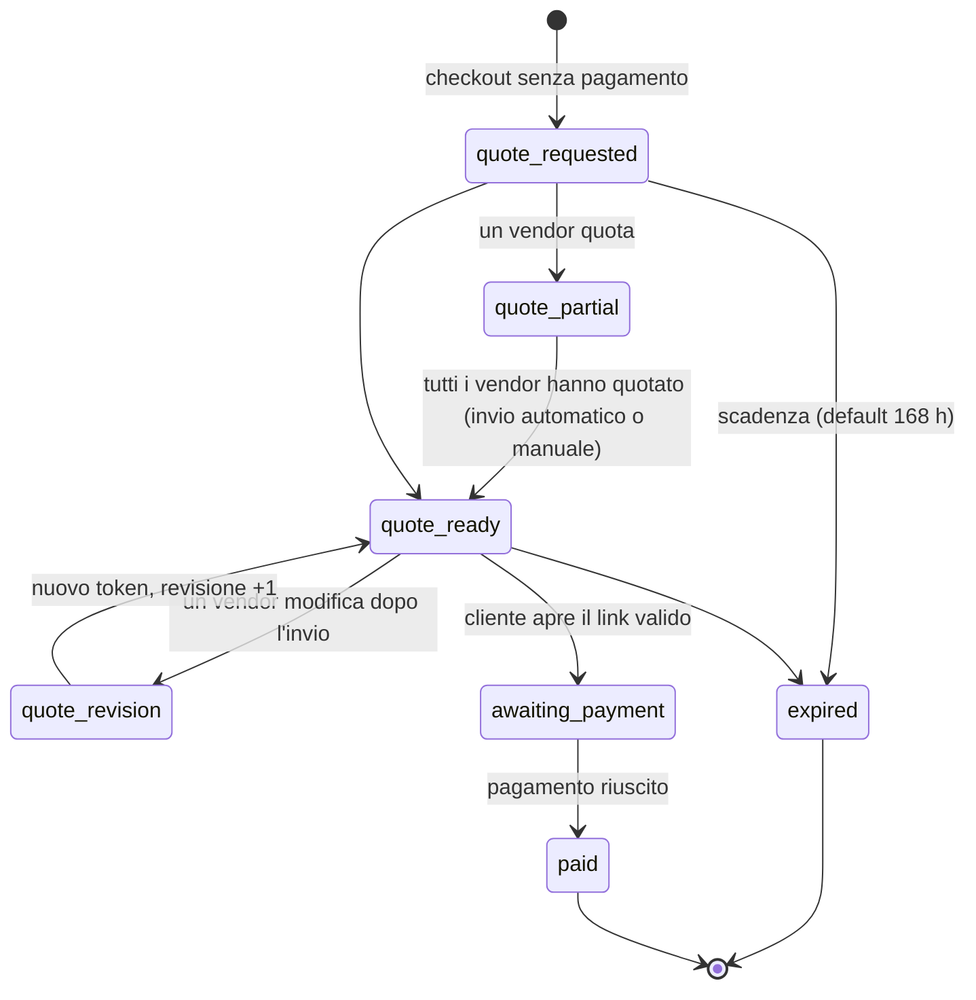

# 06 — Spedizioni e preventivi

## 6.1 Come funziona oggi

Plugin `mp-multicarrier-shipping` v2.4.0 (~7.900 righe). Unica fonte di configurazione: l'option
`custom_shipping_vendors_config_v2` (JSON). Il vecchio plugin `wfcm-price-shipping-weight-wc` è
inattivo da febbraio 2026 e non va portato.

| Classe PHP | Ruolo |
|---|---|
| `MP_Shipping_Config` | Legge/salva la config (backup ultimi 10), risolve la zona (`find_zone_for_package`), match CAP (wildcard `BT*`, range, esatto senza spazi), costo da fasce |
| `MP_Shipping_Calculator` | Filtro `woocommerce_package_rates` P200: una rate per package (= vendor), ritiro in sede, peso in kg |
| `MP_Quote_Request` / `MP_Quote_Workflow` | Stati `quote-pending` / `quote-ready`, gateway tecnico, quotazioni per vendor, token HMAC, scadenza, revisioni, email |
| `MP_Quote_Vendor` / `MP_Quote_Admin` | Pannello preventivo nella pagina ordine WCFM e metabox admin |
| `MP_WCFM_Sync` | Ricopia le zone nelle tabelle WCFM (doppia rappresentazione "non isomorfa") |
| `MP_Shipping_Zone_Editor` | Validazione zone, fasce senza sovrapposizioni, diff e hash per blocco ottimistico |
| `MP_Shipping_Simulator` | Esegue la catena reale (WCFM → spedizioni custom → IVA) su un carrello virtuale |
| `MP_Shipping_Health` | Controlli: vendor senza zone, prodotti senza peso, paesi UE scoperti, fasce vuote… |
| `MP_Shipping_API` | REST `mp-shipping/v1` (`/config`, `/fix-zona6` obsoleto) |

Configurazione LIVE: corriere principale per i vendor A, B, C (Italia + zone europee numerate, con una
zona "isole remote" definita per CAP); corriere proprio solo per il vendor D (Italia, Europa, extra UE,
Mondo); un aggregatore con zone dedicate per il vendor E;
ritiro in sede per alcuni vendor. Prezzi IVA esclusa.

## 6.2 Come funzionerà

### Modelli

```python
class Carrier(Model):
    code ("main", "vendor_own", "aggregator", "pickup"); label (tradotta); is_active: bool  # rispettato davvero
    tracking_url_template; supports_api: bool

class ShippingZone(Model):
    code; name; priority (ASC = vince, 1..999)
    countries = ArrayField(CharField(2))       # o ["*"] per "resto del mondo"
    postcode_patterns = ArrayField(CharField, default=[])   # "BT*", "70000-74999", "9000-9999"
    states = ArrayField(CharField, default=[])

class VendorZoneRate(Model):                   # vendor × zona × corriere
    vendor; zone; carrier
    UNIQUE(vendor, zone)                        # un solo corriere per vendor e zona (oggi "vince il primo")
    over_max_weight = CharField(choices=["last_band", "quote", "block"])   # D-06
class WeightBand(Model):
    rate = FK(VendorZoneRate); from_kg; to_kg (null = illimitato); cost_net; surcharge_net
    # vincolo: nessuna sovrapposizione (exclusion constraint su numrange)
class PickupOption(Model): vendor; key; cost_net; address; label (tradotta)

class ShippingConfigVersion(Model):            # sostituisce i backup dell'option
    snapshot (JSON); created_by; created_at; note   # rollback con un click
```

### Algoritmo (funzioni pure)

```python
def resolve_zone(zones: list[ZoneSnap], vendor_id, country, postcode, state) -> ZoneSnap | None:
    """1) zone con CAP che includono il paese e il vendor, per priorità; primo pattern che matcha
       2) zone con state; 3) zone solo paese per priorità; 4) "*" solo se nessuna altra zona."""

def match_postcode(pattern: str, postcode: str) -> bool:
    """wildcard 'BT*'; range 'a-b' confrontando le prime N cifre del limite; esatto ignorando spazi e '-'."""

def quote_shipping(package: VendorPackage, dest: Address, cfg: ShippingConfigSnap) -> ShippingOutcome:
    """package = righe di UN vendor; peso = Σ peso×qtà (kg, 3 decimali).
       → Rates([...])         tariffe corriere e/o ritiro
       → NeedsQuote(reason)   paese non coperto, peso oltre fascia con policy "quote", peso 0
       → Blocked(reason)      quando il preventivo è disattivato
       Mai una lista vuota silenziosa."""
```

Regole del checkout:

1. Il carrello si divide in **un package per vendor**; il totale spedizione è la somma.
2. Le tariffe sono **sempre al netto**: l'IVA la aggiunge il motore fiscale (`resolve_shipping_tax`).
3. Estremi delle fasce inclusi a destra (5,000 kg → fascia 0–5; 5,001 → 5–10).
4. Un prodotto `buy` senza peso non si può pubblicare (vedi [03](03-catalogo.md)): il caso "peso 0"
   diventa impossibile invece di essere gestito.
5. Ritiro in sede: alternativa in aggiunta al corriere, se configurato.
6. Spedizione gratuita sopra soglia per vendor e zona: regola esplicita (oggi non c'è logica propria).

### Preventivi (ordine unico)

Se un package restituisce `NeedsQuote`, l'intero checkout diventa una **richiesta di preventivo**:
niente incasso, ordine creato in stato `quote_requested`. I vendor coperti mantengono la loro tariffa.



```python
class ShippingQuote(Model):                    # una per VendorOrder in preventivo
    vendor_order; shipping_net; discount_net; note (≤500); quoted_by; source ("vendor"|"staff"); revision

class QuoteLink(Model):                        # token monouso, solo hash in DB
    order; token_hash (HMAC-SHA256); revision; expires_at; used_at

def submit_vendor_quote(order, vendor, shipping, discount, note, actor) -> QuoteState
def send_quote(order, actor, expires_in_h=168) -> QuoteLink   # ricalcola IVA e commissioni, invia email
def open_quote_link(token) -> Order                           # valida: hash, scadenza, revisione, fingerprint
def expire_quotes(now) -> int                                 # job orario
```

Regole portate dalla versione 2.4 (tutte come test):

- Un vendor quota solo il proprio package; sconto ≥ 0 e non oltre il totale merce del vendor; nota ≤ 500 caratteri.
- La modifica dopo l'invio invalida il link precedente e crea una nuova revisione con nuova email.
- **Fingerprint** di indirizzo e righe: se cambiano, la richiesta non è pagabile; spedizione e sconto quotati non lo invalidano.
- Anti-spam: honeypot, email obbligatoria, una richiesta ogni 10 minuti per sessione ed email, rilascio del blocco se il checkout fallisce.
- L'IVA della spedizione quotata si calcola col motore fiscale (non "spedizione × aliquota media").
- Lo sconto si distribuisce in proporzione sulle righe del vendor; il resto di arrotondamento sull'ultima riga.
- L'email "nuovo ordine" al vendor parte **solo dopo il pagamento**; prima riceve "preventivo da inserire".
- Uno stato modificato a mano dallo staff non rende pagabile una richiesta non quotata (bug del 23/9/2026).
- Gli ordini storici a due fasi si migrano in sola lettura.

### Strumenti di gestione

- Editor zone e tariffe in admin con **anteprima del diff** e verifica d'impatto (quanti carrelli
  tipo cambiano prezzo) prima di salvare; ogni salvataggio crea una `ShippingConfigVersion`.
- **Simulatore** carrello multi-vendor con IVA (stesse funzioni del checkout).
- **Health check** giornaliero con report: vendor attivi senza zone, paesi UE scoperti, fasce
  vuote o con buchi, prodotti pubblicati senza peso, vendor in zona che non sono vendor attivi.
- Export tariffe per Google Merchant (spedizione per paese e fascia, oggi hardcoded nel feed).
- Futuro (P3): integrazione API del corriere per etichette e tracking.

## 6.3 Casi di regressione obbligatori

1. CAP IT 70123, 28100, 81100, 82100, 83100, 29121, 31100, 37010 → zona Italia, mai zona isole remote.
2. GR 70100 (Creta) e 84600 → zona isole remote GR; GR 10100 (Atene) → zona continentale GR.
3. GB `BT1 1AA` → zona isole remote GB; altri CAP GB → zona GB.
4. PT `9000-001`, `9400-001`, `9500-001` → zona isole remote PT; `1000-001` → zona PT.
5. `846 00` = `84600`; CAP vuoto → zona del paese.
6. Una zona con CAP vale solo per i paesi elencati.
7. `*` solo come ultima risorsa (vendor D: USA → Mondo).
8. Estremi delle fasce; `to = null` illimitato; oltre l'ultima fascia → policy esplicita (vendor D, Mondo).
9. Il vendor D non riceve mai tariffe del corriere principale; un vendor non può stare in due corrieri della stessa zona (vincolo DB).
10. Corriere disattivato → nessuna sua tariffa.
11. Paese non coperto: preventivo attivo → `NeedsQuote`; disattivo → `Blocked` con messaggio, mai checkout vuoto.
12. Carrello misto coperto + scoperto → ordine unico in preventivo, la tariffa del coperto resta.
13. Ritiro in sede non intercetta i paesi scoperti.
14. Tutti i casi 22–35 del flusso preventivo elencati nell'analisi (token, revisioni, scadenza, fingerprint, rate limit).

## 6.4 Task

| ID | Micro-task | Pri | Ore | Dipende da | Done quando |
|---|---|---|---|---|---|
| SHP.1 | Modelli Carrier, Zone, VendorZoneRate, WeightBand (exclusion constraint), PickupOption, ConfigVersion | P1 | 10 | VEN.1 | Vincoli DB testati |
| SHP.2 | `match_postcode` + `resolve_zone` funzioni pure con casi 1–7 | P1 | 8 | SHP.1 | Casi verdi |
| SHP.3 | `quote_shipping` con esiti Rates/NeedsQuote/Blocked, policy oltre fascia, ritiro, soglia gratuita | P1 | 8 | SHP.2 | Casi 8–13 verdi |
| SHP.4 | Integrazione col carrello: package per vendor, IVA via motore fiscale | P1 | 6 | SHP.3, TAX.4, ORD.1 | Totali carrello corretti nei test misti |
| SHP.5 | Import della config LIVE v2 (JSON) nei nuovi modelli con report di parità | P1 | 6 | SHP.1 | Stesse tariffe su 200 combinazioni campione |
| SHP.6 | Editor admin zone/tariffe con diff, impatto e versioni/rollback | P2 | 12 | SHP.1, CORE.8 | Rollback a versione precedente funzionante |
| SHP.7 | Simulatore carrello (admin + `/shipping/simulate`) | P2 | 6 | SHP.4 | Parità con simulatore attuale su casi seed |
| SHP.8 | Health check giornaliero + report | P2 | 6 | SHP.1, ARC.9 | Report via email con i 7 controlli |
| SHP.9 | Preventivi: modelli, stati, `submit_vendor_quote`, `send_quote`, link con token, scadenza | P1 | 16 | ORD.2, SHP.3 | Flusso end-to-end con 2 vendor |
| SHP.10 | Preventivi: UI vendor e staff, email (cliente, vendor, staff), rate limit e honeypot | P1 | 10 | SHP.9 | Parità con 2.4.0 |
| SHP.11 | Export tariffe per Google Merchant | P2 | 4 | SHP.1 | Feed senza tariffe hardcoded |
