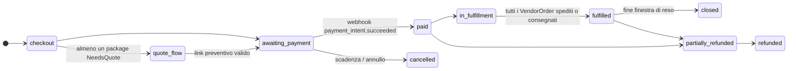

# 07 — Carrello, checkout, ordini, pagamenti e resi

## 7.1 Come funziona oggi

- **Un solo `shop_order`** WooCommerce per checkout, con una riga per vendor nella tabella
  `wcfm_marketplace_orders` (commissioni) e righe di spedizione con `vendor_id`. Non esistono veri
  sotto-ordini: la vista vendor si ricostruisce a posteriori dalla tabella commissioni.
- Stati custom: `quote-pending`, `quote-ready`, `quote-converted` (legacy).
- Impostazioni: prezzi netti, IVA sul paese di fatturazione, prezzi mostrati IVA inclusa nello shop
  ed esclusa nel carrello; geolocalizzazione al checkout disattivata.
- Gateway: `stripe_split` (destination charges) **e** `stripe_cc` senza split, attivi insieme.
- Email: "New Store Order" WCFM (soppressa negli stati di preventivo) + email custom dei preventivi.
- **Rimborsi**: nessuna procedura né codice; solo policy testuali per vendor.
- Protezioni: rate limit su account e registrazioni, Turnstile, GET `?add-to-cart` respinte.

## 7.2 Come funzionerà

### Modelli

```python
class Cart(Model):
    session_key / user; language; country_hint; created_at; updated_at
class CartLine(Model):
    cart; product; variant; quantity; added_price_net   # per avvisare se il prezzo cambia

class StockReservation(Model):                 # prevenzione oversell
    variant_or_product; cart; quantity; expires_at      # 15 minuti, rinnovata al checkout

class Order(Model):
    number (sequenziale con prefisso configurabile, es. "2027-000123"); public_id; customer (null = ospite); email; language
    billing_address; shipping_address (JSON strutturato + paese ISO)
    customer_tax_status (b2c | b2b) ; vat_validation snapshot
    state = FSMField(...)                      # vedi diagramma
    totals: goods_net, shipping_net, tax_total, grand_total (snapshot)
    payment_intent_ref; transfer_group
    legacy_wp_order_id

class VendorOrder(Model):                      # sotto-ordine esplicito per vendor
    order; vendor; state = FSMField(...)
    goods_net; shipping_net; tax_total; gross_total
    shipping_choice (snapshot: carrier, zona, tariffa o preventivo)
    commission_snapshot (JSON: regola, percentuale, fee)  # da compute_commission
    tax_profile_snapshot (JSON)
    tracking_number; carrier; shipped_at; delivered_at

class OrderLine(Model):                        # snapshot immutabile
    vendor_order; product (null se cancellato); sku; title; variant_label
    unit_price_net; quantity; discount_net
    tax_rate; tax_reason; tax_amount; legal_note_key

class OrderEvent(Model):                       # timeline leggibile per cliente, vendor, staff
    order; vendor_order (null); kind; payload; actor; created_at

class ReturnRequest(Model):                    # recesso / reso
    order; vendor_order; lines (M2M + quantità); reason; kind ("withdrawal" | "warranty" | "other")
    state (requested → authorized → received → refunded | rejected); refund_amount
```

### Macchine a stati



`VendorOrder`: `pending` → `accepted` → `shipped` (tracking) → `delivered` → `completed`;
oppure `cancelled` / `refunded`. Lo stato dell'`Order` si deriva da quello dei sotto-ordini.

### Checkout (servizio)

```python
def build_checkout(cart, address, customer_tax_input) -> CheckoutPreview:
    """Per ogni vendor: righe → resolve_goods_tax → quote_shipping → resolve_shipping_tax.
       Restituisce totali per vendor e complessivi, più eventuali NeedsQuote/Blocked."""

def place_order(preview, payment_method) -> Order:
    """Transazione: verifica prezzi e stock, conferma StockReservation, crea Order, VendorOrder e righe
       con snapshot; crea il PaymentIntent (o la richiesta di preventivo)."""

def on_payment_succeeded(event) -> None:       # idempotente per event.id
    """Order → paid; decrementa stock; compute_commission per VendorOrder; ledger; transfer per vendor;
       email cliente e vendor."""
```

### Pagamenti: astrazione e Stripe Connect

```python
class PaymentGateway(Protocol):
    def create_payment(self, order: Order) -> PaymentRef
    def transfer_to_vendor(self, vendor_order: VendorOrder, amount: Decimal) -> TransferRef
    def refund(self, order: Order, amount: Decimal, lines) -> RefundRef
    def reverse_transfer(self, transfer: TransferRef, amount: Decimal) -> ReversalRef
    def parse_webhook(self, request) -> GatewayEvent    # verifica firma obbligatoria
```

- Prima implementazione: **Stripe Connect, account Express, "separate charges and transfers"**.
  Un unico PaymentIntent sulla piattaforma con `transfer_group = order.number`, poi un transfer per
  vendor con importo `vendor_net`. È il modello adatto ai carrelli **multi-vendor**: le destination
  charges ammettono un solo account destinatario per pagamento.
- Un solo flusso di incasso: nessun gateway "senza split" che lasci crediti vendor orfani.
- Vendor non collegato (oggi il vendor E) → prodotti non acquistabili (`on_request`) finché l'account non è attivo.
- I fondi dei clienti non si fermano sui conti della piattaforma oltre il tempo tecnico del
  trasferimento (vincolo PSD2, da confermare col consulente: D-08).
- Metodi: carte, Apple Pay e Google Pay; altri metodi Stripe (SEPA, PayPal via Stripe) da verificare
  per compatibilità con i transfer (D-09).
- Webhook idempotenti (tabella `ProcessedEvent`), firma verificata, retry gestiti.

### Rimborsi, recesso e resi

- Rimborso totale o parziale per righe; IVA stornata con le aliquote dello snapshot.
- Ledger: `refund` e `commission_reversal` proporzionali; `reverse_transfer` verso il vendor.
- **Funzione di recesso online** nell'area cliente (pulsante "Recedi dal contratto" con conferma e
  ricevuta su supporto durevole): obbligo dal 19/06/2026, vedi [11](11-compliance.md).
- Reso: richiesta per riga → autorizzazione del vendor (o automatica entro 14 giorni per il recesso)
  → ricezione → rimborso.

### Area cliente

Ordini con timeline e tracking, preventivi da confermare, recesso e resi, indirizzi, export e
cancellazione dati (anonimizzazione, vedi GDPR), lingua preferita. Checkout ospite consentito.

### Email transazionali (per lingua del destinatario)

Cliente: ordine ricevuto, pagamento confermato, spedito (tracking), preventivo ricevuto/pronto,
rimborso, recesso registrato. Vendor: nuovo ordine (solo dopo pagamento), preventivo da inserire,
promemoria evasione, reso richiesto, payout. Staff: anomalie (pagamento senza transfer, webhook
falliti, preventivi in scadenza).

## 7.3 Task

| ID | Micro-task | Pri | Ore | Dipende da | Done quando |
|---|---|---|---|---|---|
| ORD.1 | Cart, CartLine, sessione ospite/utente, merge al login | P1 | 8 | CAT.1 | Test merge carrello |
| ORD.2 | Order, VendorOrder, OrderLine con snapshot, numerazione, FSM | P1 | 12 | ORD.1 | Transizioni illegali impossibili (test) |
| ORD.3 | `build_checkout` (fiscale + spedizioni per vendor), anteprima e messaggi di blocco | P1 | 12 | TAX.4, SHP.4 | Carrello misto 3 vendor corretto |
| ORD.4 | `place_order` transazionale con StockReservation e verifica prezzi | P1 | 10 | ORD.2 | Test di concorrenza su stock 1 |
| ORD.5 | UI carrello e checkout (HTMX), campi B2B condizionali, VIES, Turnstile | P1 | 16 | ORD.3, TAX.5 | Checkout accessibile da tastiera |
| PAY.1 | `PaymentGateway` + implementazione Stripe (PaymentIntent, transfer_group) | P1 | 12 | ORD.4 | Pagamento test end-to-end |
| PAY.2 | Webhook firmati e idempotenti, `on_payment_succeeded` | P1 | 8 | PAY.1, VEN.4 | Evento duplicato senza effetti |
| PAY.3 | Transfer per vendor, reverse transfer, riconciliazione con ledger | P1 | 10 | PAY.2 | 3 vendor in un ordine: 3 transfer corretti |
| PAY.4 | Rimborsi totali/parziali con IVA e commissioni stornate | P1 | 10 | PAY.3 | Casi di rimborso parziale verdi |
| ORD.6 | Evasione vendor: accetta, spedisci con tracking, consegnato | P1 | 8 | ORD.2, CORE.9 | Vendor evade dal proprio pannello |
| ORD.7 | Area cliente: ordini, timeline, tracking, preventivi | P1 | 10 | ORD.2 | Parità con My Account |
| ORD.8 | Recesso online e flusso resi | P1 | 12 | PAY.4, CMP.6 | Pulsante di recesso conforme, ricevuta email |
| ORD.9 | Email transazionali per lingua (cliente, vendor, staff) | P1 | 10 | ORD.2 | Tutte le email in EN/IT/DE con test snapshot |
| ORD.10 | Kill-switch checkout e pagamenti, alert su pagamento senza transfer | P1 | 4 | ARC.8, PAY.3 | Kill-switch verificato su STAGE |
