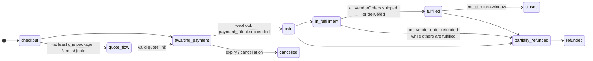

# 07 — Cart, checkout, orders, payments and returns

## 7.1 How it works today

- **A single WooCommerce `shop_order`** per checkout, with one row per vendor in the
  `wcfm_marketplace_orders` table (commissions) and shipping lines with `vendor_id`. There are no real
  vendor sub-orders: the vendor view is reconstructed after the fact from the commissions table.
- Custom states: `quote-pending`, `quote-ready`, `quote-converted` (legacy).
- Settings: net prices, VAT based on the billing country, prices shown VAT-inclusive in the shop
  and VAT-exclusive in the cart; geolocation at checkout disabled.
- Gateways: `stripe_split` (destination charges) **and** `stripe_cc` without split, both active.
- Emails: WCFM "New Store Order" (suppressed in the quote states) + custom quote emails.
- **Refunds**: no procedure and no code; only per-vendor text policies.
- Protections: rate limiting on accounts and registrations, Turnstile, GET `?add-to-cart` requests rejected.

## 7.2 How it will work

### Models

```python
class Cart(Model):
    session_key / user; language; country_hint; created_at; updated_at
class CartLine(Model):
    cart; product; variant; quantity; added_price_net   # to warn if the price changes

class StockReservation(Model):                 # oversell prevention
    variant_or_product; cart; quantity; expires_at      # 15 minutes, renewed at checkout

class Order(Model):
    number (sequential with configurable prefix, e.g. "2027-000123"); public_id; customer (null = guest); email; language
    # the number is an order reference, never an invoice number: the vendor invoices (spec 00)
    billing_address; shipping_address (structured JSON + ISO country)
    customer_tax_status (b2c | b2b) ; vat_validation snapshot
    state = FSMField(...)                      # see diagram
    totals: goods_net, shipping_net, tax_total, grand_total (snapshot)
    payment_intent_ref; transfer_group
    legacy_wp_order_id

class VendorOrder(Model):                      # explicit vendor sub-order
    order; vendor; state = FSMField(...)
    goods_net; shipping_net; tax_total; gross_total
    shipping_choice (snapshot: carrier, zone, rate or quote)
    commission_snapshot (JSON: rule, percentage, fee)  # from compute_commission
    tax_profile_snapshot (JSON)
    tracking_number; carrier; shipped_at; delivered_at

class OrderLine(Model):                        # immutable snapshot
    vendor_order; product (null if deleted); sku; title; variant_label   # sku: display snapshot of the vendor label, never a reference
    unit_price_net; quantity; discount_net
    tax_rate; tax_reason; tax_amount; legal_note_key

class OrderEvent(Model):                       # readable timeline for customer, vendor, staff
    order; vendor_order (null); kind; payload; actor; created_at

class ReturnRequest(Model):                    # withdrawal / return
    order; vendor_order; lines (M2M + quantity); reason; kind ("withdrawal" | "warranty" | "other")
    state (requested → authorized → received → refunded | rejected); refund_amount
```

### Order privacy fields (owner decisions D-29, D-30)
- `Order.tax_retention_until`: 31 December of the order year plus 10, computed at order build in
  the business time zone (D-31). `Order.privacy_status`: `active`, `restricted_tax_only`,
  `anonymized`, changed only by the scrub service (see [11](11-compliance.md), "Order data
  retention and archive").
- The VIES log in the snapshot keeps the consultation time, the consultation number and the name
  returned by VIES.
- `Order.user` is a foreign key with `SET NULL`. The snapshot never joins live user or address
  tables: names, addresses and email are copied at order build.

### State machines



`VendorOrder`: `pending` → `accepted` → `shipped` (tracking) → `delivered` → `completed`;
or `cancelled` / `refunded`. The `Order` state is derived from the states of its vendor sub-orders.

### Checkout (service)

```python
def build_checkout(cart, address, customer_tax_input) -> CheckoutPreview:
    """For each vendor: lines → resolve_goods_tax → quote_shipping → resolve_shipping_tax.
    Returns per-vendor and overall totals, plus any NeedsQuote/Blocked outcomes."""


def place_order(preview, payment_method) -> Order:
    """Transaction: verifies prices and stock, confirms the StockReservation, creates Order, VendorOrder and lines
    with snapshots; creates the PaymentIntent (or the quote request)."""


def on_payment_succeeded(event) -> None:  # idempotent per event.id
    """Order → paid; decrements stock; compute_commission per VendorOrder; ledger; transfer per vendor;
    customer and vendor emails."""
```

### Payments: abstraction and Stripe Connect

```python
class PaymentGateway(Protocol):
    def create_payment(self, order: Order) -> PaymentRef
    def transfer_to_vendor(self, vendor_order: VendorOrder, amount: Decimal) -> TransferRef
    def refund(self, order: Order, amount: Decimal, lines) -> RefundRef
    def reverse_transfer(self, transfer: TransferRef, amount: Decimal) -> ReversalRef
    def parse_webhook(self, request) -> GatewayEvent    # signature verification mandatory
```

- First implementation: **Stripe Connect, Express accounts, "separate charges and transfers"**.
  A single PaymentIntent on the platform with `transfer_group = order.number`, then one transfer per
  vendor for the `vendor_net` amount. This is the model suited to **multi-vendor** carts: destination
  charges allow only one destination account per payment.
- A single payment collection flow: no "non-split" gateway leaving orphaned vendor credits.
- Vendor not connected (currently Vendor E) → products not purchasable (`on_request`) until the account is active.
- Connected accounts are in EU countries at go-live, since only EU-established vendors are
  admitted (D-21, [11](11-compliance.md) CMP.13). Vendor countries outside the EU and cross-border
  payouts are CMP.22. UK consumer consignments of £135 or less create no charge at all (CMP.14).
- Customer funds do not sit in the platform's accounts (D-08, decided: adviser opinion 2026-11-11): no PSD2
  licence is needed while every customer payment goes through Stripe Connect. Each transfer to a
  connected account is created automatically and tied to the charge (`source_transaction`), so
  there is no free balance of third-party money; refunds use `reverse_transfer`. Customer money is
  never collected on the operator's bank account. The customer terms state that payment through
  the platform discharges the debt towards the vendor (Italian civil code art. 1188); the vendor
  terms carry the Stripe Connected Account Agreement and the set-off clause (art. 1252) (CMP.5).
- Launch scope (owner decision D-09, 2026-11-11): **Stripe Connect only**, split at source, so the
  platform fee and the vendor payout are separated by the provider. Other payment methods come
  later behind a documented hook, the `PaymentProvider` interface and the dev page "how to add a
  payment method" (PAY.5): a provider must support a split or a deferred collection of the platform
  fee, refunds, and payout reconciliation. For a method that cannot split at source (proposed
  follow-up PAY.6, spec only): the platform fee becomes a ledger receivable netted from the
  vendor's next Stripe payout, with a vendor SEPA debit mandate as the fallback when the balance
  does not cover it.
- Idempotent webhooks (`ProcessedEvent` table), verified signature, retries handled.

### Refunds, withdrawal and returns

- Full or partial refund by line; VAT reversed using the rates in the snapshot.
- Ledger: proportional `refund` and `commission_reversal`; `reverse_transfer` towards the vendor.
- **Fees on a refund (owner decision D-05, 2026-11-11).** The platform gives back everything it
  took on the refunded order (percentage commission, collection cost, order-handling fee) and
  charges the vendor a **refund fee** instead, a new ledger line type. Refund fee = the real
  provider cost of that refund or chargeback, read from the provider's balance transaction (never a
  fixed table), plus a surcharge (default 2 EUR), the total **rounded up to the whole euro** (the one ceil; every
  other line stays `ROUND_HALF_UP`); every refund event is charged cost plus surcharge. Examples:
  provider cost 3.15 EUR + 2 EUR = 5.15 EUR, charged 6 EUR; a second partial refund with cost
  1.20 EUR + 2 EUR = 3.20 EUR, charged 4 EUR. Surcharge and ceil are configurable per plan on the
  versioned CommissionRule (VEN.2, VEN.33). A partial refund gives the fees back pro rata and
  charges one refund fee per refund event; a chargeback uses the dispute cost as the provider
  cost. The refund fee is charged to the vendor on every refund, withdrawal included; there is
  no split by cause, and the vendor may **not** pass it on to consumers in its return terms (owner's legal review 2026-11-13: Codice del consumo artt. 56-57 forbid charging the consumer refund handling costs).
  The one exception (L-10, owner, 2026-11-11, adviser opinion 2026-11-11) is a refund caused by a platform
  malfunction or error: the refund carries an exclusion flag with a reason, audited, and no refund
  fee is charged. A second exception: a refund from an amendment the customer asked for (D-47, ORD.20) charges no refund fee; the service sets the reason `customer_requested_amendment` and audits it. The contract states the exact fixed part (EUR 2.00 at signature); a change of it
  is notified on a durable medium at least 15 days before and applies only to orders created from
  its effective date (a versioned plan parameter, VEN.33). The refund fee is a platform service
  with the commission's VAT treatment and a line of its own on the periodic statement (T-8, CMP.2). The clause that lets the platform charge it sits in the vendor terms (CMP.5, VEN.33).
- **Online withdrawal function** in the customer area (button labelled "withdraw from contract
  here", in Italian "recedere dal contratto qui", then a confirmation labelled "confirm withdrawal",
  in Italian "conferma recesso", and an acknowledgement on a durable medium with the date and time):
  mandatory from 2026-06-19 (directive (EU) 2023/2673; Italy: article 54-bis of the Codice del
  Consumo, added by legislative decree 209/2025), see [11](11-compliance.md).
- Return: request per line → vendor authorization (or automatic within 14 days for withdrawal)
  → receipt → refund.

### Customer area

Orders with timeline and tracking, quotes to confirm, withdrawal and returns, addresses, data export and
deletion (anonymization, see GDPR), preferred language. Guest checkout allowed.

**Preferences and request history (ORD.11).** Launch scope (P1, owner decision 2026-11-16, MQ-43): language and country, email and notifications, default garage vehicle, privacy and data, plus the business net-view switch (TAX.22). The rest of the section (request history, followed vendors, wish and gift lists, other marketing opt-ins) stays P2. Original note: The owner wants one section
of the customer account where the customer sees all their product information and quote requests
and sets other preferences, including following vendors and event notifications (owner decision
Q-74; event notifications are EVT.16, [15](15-events.md)). The owner has still to review its
content, so it is not designed here: ORD.11 is a placeholder with a small estimate, re-estimated
and detailed in this section once the owner's answers are in.

### Free gifts (P2, ORD.12, owner decision MQ-9)

A price is never 0.00, neither on a product nor on a variant ([03](03-catalog.md), Q-31), so a gift
is not a zero-priced product. It is a promotion, triggered by a coupon code or by a cart condition
(for example a minimum amount or a given product in the cart). The gift enters the order as its
own line at full price plus a discount of 100% of that line (`discount_net`), so VAT and
commission are computed per line as for any other line. Who funds the discount follows the coupon rules of [18](18-promotions-coupons.md) §18.3: the
gift's issuer (the vendor or the platform) is its only funder, with no co-funding in v1, and a
platform-funded gift reduces the commission (Q-90). The split funding of bundles (CAT.16 to
CAT.18) stays a bundle rule.
The promotion tracks the gift's stock and a per-customer limit. VAT treatment (T-7, adviser opinion 2026-11-11):
a gift is allowed only as an in-kind discount on a paid order, with the gift's value at most the
value of the paid goods; never a standalone free supply.
Proposal D-39 ([18](18-promotions-coupons.md)) would build the gift as the `gift` kind of a general
coupon engine (PRM.1 to PRM.5), funded by whoever sets the promotion up (decided).

### Transactional emails (in the recipient's language)

The platform sends order confirmations and order summaries, never invoices or receipts. Each
order confirmation is per vendor, carries the vendor's identity, and is labelled "Documento non
fiscale / Non-fiscal document" in the recipient's language; the vendor issues the invoice or
receipt with its own tools ([00](00-vision-and-review.md)).

Customer: order received, payment confirmed, shipped (tracking), quote received/ready,
refund, withdrawal registered. Vendor: new order (only after payment), quote to be entered,
fulfillment reminder, return requested, payout. Staff: anomalies (payment without transfer, failed
webhooks, quotes about to expire).

### Proof of intra-EU dispatch (ORD.13, owner decision D-28, needs human review)

A reverse-charge intra-EU supply (spec [05](05-tax.md), nature code `N3.2`) is exempt only if the
goods really left for another member state. For every vendor order taxed that way the platform
collects at least **two non-contradictory proofs issued by independent parties** (Implementing
Regulation (EU) 282/2011 art. 45a): a signed CMR, the carrier's invoice, a transport insurance
document, or the carrier's tracking record. Two proofs from the same party count as one, and two
proofs that disagree on destination or date count as none.

When the **buyer arranges the transport**, the buyer also sends a written receipt declaration
(goods received, date, destination member state), due by the **10th day of the month following the
dispatch**. The platform sends reminders before and after the deadline. The vendor sees a status
per vendor order (`proof_missing`, `proof_partial`, `proof_complete`, `declaration_pending`,
`declaration_overdue`); a vendor order without complete proof is flagged for the vendor and for
staff. The proofs are stored as private documents on the vendor order, with the party that issued
each of them.

### Checkout legal step (ORD.17, owner decision D-40)

The last step before payment, in the core checkout and in any checkout module, follows the counsel opinion of
2026-11-13 (questions L-1 to L-6, D-40). Each seller's sales terms must be readable **before** the button: sending them
only after payment would leave them out of the contract (art. 1341(1) c.c.; artt. 49 and 51 Codice del consumo), and the
right of withdrawal does not cure missing pre-contractual information (art. 53 extends withdrawal by 12 months; art. 57
moves the return costs to the seller; the platform answers for its interface under art. 31 DSA).

**Per seller, in that seller's block of the recap** (in clear or in an accordion that opens on the same page):

- the goods, quantities, prices, VAT and that seller's shipping cost;
- identity: full legal name, "professional seller" status (or not, art. 49-bis), geographic address, VAT or registration
  number, contact email;
- the split of obligations: the sales contract is concluded directly with the seller, who is responsible for shipping,
  conformity, invoicing, returns and withdrawals; the platform provides the marketplace service and collects the payment;
- the delivery time the seller commits to (a date or a range);
- withdrawal for consumers: 14 days from delivery, also through the online withdrawal button; who pays the direct cost
  of returning the goods; for goods that cannot normally be returned by post (pallet, bulky), a reasonable estimate of
  the maximum return cost (art. 49(1)(i)); if it is missing, the seller pays the return;
- the legal guarantee reminder (24 months for consumers) and, when the buyer used the garage, the selected item with
  "Compatibility declared by the seller" (D-38);
- a link "Sales terms of <seller> (version <n> of <date>, download PDF)" that opens a printable page or downloads the
  version in force (art. 12(3) D.Lgs. 70/2003, mandatory for business buyers too).

**Right above the button, with no long text in between** (art. 51(2); CJEU C-249/21):

- the short list of goods and the final total with VAT, shipping and every other charge, with the share of each seller;
- **box 1**, mandatory for every buyer, unticked: the buyer declares to have read and to accept the platform's terms of
  use **and the sales terms of each seller named in the recap** (one link per seller), and to have read the privacy
  notice (an acknowledgement, not a consent: the order runs on the contract basis; any marketing consent is a separate,
  optional, unticked box);
- **box 2**, only between businesses: a **business buyer** (one who chose to buy as a business and gave a VAT number;
  the VIES result drives the tax treatment, not box 2: an unverified number still shows box 2, because the buyer
  declared to act as a business) **and** an Italian party, that
  is the operator established in Italy (`current_operator()`, never a literal) and/or at least one seller in the cart
  established in Italy (owner, 2026-11-13). It is the specific approval under artt. 1341 and 1342 c.c. of the onerous
  clauses, each named by **article number and title** (a generic "I approve all onerous clauses" is not valid): the
  platform terms' list when the operator is Italian (declared per version of the customer terms of use in the same
  structured form as VEN.35, kept with the CMP.5 versioned terms; the vendor-contract clauses of CMP.5 are not part of it), then the list each seller in the cart declared for the version
  in force (VEN.35) when that seller is established in Italy **or its terms choose Italian law**. Any other foreign
  seller's B2B terms follow its own law (Reg. (EC) 593/2008) and its court clause is valid through the pre-contract
  link and box 1 (art. 25 Reg. (EU) 1215/2012), so its clauses are not listed (owner chose this variant A, 2026-11-13).
  The owner chose counsel's option A (2026-11-13): box 2 is never shown to a consumer, because asking a consumer to
  approve clauses that are void for them (artt. 33-36 Codice del consumo) is a misleading practice;
- the button, whose label names the obligation to pay: "Confirm order and pay now – EUR <total>" (IT "Conferma ordine e
  paga ora – EUR <totale>"); never "Complete order" or "Send";
- after a redirect back from the provider (3-D Secure) and before the webhook: a "payment received, confirming" state
  with a short HTMX poll; only the webhook marks the order paid.

**Competent court and applicable law** (counsel confirmed the rule):

- consumer: the court of the consumer's residence, never moved by any term (art. 66-bis Codice del consumo; artt. 17-19
  Reg. (EU) 1215/2012), and the mandatory law of the consumer's habitual residence is kept (art. 6(2) Reg. (EC)
  593/2008);
- business: for disputes with the operator, the court of the operator's seat; for the sales contract, the court in the
  seller's terms, or, when the seller names none, the court of the seller's registered office (the fallback clause in
  the platform terms). In box 2 the court clause is one of the listed onerous clauses;
- the terms never link the retired EU ODR platform (Reg. (EU) 2024/3228 repealed Reg. 524/2013 from 2025-07-20).

The confirmation email carries, on a durable medium (the text or a PDF, not only a link), the accepted platform terms and
each seller's sales terms in the version of the order (art. 51(7)): this is the confirmation duty, never a substitute for
the information before the button. The ready-made texts of box 1, box 2 and the court clauses are in counsel's opinion
(kept private); the legal pages and the translations use them.

### Order amendments (ORD.20 to ORD.24, owner decision D-47)

Owner decision D-47 (2026-11-16, Q-99). After payment a vendor sometimes cannot ship exactly what
was sold: a line is out of stock, the price was wrong, the carrier changed, or the customer asks to
fix the address. Today the only tools are a refund (PAY.4, PAY.7) or a cancellation. An
**amendment** is a typed change to one `VendorOrder`, recomputed with the checkout engines, that is
either applied at once (minor) or proposed to the customer (substantial). Every rule below is a
service rule tested in the service, never only in a view. The PRs touch orders, payments, ledger,
tax and consumer law and carry the human-review flag. The joint tax and legal opinion of
2026-11-16 (kept private) confirmed the model and set the VAT timing, the territory checks, the
14-day refund deadline, the durable-medium and proposal-content duties and the contract clauses
below.

**When.** Only on a paid vendor order in `pending` or `accepted`, never once it is `shipped`,
`delivered`, `completed`, `cancelled` or `refunded`. Before payment the quote flow (SHP.9 revisions)
handles changes, not amendments. While an amendment is open the vendor cannot mark the package
shipped (the ship action is refused with a message naming the open amendment); the vendor may
withdraw its own proposal first.

**Versions, never edits.** The `OrderLine` rows and the `VendorOrder` snapshot fields of the
placed order stay immutable. They are **version 1**. Each applied amendment writes a new
`VendorOrderVersion` (v2, v3…) holding the full snapshot of that version: lines (product, sku,
title, variant, unit price, quantity, discount, and its tax portions, each with rate, reason, nature
code, tax amount and `tax_on`, see VAT timing below), shipping
choice (carrier, method, zone, special area, rate or quote with its revision), shipping address,
tax profile snapshot, totals and the commission snapshot. `VendorOrder.current_version` points to
the last applied one; a version is append-only (a database trigger refuses updates, as for the
order snapshot). Each version line carries a stable `line_key` that links it to the line it
replaces, so PAY.4 refunds, ORD.8 returns and the ORD.13 proofs work on the current version. The
shipping address becomes per vendor order from v2 on: an address change on one package of a
multi-vendor order never touches the other packages. `Order` totals are the sum of the current
versions. The commission rule stays the one frozen at payment (v1), and the refund-fee surcharge
stays the plan version of the order's creation (VEN.33): an amendment never re-reads a live rule.

```python
class VendorOrderVersion(Model):          # append-only; v1 is the placed order
    vendor_order; number; amendment (null for v1); snapshot (JSON, as above); totals; created_at

class OrderAmendment(Model):
    public_id; vendor_order; from_version; to_version (null until applied)
    changes (JSON, typed: carrier, address, price, remove_line, quantity_down, quantity_up,
             add_line, substitute, delivery_time)
    kind ("minor" or "substantial")       # set by classify_amendment, never by the actor
    initiator ("vendor_owner", "vendor_member", "platform_owner", "support")
    actor; reason (required); staff_note (required for platform staff)
    customer_request (channel, date, text; required for an address change on the customer's request)
    state                                 # see below
    preview (the ChangeSet: per-line before and after, tax, shipping, commission, money delta)
    fallback ("keep", "remove_unavailable_lines", "cancel_package")   # what a decline or expiry does
    expires_at; reminded_at; decided_at; decision_channel ("email_link", "customer_area")
    quote (FK ShippingQuote, null; ORD.23); payment_ref; refund_ref

class AmendmentLink(Model):               # one-time token, like QuoteLink: only the HMAC hash is stored
    amendment; token_hash; expires_at; used_at
```

`OrderAmendment` states: `draft` → `applied` (minor), or `draft` → `awaiting_quote` (ORD.23) →
`proposed` → `accepted` → `awaiting_payment` → `applied`; side exits `declined`, `expired`,
`withdrawn` (by the actor, or by the customer's withdrawal), `superseded` (the version moved under
it) and `discarded` (a draft never sent). The open states are `draft`, `awaiting_quote`, `proposed`,
`accepted` and `awaiting_payment`.

**One engine.** `engine.recompute_vendor_order(version, changes, ctx) -> AmendmentPreview` is a
pure function that replays the checkout: `resolve_goods_tax` per line, `quote_shipping` for the
package, `resolve_shipping_tax` (shipping follows the goods, TAX.17, so removing a line can move the
shipping VAT split), `compute_commission` with the frozen rule, and the money delta (gross to pay
or to refund). The customer's tax status (B2C or B2B and the VIES snapshot) is never amended.
`engine.classify_amendment(before, after, changes, initiator) -> "minor" | "substantial"` is pure
and decides the kind; the actor never picks it.

**VAT timing (joint opinion 2026-11-16, point 1.a; replaces "the order date for every version").**
Every version recomputes the VAT line by line, and every tax portion of a version line (goods and
its share of shipping) carries its own `tax_on` date and the rate and rules it was taxed with:

- the amount **already paid** keeps the rate and rules of the original payment (art. 6 c. 4 DPR
  633/72): an unchanged line, or the unchanged part of a changed line, copies its portion from the
  previous version and is never re-rated, even if a rate changed by law in the meantime;
- a **reduction** or a **removed line** is reversed line by line at the rate of the portion it
  reduces, that is the original rate of that line (art. 26 c. 2), exactly as a PAY.4 refund by
  line, with no priority between rates (tax adviser opinion 2026-11-17);
- a **substitute** or an **added line** is taxed with its own fiscal category (its own rate, which
  may differ from the line it replaces), and an **increase** of an existing line (higher price or
  quantity) adds a new portion for the increment; both use the rates and rules in force on the
  amendment's tax date: the date of the second payment when money is collected, otherwise the date
  the version is applied (TAX.6 validity periods, at midnight of the rate's country);
- the customer pays the **gross difference** between the versions; the original payment and the
  second payment stay recorded separately (two charges, two sets of ledger rows, each with its
  tax date), and the order summary (ORD.9) shows both.

**Recompute rules (tax adviser opinion 2026-11-17; D-47).** The adviser confirmed the VAT timing
above and settled how the shipping VAT and a supplement are taxed:

- **(a) Reductions.** A lower price, a lower quantity or a removed line is reversed line by line at
  that line's original rate (art. 26 c. 2 DPR 633/72; art. 90 Directive 2006/112/EC). No rate has
  priority: reducing a 4 % line never reverses VAT at 22 %, and the reverse.
- **(b) Shipping follows the final goods.** The shipping VAT of every version is split again in
  proportion to the taxable goods of the **final version** under each tax decision (art. 12 DPR
  633/72, TAX.17), whatever the split of the previous version, also when the shipping net is
  unchanged or lower. Removing the 22 % line of a 22 % and 4 % package moves the whole unchanged
  shipping to 4 %, and the customer gets back the shipping VAT difference (a VAT-only shipping
  refund).
- **(c) A supplement takes the second payment's date.** Goods or shipping collected with a second
  payment use the rules and rates in force on the date of that payment (art. 6 c. 4 DPR 633/72;
  art. 65 Directive 2006/112/EC): its portions carry that `tax_on`.
- **(d) A change in law crystallises the paid part.** When the law changes the rate of the same
  goods category between the two payments, the part paid with the first payment keeps the old
  percentage, and only the excess paid with the second payment takes the new one. For the
  shipping: when the shipping net grows, the part up to the shipping already paid is split as in
  (b) under the decisions the goods were paid with, and the excess is split in the same
  proportions under each line's category decided on the second-payment date. When the shipping
  net does not grow, there is no excess: the paid shipping keeps its paid decisions and is
  re-split by (b). A **lower** shipping comes off the newest payment's part first, each part at
  the rates it was paid with (as a reduction of a line, (a)).
- **(e) A change in the goods mix moves the whole shipping.** When the goods change (a 4 % item
  replaced by a 22 % item), the whole shipping, original plus extra, follows the goods actually
  shipped as in (b). The crystallisation in (d) applies only to changes in law, never to a change
  of the goods.
- **Chained amendments.** A later version starts from the previous one, never from the placed
  order: rules (a) to (e) apply to the change from the previous version. The shipping of each
  payment is kept as its own part with its own date: when neither the goods nor the shipping net
  change, every shipping portion is copied as it is; otherwise each payment's part is re-split
  over the final goods under the rate each goods category had on that payment's date, so a part
  already taxed at a newer rate on the second payment keeps that rate and date. The same rate paid
  on two dates stays two portions.

Regression cases, with exact amounts. **Seed M:** P22 1 × 50.00 net, standard category at 22 %;
P4 1 × 50.00 net, a 4 % category (books in Italy); shipping 10.00 net split 5.00 at 22 % (VAT
1.10) and 5.00 at 4 % (VAT 0.20); gross 124.30; commission 10 % of the net goods (10.00). **Seed
S:** P22 1 × 50.00 net at 22 % and shipping 10.00 net at 22 % (VAT 2.20); gross 73.20. D1 is
the first payment, D2 the second payment (or the apply date of a minor change).

| # | Rule | Case | Expected |
|---|---|---|---|
| AM1 | (a) | Seed M, P4 lowered to 40.00 (minor) | P4 reversed 10.00 net and 0.40 VAT at 4 % (nothing at 22 %); shipping re-split 5.56 at 22 % (1.22) and 4.44 at 4 % (0.18), shipping VAT 1.40; refund 10.30; commission back 1.00; v2 gross 114.00 |
| AM2 | (a) | Seed M, P22 lowered to 40.00 (minor) | P22 reversed 10.00 net and 2.20 VAT at 22 %; shipping re-split 4.44 at 22 % (0.98) and 5.56 at 4 % (0.22), shipping VAT 1.20; refund 12.30; commission back 1.00; v2 gross 112.00 |
| AM3 | (b) | Seed M, P22 removed as unavailable, shipping unchanged at 10.00 | P22 reversed 50.00 net and 11.00 VAT at 22 %; the whole shipping at 4 % (VAT 0.40): a VAT-only shipping refund of 0.90; refund 61.90; commission back 5.00; v2 gross 62.40; the ledger of the package sums to zero |
| AM4 | (c) | Seed M, P22 quantity 1 → 2, collected with the second payment on D2 | new P22 portion 50.00 at 22 % (11.00) with `tax_on` D2, the paid portion kept on D1; shipping unchanged at 10.00, re-split 6.67 at 22 % (1.47) and 3.33 at 4 % (0.13); to pay 61.30 |
| AM5 | (c) | Seed M, address change on the vendor's initiative in the same tax territory, the method costs 14.00 there | the paid 10.00 keeps 5.00 at 22 % (1.10) and 5.00 at 4 % (0.20) on D1; the 4.00 excess is split 2.00 at 22 % (0.44) and 2.00 at 4 % (0.08) with `tax_on` D2; to pay 4.52 |
| AM6 | (d) | Seed S, the standard rate changed by law from 22 % to 23 % between D1 and D2; P22 quantity 1 → 2 and an address change whose method costs 14.00 | goods: 50.00 at 22 % (11.00, D1) kept and 50.00 at 23 % (11.50, D2); shipping: 10.00 at 22 % (2.20, D1) kept and the 4.00 excess at 23 % (0.92, D2); to pay 66.42 |
| AM7 | (e) | Seed M, P4 replaced by a substitute Q 1 × 50.00 net, standard category | P4 reversed 50.00 net and 2.00 VAT at 4 %; Q 50.00 at 22 % (11.00, D2); the whole shipping 10.00 at 22 % (2.20); to pay 9.90 |
| AM8 | (e) | AM7 together with an address change whose method costs 14.00 | the whole shipping 14.00 at 22 %: the paid 10.00 (2.20) and the 4.00 excess (0.88, D2); to pay 14.78 |
| AM9 | Chained, (d) | AM6 applied as v2 (goods 11.00 + 11.50, shipping 10.00 at 22 % on D1 and 4.00 at 23 % on D2, gross 139.62); on D3 P22 quantity 2 → 1 (minor), shipping unchanged at 14.00 | the newest unit reversed: 50.00 net and 11.50 VAT at 23 %; shipping unchanged, 10.00 at 22 % (2.20, D1) and 4.00 at 23 % (0.92, D2), never re-rated; refund 61.50; v3 gross 78.12 |
| AM10 | Chained, (a), (b) | AM5 applied as v2 (shipping 5.00 at 22 % and 5.00 at 4 % on D1, 2.00 at 22 % and 2.00 at 4 % on D2, gross 128.82); P22 lowered to 40.00 | P22 reversed 10.00 net and 2.20 at 22 %; each payment's shipping re-split on its own: D1 10.00 as 4.44 at 22 % (0.98) and 5.56 at 4 % (0.22), D2 4.00 as 1.78 at 22 % (0.39) and 2.22 at 4 % (0.09), both dates kept; refund 12.34 |
| AM11 | Chained, lower shipping | AM6 applied as v2; a carrier at 11.00 net instead of 14.00 | the 3.00 comes off the D2 part first: shipping 10.00 at 22 % (2.20, D1) and 1.00 at 23 % (0.23, D2); refund 3.69 |

**Territory change (joint opinion, point 1.b).** A change of destination country or tax territory
is not a recompute only: `recompute_vendor_order` runs the **full eligibility and blocking checks
of a new checkout** (ORD.3) on the new destination at the amendment's tax date: the EUR 10,000
distance-sales threshold and OSS and the RF20 rules (TAX.20), the vendor's shipping zones and the
special-area treatments of the excluded territories (SHP.14: the Canary Islands, Livigno, Campione
d'Italia and the other extra-VAT territories), a non-EU destination when the vendor does not ship
there, Northern Ireland (`XI`) blocked for a vendor above the threshold without OSS (TAX.21), the
CMP.14 UK lead-only consignment, and for a B2B buyer the VIES check (TAX.5): an intra-EU zero-rated
supply only with a valid VAT number of another member state and the ORD.13 transport proofs, which
follow the final destination. Every line of the previous version is reversed at its original rate
and taxed again for the new destination on the amendment's tax date (a change of regime, art. 26
c. 2). A destination the checks do not support **blocks** the amendment: the draft is refused with a
plain message naming the reason ("the seller cannot deliver to the Canary Islands, so the address
cannot be changed to it") and is never proposed. A territory change is always substantial (the
customer-terms article below); on acceptance a lower gross total is refunded automatically and a
higher one is collected by the second payment. The commission is computed on the net goods with
the frozen rule, so it does not change with the destination's VAT rate (only the percentage part of
the collection cost moves by a few cents with the gross).

**Minor changes** (applied at once, the customer is told by email and in the order history):

1. A carrier or method change of the same vendor at the **same or a lower** shipping price, with a
   comparable delivery time: the new method's maximum delivery days exceed the old by at most the
   operator setting `amendment_comparable_delay_days` (default 2). If the new method costs more,
   the vendor absorbs it: the customer's shipping amount stays the same and no money moves. If it
   costs less, the difference is refunded.
2. A lower unit price, a lower quantity, or a line removed as unavailable: an automatic partial
   refund through PAY.4. The notice offers the customer "cancel the rest of this package", and the
   package cannot be marked shipped until the operator setting `amendment_cancel_hold_hours`
   (default 24) has passed since the notice, unless the customer answered earlier. A cancel of the
   rest is a full refund of the package under PAY.4 (refund fee charged to the vendor, D-05).
3. An address correction **requested by the customer** inside the same country and the same tax
   territory (TAX.1 `Territory`: Livigno, the Canary Islands or Northern Ireland count as a
   territory change), such as the house number or the intercom, when the recompute neither changes
   the tax nor raises the shipping. The request is recorded (channel, date, the customer's words).

A minor change never raises what the customer owes. If the recompute of a change listed as minor
gives a higher gross for the package (for example a removed line moves the shipping VAT split up by
more than the goods go down, or a cheaper carrier lands in a special area), the change is
classified substantial. Discounts stay per line as snapshotted: a removed line takes its own
discount share with it, and a coupon or free-shipping threshold that the amended package no longer
meets is kept (the customer never pays more because of a vendor's change).

**Substantial changes** (need the customer's acceptance, ORD.21):

- a substitute product (never shipped without the customer's consent);
- a higher price, a higher quantity or an added line; the difference is paid through a new
  PaymentIntent, because a captured Stripe payment cannot be increased;
- an address change made on the vendor's or staff's own initiative (fraud risk), or any address
  change to another country or tax territory, whoever asks; the full checkout checks run again
  (territory change, above) and an unsupported destination blocks the draft; an other-country
  change is substantial even when the new total is lower (the customer then gets the difference
  back automatically when accepting);
- a much slower delivery: the new maximum delivery days exceed the old by more than
  `amendment_comparable_delay_days`;
- any minor change whose recompute raises the gross (above).

One amendment may combine changes; it is substantial if any part is.

**The 72-hour answer (ORD.21).** A substantial amendment is sent as a proposal: email and customer
area, with what changes, the new total, the amount to pay or to refund, the deadline (72 hours,
operator setting `amendment_answer_hours`, shown in the customer's language and the business time
zone, D-31) and what a decline means (the `fallback`). The email links open a page with **Accept**
and **Decline** buttons; the decision is a POST, never the GET of the link, so mail scanners that
prefetch links decide nothing. A guest decides through the link; a signed-in customer also from the
customer area. One reminder 24 hours before the deadline. The `AmendmentLink` is single use, bound
to the amendment and the from-version, and dies with it.

- **Accept** with money to refund or nothing to pay: the new version is applied at once and any
  refund runs through PAY.4.
- **Accept** with money to pay: the amendment goes to `awaiting_payment` and the customer pays the
  difference on our payment page (a new PaymentIntent in the same `transfer_group`, metadata
  `amendment = public_id`). The version is applied only by the signed, idempotent webhook (PAY.2).
  The payment must succeed before the deadline, or within 24 hours of an acceptance given in the
  last 24 hours. If it does not, the amendment expires as a decline. A supplement that succeeds
  after the amendment closed is a duplicate-payment case (PAY.4: refunded in full, audited).
- **Decline or no answer**: the order stays as it was (the current version does not change). If the
  vendor can still fulfil it that way, it ships it. If it cannot, the `fallback` applies:
  `remove_unavailable_lines` removes the unavailable lines with a refund (a minor change, the
  customer may cancel the rest), and `cancel_package` cancels the package with a full refund. A
  substitute is never shipped without the customer's consent, and unavailable goods are refunded,
  never replaced by default. A declined higher price does not let the vendor cancel for
  convenience: `cancel_package` after a declined price increase needs the vendor's declared reason
  "cannot be fulfilled as ordered", is audited, and such cancellations are counted per vendor on
  the staff dashboard.
- **After a decline or expiry, if the vendor ships the original order**, the 72 hours have moved
  the delivery: the vendor confirms a new estimated delivery date before it can mark the package
  shipped, and the customer is told that date (email and customer area).

**Refund deadline (joint opinion, point 2; art. 61 c. 4 Codice del consumo).** Every refund that
an amendment causes (a decrease, a removed line, a cancel of the rest, a decline or expiry
fallback, a package cancelled by the vendor or staff, a lower total after a territory change) is
made **without undue delay and in any case within 14 days**, on the same means of payment, never
30 days (that term is repealed). The service submits the PAY.4 refund to the provider in the same
step as the event that causes it; each refund event stores `due_by` (the event time plus 14 days),
and a refund not succeeded with the provider 4 days before `due_by` raises a staff alert. Customer
messages say: "credited within 5 to 10 business days depending on the card issuer, and in any case
within 14 days".

**Unsolicited supply (art. 66-quinquies Codice del consumo).** A substitute shipped without the
customer's express consent is an unsolicited supply: the consumer neither pays nor returns it. So
a substitute enters a version only through an `accepted` amendment with a recorded decision (POST,
channel and time); no other path (a minor change, a staff tool, the API, a dry run applied later)
can add it, and the ship action ships only the current version.

**Durable medium (art. 51 c. 7 Codice del consumo).** The unavailability notice (a line removed or
reduced), the proposal and the confirmation of the accepted version are each sent by email with
the full content in the body or an attached PDF (never only a link) **and** recorded in the
customer area (for a guest, the order page reached from the order email) as an `OrderEvent` that
keeps the exact text sent, in the customer's language, with its CMP.24 wording version.

**Mandatory content of a proposal (joint opinion, operating point 1).** Before the Accept button,
the proposal page and email show, and `propose_amendment` refuses a proposal (`ProposalIncomplete`,
naming each missing field in plain words) that lacks any of:

- for a **substitute**: the original item with its price; the substitute's description, brand and
  SKU; its compatibility with the vehicle the customer selected in the Garage, when the original
  line carries a vehicle snapshot (spec 17 §17.4.6, FIT.17: the fit answer for that vehicle with
  "Compatibility declared by the seller", obtained through the order-line annotation hook so that
  `orders` still does not import `fitment`);
- for a **price or quantity increase**: the vendor's reason, quoted;
- in every case: the unit and total price including VAT; the change in shipping; the exact
  difference to pay or to be refunded; the new estimated delivery date; the answer deadline; what
  a decline or no answer means (the `fallback`); that nothing is charged without the customer's
  express consent; and a reminder of the 14-day right of withdrawal from delivery (who pays the
  return as in the seller's terms, the seller when the goods are not in conformity) and of the
  legal guarantee of conformity, both unchanged by the amendment.

**The second-payment button ("button solution", art. 8(2) Directive 2011/83/EU; § 312j(3) BGB).**
The final button of the second payment names the obligation to pay and the amount including VAT,
exactly per language: IT "Conferma modifica e paga EUR [x]", EN "Confirm change and pay EUR [x]",
DE "Änderung zahlungspflichtig bestätigen (EUR [x])", FR "Confirmer la modification et payer EUR
[x]", ES "Confirmar modificación y pagar EUR [x]", where [x] is the gross difference. Never
"Accept", "Continue" or "Send" alone on that button.

**Confirmation of the accepted version.** Once the accepted version is applied (after the webhook
when money was collected), the customer and the vendor each receive a confirmation on a durable
medium with the final version: lines, shipping, VAT per rate, and the total as first payment plus
second payment (or minus the refund), with both collections listed separately. The vendor's copy
is for its invoicing and carries the invoice notice below.

**Vendor invoice already issued (joint opinion, point 1.c).** The vendor corrects its own fiscal
documents: a TD04 credit note when the amount goes down or the regime changes (art. 26 c. 2); a
TD01 or TD05 when it goes up (art. 26 c. 1), or a full TD04 and a new invoice. The platform does not
issue them. It **warns** the vendor in every applied-change notice to the vendor (email and the
vendor order page) and, prominently, on the amendment screen when `invoice_issued_at` is set; the
amendment is never blocked. The message requirement (CMP.24 wording, IT reference text of the
opinion): EN "Order changed after payment: if you already issued an invoice or receipt for the
previous version, remember to issue a credit or debit note to bring the document in line with the
new amounts."; IT "Ordine modificato dopo il pagamento: se hai già emesso fattura o scontrino per la
versione precedente, ricorda di emettere nota di variazione/rettifica per allineare il documento ai
nuovi importi". From the vendor order the vendor downloads (PDF and CSV) the **final snapshot** and
the **difference statement** between the previous and the new version: per line before and after,
per tax portion the rate, `tax_on`, net and VAT, the shipping, the totals and the gross difference,
the payment and refund references, and whether the change lowered, raised or changed the regime.

**Business details after the order (ORD.25, owner decision 2026-11-16).** A business buyer can add or
update its VAT number and invoicing details on a placed order until the order is invoiced or its
first shipment is created, whichever comes first; after that the form is closed and the buyer is
pointed to a credit note request. The number is re-checked with VIES (TAX.5, fail closed), the
change is audited and the vendor (owner and members with ORDERS) is notified. The order is
recomputed only when the tax treatment changes, through the amendment flow above when money moves.

**Message templates (ORD.24).** The counsel-approved texts are kept in private/ (CMP.24) in five
languages: Italian in the opinion, English, German, French and Spanish in the owner's PDF to be
filed under private/consulenti/. The spec fixes each template's required fields and structure;
ORD.24 loads the approved wording into the gettext catalogues with the `(L)` context. Every
template says what changed, what it costs, what to do and by when (owner, 2026-11-16).

| Template | Subject must say | Body must contain | Actions |
|---|---|---|---|
| A1, item unavailable, whole package cancelled | order reference, item unavailable, full refund | the item, the seller, that the order to that seller is cancelled, the full refund amount on the same means of payment started at once, the credit-time wording (5 to 10 business days, in any case 14 days), an apology | none |
| A2, partial unavailability | order reference, partial refund for an unavailable item | the refund amount (VAT and the shipping share included), that the order goes on at the new total, the right to cancel the rest free of charge before shipping and the deadline (date and time) | "Cancel the rest of the order and refund everything" |
| 2b, substitute proposal (72 hours) | "action required within 72 hours", order reference, substitute proposal | every mandatory proposal field above; the difference case (none, refunded automatically with the credit-time wording, or to pay on acceptance); the deadline; "the substitution happens only with your explicit consent"; if accepted, withdrawal and guarantee unchanged; if declined or unanswered, the `fallback` with the full refund within 14 days | "I accept the substitute" and "I decline" |
| Price increase, email | "action required within 72 hours", order reference, price update proposal | the vendor's reason quoted; "you are under no obligation to accept, and nothing more is charged without your explicit consent"; the summary (items, total already paid, new total with goods, shipping and VAT, difference, estimated delivery); the deadline; if accepted, withdrawal and guarantee unchanged; if declined or unanswered, no cost and the original order at the original price or a full refund within 14 days; signed by the platform team | "Accept and pay the difference (EUR …)" and "Decline the change" |
| Price increase, banner in the order area | (none) | the seller, old and new price and the difference including VAT, the reason, the deadline (date and time), that silence declines it without any charge and the order stays at the original price or is cancelled with a full refund within 14 days | "Accept and pay EUR …" and "Decline" |

The confirmation of the accepted version, the reminder, the new delivery date after a decline and
the outcome messages follow the same rule (what changed, what it costs, what to do, by when) and
the same CMP.24 approval.

**Contract clauses (joint opinion; CMP.5).**

- **Customer terms**, a new article "Order changes after payment and before shipping" in the
  platform terms, with three paragraphs stated as requirements: (1) **minor changes** that do not
  worsen the customer's position (a carrier at the same or a lower cost with an equivalent delivery
  time, an address correction requested by the customer within the same country, a lower price or
  an unavailable item removed with the difference refunded at once) may be made before the goods
  go to the carrier, and after a partial unavailability the customer may cancel the rest free of
  charge before shipping with a full refund; (2) **substantial changes** (a substitute, a higher
  price, a significantly longer delivery time, a change of the destination country or tax
  territory) are a proposal that needs the customer's express acceptance within 72 hours of the
  notice on a durable medium, and silence is always a refusal; (3) on **refusal or no answer** the
  proposal lapses at no cost and the original order stands; if the seller cannot fulfil it as
  ordered, the order is cancelled and the whole amount paid is refunded without undue delay and in
  any case within 14 days, on the same means of payment. The counsel-approved Italian wording is
  in CMP.5 (spec 11).
- **Vendor terms**, clause **(l) "Changes to paid orders"** (CMP.5): a substantial change before
  shipping is only a proposal, effective only on the customer's express acceptance within 72
  hours, silence is a refusal; on refusal the vendor ships the original order or cancels it with a
  full refund and the refund fee; **anti-abuse rule**: the vendor must not systematically propose
  price increases after payment to get around its catalogue prices ("bait pricing"), a serious
  breach under the vendor-terms suspension clause (m) "Limitazione, sospensione e cessazione",
  with suspension under the P2B rules (statement of reasons, CMP.5); clause (l) is approved with the second signature
  (arts. 1341 and 1342 c.c., counsel 2026-11-16); the
  correction of invoices already issued is the vendor's alone. Staff see, per vendor, the count of
  price-increase proposals and their acceptance rate (ORD.22) to apply it.

**Money: ledger and commission.**

- A decrease is a PAY.4 refund event: the same arithmetic as a refund by line, quantity or amount
  (VAT reversed at the original rate of each portion, the collection cost given back pro rata
  with cumulative rounding, one refund fee per refund event, D-05), with `refund_ref` and the
  amendment in the memo, except the commission (owner decision on #564, 2026-11-16): an
  amendment gives back the commission of its recompute, the previous version's commission minus
  the new one under the frozen rule (3.00 for B in the seed), whatever the operator's
  `reverse_fees_on_vendor_refund`; a PAY.7 refund keeps the pro rata (2.79 for the same B under a
  goods-only rule; the rows are identical under a rule on goods and shipping). The event that
  refunds the rest of a package gives back all the commission and collection cost left. A later
  refund by line reads the line of the current version. The refund is recorded with the version
  and submitted to the provider right after it commits; one the provider does not take stays
  pending, is retried by the sweep and alerts staff. A pending refund older than the provider's
  idempotency window (20 hours) is not retried automatically: staff check the provider first. A
  refund the provider reports `failed` or `canceled` posts nothing (no ledger line, no state
  change, it counts for no cap) and alerts staff at once, who refund the customer another way
  within the 14 days. Staff are alerted once 4 days before `due_by` and once, escalated, when it
  has passed unconfirmed.
- Design notes (ORD.20 part 2): a removal or a lower quantity is `unavailable` unless the vendor
  says otherwise (part 3's screen asks explicitly); only unavailable units keep their stock, the
  others restock. Each unavailable amendment opens the cancel-the-rest offer again and re-arms the
  24-hour hold from its own apply. The offer stays open until shipping (the counsel clause), the
  hold only blocks shipping for its hours. The offer also stays open while the shop's orders are
  frozen (a termination awaiting staff review, CMP.5): the freeze stops the shop, never the
  customer's free cancel of the rest (customer protection, ORD.20 part 3b).
- Design notes (ORD.20 part 3b-1): each notice is an outbox email and an append-only `OrderEvent`
  (the exact subject and text, the language, the CMP.24 wording version as the SHA-256 of the
  template rendered in that language and branch with fixed placeholders, and the customer terms
  version in force); its text carries no customer name, and anonymisation replaces it. The
  vendor records `invoice_issued_at` on its order page (once, the shop only). The audit entry of a
  package cancellation names its `kind` (`rest_cancelled` or `package_cancelled`).
  The event keeps the text stored with the outbox row when the email was queued (ORD.26): the
  outbox sends that stored copy and anonymisation scrubs the outbox rows of the order's emails.
  An event is written only when the email was accepted into the
  outbox (a recipient, not suppressed, not refused), and the vendor's fee line reads the
  ledger's outcome (exclusion reason and platform-error flag), never the cause.
- Counsel's answer of 2026-11-17 (CMP.24, kept private) approved the notice wording: customer
  texts informal (du, tu, tú) and vendor texts formal (Sie, vous, usted), changing only pronouns
  and verbs and never the statutory terms (Widerrufsrecht, gesetzliche Mängelhaftungsrechte or
  Gewährleistung; droit de rétractation, garantie légale de conformité); A1 with the general
  "the seller cannot fulfil your order" for every cancellation for the vendor's fault; A2 with
  "until the parcel is handed to the carrier; the seller will not ship it before {date}", the
  date at least 24 hours after the notice; the reference texts of the platform-error
  cancellation (customer and vendor), the vendor invoice notice in DE, FR and ES and the
  guest A2. The outbox sets no reply-to, so the guest A2 names only the support address
  (`PlatformOperator.support_email`). The DE, FR and ES texts still wait for the professional
  translator's review (I18N.14); the provenance is `amendment_notices.WORDING_APPROVAL`, copied
  into each kept notice.
- **Refund-fee exemption (owner, 2026-11-16).** A refund that comes from an amendment **the
  customer asked for** (an amendment whose every change is an address correction marked as asked
  by the customer, with the recorded `customer_request`; the vendor's own record of the request
  is enough, owner 2026-11-16, and is audited for staff review) charges **no** D-05 refund fee (VEN.33): the refund
  event carries the exclusion reason `customer_requested_amendment`, set by the service from the
  amendment and never by hand, and is audited like the L-10 flag; the commission and the
  collection cost still go back. An address fix combined with a removal or a price change keeps
  the fee. Every other refund keeps the refund fee: a vendor's
  change (a line removed, a lower price, a cheaper carrier chosen by the vendor), a cancel of the
  rest, a decline fallback, a staff cancellation and every refund outside amendments.
- An increase writes `sale`, `shipping`, `commission` and `payment_fee` rows for the supplement,
  tied to the supplement charge and taxed on the amendment's tax date (VAT timing, above), and a
  transfer of the vendor's share with `source_transaction`
  equal to that charge (PAY.3, D-08). Commission rounds **cumulatively**: the commission added is
  `round(base_new × pct) − round(base_old × pct)` on the version bases, so several small increases
  add up to the commission of the final base and never drift by a cent per step. The supplement's
  collection cost is the percentage part on the supplement's gross; the fixed part is charged once
  per vendor order (D-43) and is not charged again: the platform pays the provider's fixed cost of
  the second charge (owner, 2026-11-16).
- The ledger stays append-only and sums to zero for the vendor order after every applied version.
- **DAC7** (CMP.1) reads the ledger, so the reported consideration is that of the final version: the
  original payment plus supplements minus refunds, net of fees. The vendor order counts as one
  transaction however many versions it has.
- **Invoicing.** The vendor invoices (spec 00); the platform sends only the non-fiscal order summary
  (ORD.9), regenerated for each version and labelled "version n, replaces version n−1". The vendor
  may record `invoice_issued_at` on the vendor order. The vendor is warned to issue a credit or debit
  note, and downloads the final snapshot and the difference statement ("Vendor invoice already
  issued", above): that is the vendor's job and the amendment is not blocked. The periodic
  statement (CMP.2) follows the versions through the ledger.

**Stock.** Proposing a substitute reserves its stock with a `StockReservation` linked to the
amendment and expiring at the amendment's deadline. Accepting confirms it and decrements stock
when the version is applied; declining, expiry or withdrawal release it. A line removed as
unavailable restores no stock; a line removed or reduced for any other reason restores the units.

**Concurrency.** At most one open amendment per vendor order (a partial unique index on
`vendor_order` over the open states). A second actor who opens the amendment page sees who holds
the draft and since when, and cannot start another. A draft idle for 60 minutes is discarded. Each
apply locks the vendor order (`select_for_update`) and checks `current_version == from_version`;
otherwise the amendment becomes `superseded` and nothing moves. A refund, a return or a withdrawal
recorded on the vendor order while an amendment is open supersedes it.

**Withdrawal in the meantime (CMP.6, ORD.8).** A consumer may withdraw before delivery. A
withdrawal registered while an amendment is open closes it as `withdrawn`, releases its stock
reservation and voids its link; the withdrawal and its refund run on the current (last applied)
version. A link opened after that shows the amendment as closed. An amendment cannot be drafted on
a vendor order with a registered withdrawal.

**Roles and the passkey (ORD.20, ORD.22, CORE.25).**

| Change | Vendor owner and members with `VendorAction.ORDERS` (own shop only) | Platform owner and Support (mandatory note) |
|---|---|---|
| Carrier or method of the same vendor | Yes | Yes, only at the same or a lower price; a dearer method is the vendor's call |
| Address on the customer's request | Yes | Yes |
| Address on own initiative | Yes (substantial) | No |
| Price, quantity, line removal, substitute, delivery time | Yes | No: the vendor is the seller, the platform is the intermediary |
| Cancel the package (full refund) | Yes | Yes |

The vendor-side lookup is scoped in the service as in PAY.7 (a vendor order of another shop answers
404). Platform staff work from the platform space, never through impersonation for this, and the
vendor is told of every staff change. Three kinds of amendment are **critical** (a fresh passkey
each time, even with the passkey window open): `order_amend_price_up` (any money to collect),
`order_amend_address` (any address change, customer-requested included) and every amendment that
refunds money, which spends the PAY.7 `vendor_refund` grant for vendor members or a new
`order_amend_cancel` grant for platform staff. An amendment that is critical on several counts asks
**one** passkey, bound to the amendment's digest (vendor order, from-version, changes, amounts) and
the shop; any change to the draft voids the grant. The other changes (a carrier at the same price,
a substitute or a slower delivery without a higher price) are everyday actions: the customer's
acceptance is their control. API keys can read amendments but cannot apply a critical one.

**Audit and history.** Every step writes an `AuditLog` entry (`orders.amendment_drafted`,
`_applied`, `_proposed`, `_reminded`, `_accepted`, `_declined`, `_expired`, `_withdrawn`,
`_superseded`, `_payment_received`, `_package_cancelled`) with actor, role, shop, the before and
after version digests and diff, reason, staff note, customer request, proposal sent, customer
answer with channel and time, and money moved (refund and supplement references and amounts). The
customer sees an `OrderEvent` timeline of versions in the customer area ("version 2, 17 Nov: line
removed as unavailable, EUR 36.60 refunded"), without internal notes. Personal data in these
entries follow the order retention rules (D-29, D-30, ORD.14 masking).

**Emails (ORD.9, five languages; wording from ORD.24).** Customer: minor change applied (with the
cancel-the-rest action when a line was removed or reduced), proposal, reminder, outcome (accepted,
declined, expired, payment received), confirmation of the accepted version, new estimated delivery
date after a decline, package cancelled. Vendor (its mail language, ORD.16): proposal accepted
(with the confirmation of the final version and the invoice notice), declined, expired, payment
received, staff changed your package, quote needed (ORD.23). Staff: an amendment waiting for a
vendor quote for 48 hours, a package cancelled after a declined price increase, a refund close to
its 14-day `due_by`.

**Settings, control tests and clear messages (owner, 2026-11-16).** The defaults are confirmed:
`amendment_answer_hours` 72, `amendment_comparable_delay_days` 2, `amendment_cancel_hold_hours`
24, on the versioned `PlatformOperator` configuration (ARC.7). The owner asked to "activate control
tests with intelligible answers":

- Every default and every amendment outcome (each classification, each state exit, each money
  movement, each refused draft) has a regression test whose failure message says in plain words
  what went wrong and what was expected, for example "a carrier change that costs the customer
  more must be a substantial change, but it was classified minor" or "a refund from an address
  correction the customer asked for must not charge a refund fee, but a fee of 4.00 was written".
  A bare `assert a == b` is not enough for these tests; a shared helper builds the message from the
  case's description.
- The Manager (platform space, configuration) shows the current amendment settings, each with a
  one-line plain explanation (for example "72 hours: how long the customer has to accept or
  decline a proposed change; after that the order stays as it was"), read from the same
  configuration the services use.
- Every customer- and vendor-facing message of an outcome (email, customer-area page, Manager
  notice, refusal message) says **what changed, what it costs** (amount to pay, amount refunded,
  or nothing), **what to do** (accept, decline, pay, nothing) **and by when** (date and time in the
  recipient's language and the business time zone), in all five languages. A refusal names the
  reason in plain words ("this package has already shipped, so it can no longer be changed").

**Quote-priced shipping (ORD.23, the owner's point).**

- **A change that lands in a quote case.** A carrier or address change whose recompute gives
  `NeedsQuote` or `IndicativeRates` (a `quote_only` or default-indicative special area of SHP.14 and
  SHP.15, a remote zone such as Northern Ireland `BT*`, a weight above the last band with the
  `quote` policy, or a method priced "indicative, subject to quote") cannot be classified until the
  vendor enters a quote. The vendor enters it in the draft, against the indicative estimate when
  there is one (a `ShippingQuote` with `source = "amendment"`, the same validators as SHP.9). The
  tax engine computes the VAT on it. If the quoted shipping gross is **higher** than the shipping
  paid, the change is substantial: the customer must accept and pay the difference. If it is
  **equal or lower**, it is minor and the difference is refunded (unless another part of the
  amendment is substantial). An address change on the vendor's or staff's initiative stays
  substantial whatever the quote.
- **Support or customer-requested changes.** Support cannot enter prices, so a support change that
  needs a quote goes to `awaiting_quote` and the vendor gets "quote to be entered". The vendor has
  `amendment_answer_hours` (72 hours) to quote; a reminder goes at 48 hours and staff are alerted.
  If no quote comes, the amendment **expires**: the order stays as it was (the original address or
  carrier), and the customer and staff are told that the change could not be made; the customer
  keeps the right of withdrawal. Once quoted, the customer's own 72 hours start.
- **An order whose shipping was a quote.** Version 1 then holds the quoted shipping (the SHP.9
  `ShippingQuote` and its revision) as its shipping price; bands are never used to reprice it. A
  change that leaves the package's destination, carrier and weight alone (a lower price on a line)
  keeps the quoted shipping as it is. A change that touches them (a line removed, a new address or
  carrier) needs a new vendor quote, or the vendor's explicit "the quote stays" confirmation; the
  quoted shipping discount stays distributed over the remaining lines (the removed line's share
  goes with it).
- **Expiry and validity.** A quote entered in an amendment is valid only for that amendment and
  its fingerprint (address, lines, carrier, as in SHP.9): any later edit of the draft voids it and
  asks for a new one. The SHP.9 `QuoteLink` and its 168-hour expiry play no part after payment;
  the amendment's own deadlines apply.

### Orders API for shops (owner decisions MQ-56, MQ-57, 2026-11-18)

The owner wants a shop to manage its orders from its own systems as fully as from the Manager,
as a paid feature. The API and the management commands are thin adapters over the same services
the Manager uses: every rule (the state machines, the D-47 customer consent, the ORD.32 link
rules, tax and ledger) is enforced in the service and tested there, never only in a route.

- **Who.** Vendor API keys only, scoped to the key's vendor, with two new vendor-grantable
  scopes, `orders:read` and `orders:write`. The platform operator uses management commands over
  the same services, at no cost.
- **Paid (MQ-56).** The scopes work only while the vendor's plan grants the `orders_api`
  entitlement (`plan_allows`, VEN.19), checked on every call like the vendor status. Without it
  the call gets 403 with a problem type that names the missing entitlement, and no data is
  lost. Higher plans include it. Until plan fees ship (D-04, P2) staff assign the plan by hand.
  In v2 the same code is packaged as a separately sold add-on module (ARC.33), with a download
  and integration instructions (ORD.39).
- **Operations, one slice each:**
  - read: a list with a `changed_since` cursor, and a detail;
  - status and shipping: accept, and mark as shipped with tracking, exactly as the Manager allows;
  - drafts with a payment link: the ORD.32 rules, applied to the vendor's own customers, with
    the recipient only ever the customer's email on file;
  - amendment proposals: D-47, where minor changes apply at once and substantial ones wait for
    the customer's acceptance;
  - external orders (MQ-57).
- **External orders (MQ-57, record-only).** An order paid outside the platform (a fair, the
  phone, another channel) can be imported with `channel="external"` and a channel label. It
  updates stock, the customer's history, shipping and documents. It carries no commission and
  no platform payment, and creates no payout or ledger entry. It stays out of DAC7 platform
  sales and the platform statements. The vendor issues the invoice, as always. Prices and VAT
  are stored as the vendor sends them (a snapshot) and are checked for consistency: line totals,
  and VAT rates valid in the vendor's country. They are never turned into platform tax lines.
  The import is idempotent on the vendor's external reference. It needs human review (tax, DAC7).
- **Common rules.** Every mutating call takes `?dry_run=true`, needs an idempotency key, answers
  errors in RFC 9457, is audited with the key id, and is counted on its own scope limit
  (`API_RATE_LIMIT_SCOPES`).

## 7.3 Tasks

| ID | Micro-task | Pri | Hours | Depends on | Done when |
|---|---|---|---|---|---|
| ORD.1 | Cart, CartLine, guest/user session, merge on login | P1 | 8 | CAT.1 | Cart merge test |
| ORD.2 | Order, VendorOrder, OrderLine with snapshots, numbering, FSM | P1 | 12 | ORD.1 | Illegal transitions impossible (test) |
| ORD.3 | `build_checkout` (tax + shipping per vendor), preview and blocking messages | P1 | 12 | TAX.4, SHP.4 | Mixed 3-vendor cart correct |
| ORD.4 | Transactional `place_order` with StockReservation and price verification | P1 | 10 | ORD.2 | Concurrency test on stock 1 |
| ORD.5 | Cart and checkout UI (HTMX), conditional B2B fields, VIES, Turnstile | P1 | 16 | ORD.3, TAX.5 | Checkout keyboard-accessible |
| PAY.1 | `PaymentGateway` + Stripe implementation (PaymentIntent, transfer_group); owner decision D-09 (2026-11-11): Stripe Connect is the only payment provider at launch, split at source (platform fee versus vendor payout); no other method is built or offered at checkout until PAY.5 and a provider that passes its checklist exist; D-08 decided (adviser opinion 2026-11-11): no PSD2 licence while every customer payment goes through Stripe Connect, and no payment flow collects customer money on an operator bank account | P1 | 12 | ORD.4 | End-to-end test payment; checkout offers only the methods the Stripe provider reports; the platform fee and the vendor payout are separated at the provider, with no platform-side deferred collection; no configured payment flow has an operator bank account as the payee (test on the provider configuration) |
| PAY.2 | Signed, idempotent webhooks, `on_payment_succeeded` | P1 | 8 | PAY.1, VEN.4 | Duplicate event has no effect |
| PAY.3 | Transfer per vendor, reverse transfer, reconciliation with the ledger (D-08, adviser opinion 2026-11-11): every transfer is created automatically on payment and tied to the charge with `source_transaction`, so no free platform balance of third-party money exists; a refund reverses the vendor's share with `reverse_transfer` | P1 | 10 | PAY.2 | 3 vendors in one order: 3 correct transfers; every transfer in the test carries `source_transaction` equal to the order's charge; a refund test calls `reverse_transfer` and leaves no unassigned platform balance |
| PAY.4 | Full/partial refunds with VAT and fees reversed (owner decision D-05, 2026-11-11): the platform gives back the commission, the collection cost and the order-handling fee of the refunded order and charges the vendor a refund fee instead; refund fee = real provider cost of the refund or chargeback taken from the provider's balance transaction + the plan's surcharge (default 2 EUR, charged on every refund event), the total rounded up to the whole euro, read from the VEN.2 CommissionRule in force on the order snapshot (VEN.33); partial refund: fees given back pro rata, one refund fee per refund event; chargeback: the dispute cost is the provider cost; the refund fee is charged to the vendor on every refund, withdrawal included (no cause-based split; the vendor may **not** pass it on to consumers in its return terms (owner's legal review 2026-11-13: Codice del consumo artt. 56-57 forbid charging the consumer refund handling costs)), except a refund caused by a platform malfunction or error (L-10, adviser opinion 2026-11-11): an exclusion flag with a required reason on the refund, set only by platform staff, audited, charges no refund fee; the surcharge is read from the plan version whose effective date covers the order's creation (VEN.33); the refund fee is a platform service line for the CMP.2 statement (T-8); money rules (`Decimal`, `ROUND_HALF_UP` per line, the ceil to the euro the only exception); the service accepts `dry_run=True` and returns a `ChangeSet`, writes `AuditLog`; the PR is flagged for human review (ledger and payments code); channel and initiative per D-41 (2026-11-13): the platform refunds on its own only for its own error or a vendor default; withdrawal and conformity refunds are started by the vendor, who chooses through the platform (by line, quantity or amount, reverse transfer from its share) or outside it (no ledger movement, optional "refunded outside the platform" mark on the line); the choices and the reversal of commission and collection cost are `PlatformOperator` settings (ARC.7), default D-05; a second payment that succeeds on an order already paid (also while the first transfer is still pending) is a **platform-error case** (D-05/L-10), auto-flagged with its reason: audited as `orders.payment_duplicate`, staff alerted, refunded in full by the platform, no vendor share reversed, no transfer, no refund fee (#438 review); a refund that arrives **before a pending transfer** (PAY.3 settles through a deferred job) reduces or cancels that transfer, and no reverse transfer is issued for a transfer never created; a refund by line or quantity converts to `refunded_gross` before `refund_lines(RefundEvent)`; an outside refund (D-41): the platform is not liable for it, the mark requires the vendor's declared refund date and method and is audited, a buyer complaint of non-refund escalates to the vendor-default path (platform-initiated refund), and the mark does not change the DAC7 consideration (CMP.1 reports what the platform paid or credited; the vendor is told; tax advisor, 2026-11-13, D.Lgs. 32/2023 art. 2(1)(q) and art. 12; vendor clause (i), CMP.5) | P1 | 10 | PAY.3, VEN.33 | Partial refund cases green; full refund returns all three fees and writes one refund fee line; a partial refund returns the fees pro rata and each further refund event writes its own refund fee; regression case (owner, 2026-11-11): provider cost 3.15 EUR + 2 EUR surcharge = 5.15 EUR, charged 6 EUR; provider cost 1.37 EUR plus surcharge 2.00 gives 4.00 EUR and an exact 3.00 EUR total stays 3.00 EUR (ceil to the euro); a second partial refund on the same order with provider cost 1.20 EUR + 2 EUR = 3.20 EUR is charged 4 EUR (every refund event carries the surcharge); a chargeback charges the dispute cost plus surcharge; the same refund charges the vendor whether the cause is a withdrawal, a defect or a vendor error; a refund flagged as a platform malfunction or error charges no refund fee and gives the fees back as usual; setting the flag without a reason is refused and setting it writes an `AuditLog` entry; an order created before a surcharge change keeps the old surcharge; the provider cost comes from the balance transaction fixture, not a constant; the plan's surcharge and ceil are read from the snapshot rule, never live; a dry run changes nothing and returns the ChangeSet; the ledger sums to zero for the order after the refund fee; every refund writes an `AuditLog` entry; the PR carries the human-review flag; D-41 cases: a vendor refund through the platform by line, by quantity and by amount each issues one reverse transfer; an outside refund writes zero ledger lines and one audited mark with date and method; with the operator setting off an outside mark is refused, and with commission reversal off no commission or collection-cost reversal lines are written; the defaults reproduce D-05 with the #409 numbers (61.00 of 122.00, provider cost 1.20: reversals 10.00 and 3.44, fee 4.00, clawback 51.56); a duplicate PaymentIntent on a paid order writes `orders.payment_duplicate`, alerts staff, refunds in full, creates no transfer and no refund-fee line; a second exception: a refund from an amendment the customer asked for (D-47, ORD.20) charges no refund fee; the service sets the reason `customer_requested_amendment` and audits it.; a refund before the pending transfer leaves a reduced transfer, or none when fully refunded, and no reverse transfer |
| PAY.5 | `PaymentProvider` interface (owner decision D-09, 2026-11-11; PAY.1 is its only implementation; the payments layer stays provider-neutral, owner decision 2026-11-16: Stripe is the only provider at launch, but the interface must allow adding business payment methods later, e.g. bank transfer, without changes to orders) and the dev page `docs/dev/payment-providers.md` "how to add a payment method": what a provider must support (split at source or a deferred collection of the platform fee, refunds with the balance-transaction cost for PAY.4, payout reconciliation for PAY.3, signed idempotent webhooks for PAY.2), the contract tests a new provider must pass, and the review steps (D-08 PSD2 check, CMP.5 terms); spec and docs only for now, the code lands with PAY.1 | P2 | 4 | PAY.1 | The dev page exists and lists the four capabilities, the contract-test checklist and the review steps; the interface in PAY.1 matches it and the Stripe provider is the only registered one; a provider missing a capability is refused at registration (test, when built) |
| PAY.6 | Non-split payment methods (proposed by lane-b on the owner's request for ideas, D-09, 2026-11-11; spec only, no code now, waits for the owner to schedule it; D-08 decided, adviser opinion 2026-11-11): allowed **only when the customer pays the vendor directly**, never with customer money collected on the operator's bank account; for such a method the platform fee becomes the platform's own receivable on the vendor, netted from the vendor's next Stripe payout; when the balance does not cover it, a vendor SEPA direct-debit mandate (signed in the Manager, audited, revocable) is the fallback; unpaid receivables are listed for staff and block nothing at checkout until the owner sets a ceiling; refunds of such orders reverse the receivable | P3 | 16 | PAY.5, PAY.4, VEN.4 | Owner schedules the build (counsel's D-08 answer is in); then: a non-split order is possible only with the vendor as the payee of the customer's payment (a test refuses a configuration where the operator receives it); it creates a receivable equal to the platform fee; the next payout is reduced by it; with too little balance a debit is requested under the mandate; a refund reverses the receivable; the ledger stays append-only and sums to the order |
| PAY.7 | Vendor refund action through the platform, PAY.4 part b (owner decision on Q7, 2026-11-14, D-41 channel "through the platform"): a shop member with `VendorAction.ORDERS` on that shop may start a refund of a vendor order of that shop, confirming **each** refund with their own passkey; a new action `vendor_refund` in the critical group, so it needs a fresh passkey every time, even with a confirmation window open; built on the CORE.25 seam (`levels.may_confirm(user, action, shop)`), which gains a per-action rule (`vendor_refund` allows a member with ORDERS on that shop, not only the owner); the permission is checked again when the grant is spent; the lookup is scoped in the service, not only in the view (`VendorOrder.objects.filter(vendor=shop, public_id=...)`), and the service checks `vendor_order.vendor == shop` again; staff refunds (platform error, vendor default) stay with the platform finance role; the confirmation page and the passkey prompt read "Refund for <shop> - order <n> - EUR <amount>"; the service calls the PAY.4 refund service (`dry_run=True` returns a `ChangeSet`) and writes `AuditLog` with user, shop, vendor order and amount; the PR is flagged for human review (payments and access code) | P1 | 6 | PAY.4, CORE.25 | Owner's mandatory isolation tests (2026-11-14): (1) a member of shop A who asks to refund a vendor order of shop B, by a tampered URL or public_id and by a forged POST, gets a 404, not a 403, with no provider call, no `Refund` row and no ledger line; (2) a passkey grant obtained for a refund in shop A cannot be spent in shop B (the grant is bound to action, digest and shop); (3) a user who is a member of shops A and B with ORDERS on both refunds in A only with A in context and a fresh passkey, then in B only with B in context and another fresh passkey; a window opened in A never covers B; switching the active shop closes the open shop window; (4) a member without ORDERS on shop B cannot refund in B even with ORDERS on A; (5) the confirmation page and the passkey prompt name the shop, the order number and the amount, and the audit entry records user, shop, vendor order and amount; also: a member with ORDERS but an expired or reused grant is refused; staff cannot use this action for a platform-error refund |
| ORD.6 | Vendor fulfillment: accept, ship with tracking, delivered | P1 | 8 | ORD.2, CORE.9 | Vendor fulfills from its own panel |
| ORD.7 | Customer area: orders, timeline, tracking, quotes | P1 | 10 | ORD.2 | Parity with My Account |
| ORD.8 | Online withdrawal and returns flow | P1 | 12 | PAY.4, CMP.6, ARC.16 | Withdrawal button "withdraw from contract here" (IT "recedere dal contratto qui") visible for the whole withdrawal period, confirmation "confirm withdrawal" (IT "conferma recesso"), acknowledgement email with content, date and time |
| ORD.9 | Transactional emails per language (customer, vendor, staff); per-vendor order confirmation as a non-fiscal document | P1 | 10 | ORD.2, ARC.16 | All emails in EN, IT, DE, FR and ES with snapshot tests; the order confirmation (email and PDF) is per vendor, labelled "Documento non fiscale / Non-fiscal document" in all five languages, carries the order reference and never an invoice number, and no email or document calls itself an invoice or receipt |
| ORD.10 | Checkout and payments kill-switch, alert on payment without transfer | P1 | 4 | ARC.8, PAY.3 | Kill-switch verified on STAGE |
| ORD.11 | Customer account: preferences and request history. Launch scope (P1, owner 2026-11-16, MQ-43): language and country, email and notifications, default garage vehicle, privacy and data, and the TAX.22 net-view switch; the other parts below stay P2 (scope decided earlier): one section listing the customer's product information and quote requests and holding preferences such as followed vendors and event notifications; placeholder, hours to be re-estimated once the scope is agreed; scope decided by the owner (Q-84, 2026-11-13; owner decision 2026-11-16: the account has a **Preferences** section at launch with four parts: (1) language and country, the default delivery country, used to estimate VAT per TAX.12; (2) email and notifications: the newsletter as a separate consent, review invitations opt-out (TRU.3), event alerts (EVT.16) and reminders; (3) the default garage vehicle (FIT garage, D-38, FIT.5); (4) privacy and data: download my data (CMP.4), cookie settings and account deletion (CMP.30)): the customer's information and quote requests with their history; the vendors the customer follows and their news; event notifications (EVT.16); email preferences and newsletter consent (language, frequency; every marketing consent separate, optional and unticked); wish lists and **gift lists** of products the customer would like to receive, shareable by a private link; other marketing preferences, each an explicit opt-in | P1 | 4 | ORD.7, SHP.10 | The launch scope is agreed; this row is re-estimated and the section is detailed in §7.2 before any code is written |
| ORD.12 | Free-gift promotion (owner decision MQ-9): triggered by a coupon code or a cart condition; adds the gift product at full price plus a 100% discount line; discount funded by its issuer only (vendor, or platform on the Q-90 model; spec 18 §18.3, no co-funding in v1), gift stock reserved like any line, a per-customer limit; VAT and commission per line; gift rule (T-7, adviser opinion 2026-11-11): a gift is allowed only as an in-kind discount on a paid order, with the gift's value at most the value of the paid goods, never a standalone free supply | P2 | 10 | ORD.4, CAT.17 | A qualifying cart gets the gift line at full price and a 100% discount line; no line is priced 0.00; a vendor-funded and a platform-funded gift give the CPN-VENDOR and CPN-PLATFORM ledger rows; a customer over the limit gets no second gift; an out-of-stock gift is not added; VAT and commission are computed per line; a cart whose gift value would exceed the value of its paid goods gets no gift; an order with no paid goods line gets no gift |
| ORD.13 | Proof of intra-EU dispatch (owner decision D-28, art. 45a Reg. 282/2011): for every reverse-charge vendor order, at least two non-contradictory proofs from independent parties (signed CMR, carrier invoice, transport insurance, tracking) stored as private documents with the issuing party; when the buyer arranges transport, the buyer's written receipt declaration is due by the 10th of the following month, with reminders and a vendor-visible status | P1 | 10 | ORD.2, TAX.3, ARC.16 | A reverse-charge vendor order with one proof, or two from the same party, shows `proof_partial` to the vendor; two contradictory proofs count as none and show `proof_missing`; two independent consistent proofs give `proof_complete`; a buyer-arranged order without the declaration shows `declaration_pending`, gets reminders and is `declaration_overdue` after the 10th of the next month; a domestic or VAT-charged order needs none |
| ORD.14 | Order privacy masking, the vendor "accounting" role and the Tax/Audit permission (D-29, D-30): in `restricted_tax_only` the personal fields (name, addresses, email, phone, tax ids) are masked (for example `j***@example.com`) in every ordinary vendor, support and customer-facing UI, in the API and in exports; in clear only for the vendor owner, a new vendor role "accounting" (assigned by the owner, own orders only) and the platform Tax/Audit permission (a CORE.18 role); every in-clear view needs a reason and writes an `AuditLog` entry with actor, order, time and reason; Support impersonation never reveals the clear fields | P1 | 10 | ORD.2, CORE.18, CORE.17, ARC.9 | A `restricted_tax_only` seed order is masked for a vendor member, a Support user, the API and the CSV export, and in clear for the vendor owner, a vendor accounting member (own vendor only) and a platform Tax/Audit holder; a reasonless reveal is refused; each reveal writes an `AuditLog` entry with actor, order, time and reason; an `active` order is shown normally; the owner can assign and remove the accounting role and no other member can |
| ORD.15 | Vendor fiscal evidence package (D-30): a download per order for the vendor, while the order is `active` or `restricted_tax_only`, holding the order snapshot, the VIES log (time, number, returned name) and the transport proofs; personal fields in clear only to those allowed by ORD.14 (every download audited with a reason); no invoices, the platform issues none; refused once the order is `anonymized` | P1 | 6 | ORD.2, ORD.14, VEN.12 | A seed order's package holds the snapshot, the VIES log with the returned name and the transport proofs; a vendor member without the owner or accounting role gets the masked version; the download is in the `AuditLog`; an `anonymized` order has no package |
| ORD.16 | Email language follow-ups (coherence check 19, ORD.9 1/2 leftovers): the German, French and Spanish bodies of every ORD.9 email are translated (today they fall back to English); vendors get a mail language setting, and vendor mails use it, with the platform language as the fallback | P2 | 4 | ORD.9, I18N.7 | Each ORD.9 email renders in the five languages with no English fallback in de, fr and es (snapshot tests); a vendor with a language set receives mails in it, a vendor with none in the platform language |
| ORD.17 | Checkout legal step (owner decision D-40 and counsel opinion of 2026-11-13, §Checkout legal step): per-seller recap block (identity, professional status, address, VAT number, contact, split of obligations, delivery time, withdrawal and who pays the return, maximum return-cost estimate for goods not returnable by post, legal guarantee, garage item, link to the seller's terms version with PDF); total with each seller's share right above the button; box 1 for every buyer (platform terms plus each named seller's terms, privacy notice read); box 2 only between businesses with an Italian operator and/or a seller established in Italy or choosing Italian law, built from the Italian operator's and those sellers' declared onerous clauses by article number and title (VEN.35); button "Confirm order and pay now – EUR <total>"; accepted versions (platform terms, one per seller, box 2 text) and the time stored on the order; terms on a durable medium in the confirmation email; "payment received, confirming" state after a provider redirect (only the webhook marks paid); ⚖️ (L) counsel answered L-1 to L-6; phase note: this F2 task waits for the F3 rows VEN.35 and CMP.5, so the checkout legal step ships after them | P1 | 14 | ORD.5, ORD.9, PAY.2, CMP.5, CMP.6, VEN.35 | The order cannot be placed without box 1, nor without box 2 for a business buyer when the operator is Italian or a seller in the cart is established in Italy or chooses Italian law (server-side too); a consumer never sees box 2, also when buying from an Italian seller on an Italian operator; a business with an unverified VAT number still sees it; the operator condition reads `current_operator()` and a test with a non-Italian operator and a foreign seller shows no box 2; a business buying only from a foreign seller on a foreign operator sees no box 2; box 2 names every article by number and title for the Italian operator and each seller in the cart that is established in Italy or whose terms choose Italian law, and no other seller; each seller block shows identity, delivery time, return cost and, for a bulky item, the return-cost estimate, and links a downloadable PDF of the terms version in force; the order stores the platform version, one version per seller, the box 2 text and the time; the button label contains the total; the confirmation email attaches the terms; a redirect before the webhook shows the confirming state and the order stays unpaid until the webhook |
| ORD.18 | Single-page accordion checkout, the **first paid module** (owner decision D-40): one page with a compact order summary on top; billing, delivery ("same as billing" ticked by default), shipping per vendor package, courier notes and payment as steps; a finished step closes into an editable summary row; totals recalculate after billing (country, VIES); the Stripe Payment Element opens inline before the payment exists and the order and PaymentIntent are created on "Pay now"; progress (addresses, choices, notes, step) saved server-side with the cart and expiring with it, across devices when signed in; keyboard and phone first; Turnstile survives the steps; ORD.17's legal step is reused, not copied; UI only over the core services, which re-check everything; lives in a private module package (ARC.33); its activation option picks the mixed-cart policy (whole marketplace by default, every vendor entitled, or at least one) | P2 | 24 | ARC.33, ORD.17, PAY.3, PAY.4 | With the module on, a mixed 3-vendor cart pays on one page and a reload resumes at the same step; with it off, the core checkout runs; a tampered step (skipped terms, changed price) is refused by the core services |
| ORD.19 | Add to cart from the product page | P1 | 6 | CAT.7, ORD.5, VEN.6 | A POST form on the product page (variants, quantity) calls `apps.cart.services.add_to_cart`; HTMX updates the cart count and the message without a reload, with a no-JS fallback (a plain POST plus redirect); `add_to_cart` errors are shown to the user; the cart rate-limit budget is applied; the button shows only when `sells_online(product)`; CSRF on; an e2e from the product page to the payment page with the fake provider |
| ORD.20 | Order amendments 1/4, model, engine and minor changes (owner decision D-47, Q-99; §Order amendments): `VendorOrderVersion` (v1 = the placed order, append-only, trigger-guarded; per-package shipping address from v2; stable `line_key`), `OrderAmendment` with its states and one open amendment per vendor order (partial unique index, `select_for_update`, from-version check, `superseded`), the pure `recompute_vendor_order` (goods tax, shipping, shipping tax, frozen commission rule, money delta; VAT timing of the joint tax and legal opinion of 2026-11-16: each tax portion carries `tax_on`, the paid part keeps the original rate and rules, reductions and removed lines are reversed at it, increments and new lines use the amendment's tax date; a territory change runs the full checkout eligibility and blocking checks and an unsupported destination blocks the draft) and `classify_amendment`; minor changes applied at once by the vendor owner and members with ORDERS (carrier at the same or a lower price with a comparable delivery time, the vendor absorbing a dearer one; lower price, lower quantity, line removed as unavailable, with the PAY.4 refund and the cancel-the-rest offer and hold, which stays open while the shop's orders are frozen and whose end (the A2 date) is never less than 24 hours after the A2 notice (counsel 2026-11-17; a shorter `amendment_cancel_hold_hours` refuses the change); a customer-requested address correction in the same country and tax territory); amendments only in `pending` or `accepted`, shipping refused while one is open; decreases are PAY.4 refund events; critical actions per CORE.25 (address change, any refund through the PAY.7 `vendor_refund` grant) with one passkey bound to the amendment digest and shop; `AuditLog` entries and the customer's version timeline; minor-change emails in five languages, the unavailability notice on a durable medium (full content in the email and an `OrderEvent` with the exact text); every amendment refund without undue delay and within 14 days (`due_by`, staff alert; never 30 days); the vendor invoice notice (CMP.24 wording) on every applied change, prominent when `invoice_issued_at` is set, and downloads of the final snapshot and the difference statement; `dry_run=True` returns the `ChangeSet`; the PR is flagged for human review (orders, payments, ledger, tax) | P1 | 28 | ORD.6, ORD.9, PAY.4, PAY.7, SHP.4, CORE.25 | Regression cases on a seed vendor order (A 2 × 50.00 and B 1 × 30.00 net at 22 %, shipping 10.00 net, gross 170.80, 10 % commission rule): removing B as unavailable applies v2 at once, refunds 36.60 (VAT 6.60 reversed at the snapshot rate), reverses 3.00 commission and writes one refund fee, the same ledger rows as a PAY.7 refund of line B; lowering A to 45.00 refunds 12.20 and reverses 1.00; with A at 100.00 net 22 % and B at 50.00 net 10 % and shipping 10.00, removing B refunds 54.60 because the shipping VAT re-split goes from 1.80 to 2.20; a removal whose recompute would raise the gross is classified substantial; a carrier at the same price with max delivery +2 days is minor and +3 days is substantial; a dearer carrier keeps the customer's shipping and moves no money; a lower one refunds the difference; a customer-requested house-number fix applies at once, and a postcode that moves the address to another tax territory (IT to Livigno, GB to `BT*`) is not minor; v1 rows cannot be updated (trigger test); a second draft on the same vendor order is refused; an apply whose from-version is stale becomes `superseded` and moves nothing; a shipped vendor order cannot be amended and an open amendment blocks shipping; a member of shop A amending shop B gets 404; an address change and a refund each ask a fresh passkey even with the window open, one prompt per amendment, and a grant is void after a draft edit; a coupon threshold no longer met keeps the discount; every step writes its `AuditLog` entry with before, after, role and money; the customer sees the new version in the timeline; the dry run moves nothing; the ledger sums to zero after each version; refund-fee exemption (owner, 2026-11-16): a customer-requested address correction whose recompute refunds shipping writes the refund with the exclusion reason `customer_requested_amendment` and no refund-fee line, while the B removal above writes one, and the reason cannot be set by hand; control tests (owner, 2026-11-16): each default (72 h, 2 days, 24 h hold) and each classification and refusal has a test whose failure message says in plain words what was expected and what happened (for example "a carrier change that costs the customer more must be a substantial change, but it was classified minor"); the Manager shows the three amendment settings from the live configuration, each with a one-line plain explanation; every minor-change message to the customer and the vendor states what changed, the amount refunded or that nothing is due, what to do (including the cancel-the-rest action and its deadline) and by when, in the five languages (snapshot tests), and every refusal names its reason in plain words; VAT timing (joint opinion 2026-11-16): with the standard rate changed by law from 22 % to 23 % the day after the order (a TAX.6 validity period), removing B later still reverses 6.60 at 22 % and v2 keeps the unchanged A portion at 22 % (VAT 22.00), so no paid portion is ever re-rated; territory checks: a draft moving the address to the Canary Islands, Livigno, Campione d'Italia, a non-EU country the vendor does not ship to, or `BT1 1AA` for a vendor above the EUR 10,000 threshold without OSS is refused with a plain message naming the reason and never proposed; refunds: every refund event an amendment creates is submitted to the provider in the same step and stores `due_by` = event time + 14 days, a refund not succeeded 4 days before `due_by` alerts staff, and no setting, message or template states a 30-day term; the customer message says "credited within 5 to 10 business days depending on the card issuer, and in any case within 14 days"; the unavailability notice is an email with the full content (never only a link) plus an `OrderEvent` keeping the exact text and its CMP.24 version; the customer can still cancel the rest while the shop's orders are frozen; a hold shorter than 24 hours refuses an unavailability change with a plain message; every applied change sends the vendor the invoice notice (snapshot test in IT and EN), shown prominently when `invoice_issued_at` is set, and never blocks; the vendor downloads the final snapshot and the difference statement (PDF and CSV) whose per-portion rates, `tax_on`, totals and gross difference match the ledger; recompute rules (tax adviser opinion 2026-11-17): the regression cases AM1 to AM11 of §Order amendments pass with their exact amounts, AM3 with the ledger summing to zero |
| ORD.21 | Order amendments 2/4, proposals with the customer's acceptance (owner decision D-47; §Order amendments): substantial changes (substitute product, higher price or quantity or an added line, address changed on the vendor's or staff's initiative or to another country or tax territory, a much slower delivery, a minor change that would raise the gross) are proposed with a 72-hour deadline (`amendment_answer_hours`), a reminder 24 hours before, Accept and Decline from a one-time `AmendmentLink` (POST only, the GET decides nothing) and from the customer area; the declared `fallback` on decline or expiry (keep, remove the unavailable lines with a refund, or cancel the package with a full refund; a substitute never ships without consent); a higher price is paid through a new PaymentIntent in the same `transfer_group`, applied only by the PAY.2 webhook, with its own transfer tied by `source_transaction`, commission added cumulatively and the collection cost's percentage part only; the substitute's stock reserved until the deadline; a withdrawal (ORD.8) closes an open proposal as `withdrawn`; `order_amend_price_up` is a critical action; the vendor's "cannot be fulfilled as ordered" cancellations counted for staff; the joint opinion of 2026-11-16: the mandatory proposal content before Accept (`ProposalIncomplete` otherwise), the second-payment button labels per language (button solution), the second payment taxed on the amendment's tax date and recorded separately from the first, a territory change re-taxing every line for the new destination (VIES for B2B, commission unchanged), no substitute in a version without an accepted decision (unsolicited supply), the proposal and the confirmation of the accepted version on a durable medium, the confirmation of the final version (first plus second payment) to the customer and the vendor, and the new estimated delivery date after a decline; proposal, reminder and outcome emails in five languages; the PR is flagged for human review (orders, payments, ledger, tax, consumer law) | P1 | 30 | ORD.20, PAY.2, PAY.3, ORD.8 | On the ORD.20 seed: raising A to 55.00 sends a proposal, applies nothing, and after Accept and a test payment of 12.20 the webhook applies v2 with commission +1.00 and a collection-cost line of 0.18 (1.5 % rule, no second fixed part) and a transfer whose `source_transaction` is the supplement charge; a duplicated webhook applies nothing twice; three successive increases of 0.05 net on a 100.00 base at 10 % post commission 0.01, 0.00 and 0.01 (total 0.02, never 0.03); Decline and no answer at 72 hours both leave the current version unchanged; a decline with `cancel_package` refunds the package in full and with `remove_unavailable_lines` refunds only those lines; a prefetching GET of the link decides nothing and a used or expired link is refused; Accept with no payment by the deadline expires as a decline; a supplement paid after the amendment closed is refunded in full as a duplicate payment; a substitute reserves its stock, Accept decrements it and decline, expiry or withdrawal release it; a withdrawal during an open proposal closes it as `withdrawn` and the refund runs on the last applied version; a move from IT to DE with a lower total still asks acceptance and refunds the difference on Accept; an address change that the engines answer `Blocked`, CMP.14 or TAX.21 refuses is never proposed; each email renders in the five languages (snapshot tests); the supplement charge writes no second fixed collection cost (the platform pays the provider's fixed cost); control tests with plain failure messages cover every state exit (applied, declined, expired, withdrawn, superseded, payment received, package cancelled) and the 72-hour and 24-hour-payment deadlines; the proposal, reminder and outcome messages to the customer and the vendor state what changes, what it costs (to pay or refunded), what to do (accept, decline, pay, nothing) and the deadline with date and time, in the five languages; VAT timing: with the standard rate changed by law from 22 % to 23 % between the order and the second payment, raising A to 55.00 asks 12.30 (the 10.00 net increment at 23 %) while the paid 100.00 stays at 22 %, and the two charges are recorded separately with their tax dates; a substitute for B in another fiscal category is taxed at its own rate on the amendment's tax date while B is reversed at 22 %; territory: a move from IT to DE for a vendor in OSS reverses every line at 22 % and re-taxes it at the German rate on the amendment's tax date, with the commission unchanged (13.00 on 130.00 net); a B2B move to FR is zero-rated only with a VIES-valid FR number and asks the ORD.13 proofs for the new destination, otherwise it is taxed; mandatory content: a parametrised test removes each required field in turn (description, brand, SKU, the Garage compatibility when the line has a vehicle snapshot, unit and total price incl. VAT, shipping change, exact difference, new delivery estimate, withdrawal and guarantee reminder, the vendor's reason for a price increase) and each proposal is refused with `ProposalIncomplete` naming the field; button solution: the second-payment button reads exactly "Conferma modifica e paga EUR 12,20", "Confirm change and pay EUR 12.20", "Änderung zahlungspflichtig bestätigen (EUR 12,20)", "Confirmer la modification et payer EUR 12,20" and "Confirmar modificación y pagar EUR 12,20" (snapshot test per language, amount in the locale's format); unsolicited supply: a substitute cannot enter a version without an `accepted` decision (a direct service call, a staff tool, an API key and a minor classification are each refused), and a package with an open, declined or expired substitute proposal ships only its current version; durable medium: the proposal and the confirmation are emails with the full content plus `OrderEvent` records with the exact text; after Accept and payment the customer and the vendor each receive the confirmation of the final version with total 170.80 + 12.20 = 183.00 and both charges listed; after a decline the vendor cannot mark the package shipped before confirming a new estimated delivery date, and the customer receives that date |
| ORD.22 | Order amendments 3/4, platform staff tools (owner decision D-47; §Order amendments, roles table): in the platform space the platform owner and the Support role may change the carrier (only methods of the same vendor at the same or a lower price), change the address on the customer's request (with the request recorded) and cancel a package with a full refund, each with a mandatory note; never products, prices, quantities or delivery time; not through impersonation; the vendor is told of every staff change; staff cancellation (Support included, owner 2026-11-16) spends the critical `order_amend_cancel` grant with a mandatory note; the CORE.18 matrix gains the amendment actions (A for Support and the platform owner on "orders and customers"); a staff list of open amendments, those waiting for a vendor quote, the per-vendor count of cancellations after a declined price increase and the anti-abuse metric of vendor clause (l) (per-vendor count of price-increase proposals and their acceptance rate); the PR is flagged for human review (orders, payments, access) | P1 | 9 | ORD.21, CORE.18 | Support changes the carrier to a cheaper method of the same vendor and the address on a recorded customer request, each with a note; a change without a note is refused; Support cannot change a price, a quantity, a product or the delivery time, nor pick a dearer method (service tests, not only the view); a Catalog or Finance role member cannot amend; a staff cancellation asks a fresh passkey, refunds in full and writes its `AuditLog` entry with role and note; the vendor receives the staff-change email; the matrix sweep test covers the new actions; a Support member cancels a package with a full refund only with a fresh passkey (even with the window open) and a note, the refund charges the vendor the refund fee, and a cancellation without a passkey or without a note is refused with a plain message; anti-abuse metric (clause (l), joint opinion 2026-11-16): the staff list shows per vendor the count of price-increase proposals over a chosen period (default 90 days) and the share accepted, read from the amendments, visible to platform staff with orders access and never to vendors |
| ORD.23 | Order amendments 4/4, quote-priced shipping in amendments (owner decision D-47, the owner's point; §Order amendments): a carrier or address change answered `NeedsQuote` or `IndicativeRates` (SHP.14 and SHP.15 special areas, remote zones such as `BT*`, over-band `quote` policy, indicative carriers) waits for a vendor quote (`ShippingQuote` with `source = "amendment"`, SHP.9 validators, VAT by the tax engine); a quote above the shipping paid makes the change substantial, an equal or lower one minor with the difference refunded; a support or customer-requested change goes to `awaiting_quote` with 72 hours for the vendor, a 48-hour reminder and staff alert, and expires leaving the order as it was; an order whose shipping was a quote keeps it for changes that do not touch destination, carrier or weight and needs a new quote or an explicit "the quote stays" otherwise; a quote is bound to the amendment's fingerprint; the PR is flagged for human review (orders, payments, tax) | P1 | 10 | ORD.21, ORD.22, SHP.9, SHP.14, SHP.15 | Shipping paid 10.00 net at 22 %, customer-requested correction to a Sardinia postcode: the draft waits for a quote; a quote of 25.00 net makes it substantial with 18.30 to pay; a quote of 8.00 makes it minor with 2.44 refunded; a vendor-initiated address change with an 8.00 quote stays substantial; a support change to `BT1 1AA` goes to `awaiting_quote`, reminds at 48 hours, alerts staff and after 72 hours without a quote expires with the original address kept and the customer told; a quoted-shipping order amended by a lower line price keeps its quote, and a line removal asks for a new quote or the explicit confirmation; editing the draft after quoting voids the quote; the SHP.9 168-hour link expiry has no effect on an amendment; the 2.44 refund of the customer-requested Sardinia correction writes no refund fee (owner, 2026-11-16); control tests with plain failure messages cover each quote outcome (higher, equal, lower, none within 72 hours, voided by an edit); the "quote to be entered" message tells the vendor what changed, by when to quote and what happens without a quote, and the customer's outcome message says whether the change was made, what it costs and what to do, in the five languages |
| ORD.24 | Order amendment message templates from the counsel-approved wording, ORD.9 style (owner decision D-47; joint tax and legal opinion 2026-11-16; §Order amendments, message templates): A1 (item unavailable, package cancelled), A2 (partial unavailability), 2b (substitute proposal), the price-increase email and order-area banner, the reminder, the confirmation of the accepted version, the new delivery date after a decline, the vendor invoice notice and the second-payment button labels, in IT, EN, DE, FR and ES, loaded from the counsel-approved texts kept in private/ (CMP.24) into the gettext catalogues with the `(L)` context; the EN, DE, FR and ES texts wait for the owner's PDF in private/consulenti/; the PR is flagged for human review (consumer law) | P1 | 6 | ORD.20, ORD.21, ORD.16, CMP.24 | Each template renders in the five languages with every required field of the spec's template table, and a test fails naming the missing field; the button labels match the spec exactly; each text has a CMP.24 approval record whose hash matches, so a changed text fails the release check; no template states a 30-day refund term and every refund mention reads "credited within 5 to 10 business days depending on the card issuer, and in any case within 14 days" in the recipient's language; snapshot tests per language |
| ORD.25 | Business details after the order (owner decision 2026-11-16): a business buyer can add or update its VAT number and invoicing details on a placed order until the order is invoiced or its first shipment is created, whichever comes first (the states and events are fixed in the ORD.21 flow); the number is re-checked with VIES (TAX.5), the change writes an `AuditLog` entry and the vendor (its owner and members with ORDERS) gets a notice; the order is recomputed only when the tax treatment changes (e.g. intra-EU B2B zero rating), through the ORD.20 and ORD.21 amendment flow when money moves; after the cut-off the form is closed and the buyer is pointed to a credit note request | P1 | 8 | ORD.20, ORD.21, TAX.3, TAX.5 | Tests: a valid number added before invoicing and shipping is stored, audited and notified; an invalid or VIES-down number is rejected (fail closed); a change that does not alter the tax treatment recomputes nothing; an intra-EU B2B number that moves the order to zero rating goes through an amendment with the refund of the VAT; after the order is invoiced or its first shipment is created the form is refused |
| ORD.26 | Order emails: the outbox keeps what was mailed and forgets it with the order (lane-b review of #624): (1) the outbox stores the rendered subject, text and HTML body at queue time (ARC.16) and the send uses them, so the `OrderEvent` copy of an amendment notice (ORD.20) is byte for byte what was mailed even when a deploy or a catalog fix lands between queueing and sending (today the outbox re-renders at send time from the stored context); (2) the outbox rows of an order's emails (ORD.9, ORD.20 notices: the context snapshot with the vendor's free-text reason, the ship-to address and the order lines, and the rendered bodies once stored) are anonymised with the order (D-29 scrub) and restricted with it (D-30), keeping only template key, language, status and dates; today only an account erasure touches them (status suppressed) | P1 | 3 | ORD.20, ORD.9, ARC.16, CMP.29 | A notice queued, then a changed translation, then sent: the mailed text equals the `OrderEvent` text; anonymising an order leaves no reason, address, name or line title in the outbox rows of its emails (context and stored bodies), while their key, language, status and dates stay; a restricted order keeps them encrypted and unreadable in the Manager; the scrub is idempotent and audited |
| ORD.27 | Optional "item unavailable" detail on a vendor-fault cancellation (counsel 2026-11-17): the shop may add the sub-cause "item unavailable" when it cancels a package for its own fault; the customer's A1 notice keeps the approved general formula "the seller cannot fulfil your order" as the default text and shows the sub-cause only as an extra line; the cause, the refund fee and the restock rules do not change | P2 | 1 | ORD.20 | A vendor-fault cancellation with the sub-cause shows the general formula plus the extra line in the five languages; without it the notice is unchanged; the fee and stock follow `vendor_fault` either way |
| ORD.28 | Holding shipping while a guest's request to cancel the rest is handled (counsel 2026-11-17, operational note on the guest A2): when a guest asks support, quoting the order number, to cancel the rest of a package before it ships, support sets at once a hold on the package that refuses the vendor's "Mark as shipped" and label creation until the request is closed (cancel the rest with the full refund, or release the hold with a note); the hold is audited, shown to the shop with its reason, and lapses only by a staff action; owned by ORD.20 part 3b-2 (with the guest's signed link) or ORD.22 (staff tools) | P1 | 2 | ORD.20, ORD.22 | Support sets the hold from the platform order page with a note; the shop cannot mark the package shipped while it is set and reads why; cancelling the rest clears it and refunds; releasing it needs a note; every step is audited; a vendor cannot set or clear it |
| ORD.29 | Place packages whose shipping is split across VAT rates (follow-up of ORD.3 and TAX.17; found in coherence check 37): today checkout refuses a package with more than one shipping tax portion (`SHIPPING_VAT_SPLIT`, "order these items separately") because `VendorOrder` holds one shipping rate under a single-rate DB check. The shipping portions already kept with the shipping choice and the v1 snapshot become the only source of truth: `shipping_tax_rate` and `shipping_tax_reason` become nullable (NULL = mixed, see the portions), the check becomes `rate IS NULL OR amount = round(net × rate / 100, 2)`, `shipping_tax_amount` is the sum of the portions, the v1 builder refuses a NULL rate without portions instead of falling back, and the block is removed; every present and future reader of shipping VAT by rate (ORD.20 confirmation 'VAT per rate', the CMP.23 connector, documents) reads the portions, never the `VendorOrder` rate; a service invariant holds when the rate is NULL: `shipping_tax_amount` equals the sum of the v1 portions' VAT and the portion nets sum to `shipping_net`; per-rate VAT reporting (OSS, DAC7 where it needs rates) reads the portions; no backfill (every existing row is single-rate); the PR is flagged for human review (tax, orders) | P1 | 6 | ORD.3, TAX.17, ORD.20 | A package with goods 50.00 net at 22% and 50.00 net at 4% and 10.00 shipping is placed with portions 5.00 at 22% (1.10) and 5.00 at 4% (0.20), rate NULL, shipping tax 1.30; the v1 snapshot holds both portions with reason and nature code; an amendment removing the 22% line moves all shipping to 4% with the VAT-only refund; an amendment adding a 4% line to a single-rate order gives two portions in v2 and leaves the v1 fields untouched; the DB refuses a non-NULL rate whose amount does not match; the service refuses a NULL-rate order whose shipping tax or net does not equal the sum of its portions; PDF, email and settlement show the summed shipping gross; no reader groups VAT by the `VendorOrder` rate (guard test); any later path that builds shipping portions (imports, API, migration) goes through `resolve_shipping_tax`, so the pro-rata split with the remainder on the largest base is never re-implemented (#740 review) |
| ORD.30 | Platform list of packages staff can still act on (owner decision 2026-11-18): `/manager/platform/orders/` lists, besides the search by order number, only the packages on which an ORD.22 action is still possible (paid, not shipped, not delivered, not cancelled or closed), decided by one predicate `staff_actionable(vendor_order)` in the ORD.22 amendments service and used by both the list and the actions, oldest first, with order number, shop, state, date, total and any open amendment; filters by shop, state and placed date; paginated; each row opens the platform order page with the ORD.22 actions; shipped and closed packages stay reachable only through the number search; scoped by the CORE.18 matrix (Support and the platform owner on "orders and customers"); buyer contact data masked as on the order page | P2 | 5 | ORD.22, CORE.18 | A paid unshipped package is listed and a shipped, delivered, cancelled or closed one is not; the list and the ORD.22 service agree on what is actionable (one predicate, tested on every state); filters by shop, state and date narrow the list; a Catalog or Finance role member gets 404 (Manager convention); the query count does not grow with the number of rows; the page shows no unmasked buyer contact data |
| ORD.31 | "Order again" for the customer (owner decision 2026-11-18): on a past order in the customer area, one button puts the order's still-available items back into the cart at today's prices, availability and shipping (no snapshot is reused); items no longer sold, out of stock or not deliverable to the current address are listed as skipped with the reason; the cart then goes through the normal checkout (ORD.3, ORD.4, the button solution); nothing is placed or paid by the button itself | P2 | 4 | ORD.1, ORD.4 | A past order with three lines refills the cart with the two still on sale at today's price and lists the retired one as skipped; a price change since the order shows the new price in the cart; an existing cart is merged, not replaced: an item already in the cart gets the quantities added, capped at the stock available, and the cap is shown; another customer's order cannot be reordered (404, also by guessing the ID); no order or payment is created until checkout |
| ORD.32 | Staff draft from a past order with a payment link (owner decision 2026-11-18): Support or the platform owner copies a past order into a draft cart for the same customer (account or the guest's email), at today's prices, availability and shipping, may remove lines or change quantities up to the stock available (never prices; the customer confirms everything at checkout), and sends a one-time link only to the email of the original order's account or guest, at most 3 sends per draft per day; the draft is not an order and binds nobody: the customer opens the link, reviews the cart, sees the full pre-contractual information and pays through the normal checkout (ORD.3, ORD.4, PAY.1, the button solution), and only then is an order placed; the link is POST-confirmed, single use, expires (default 7 days, an operator setting), carries no personal data and is invalidated when the draft changes; staff never place or pay an order for the customer and never impersonate (ORD.22); every draft, change and send is audited with role and note; the CORE.18 matrix gains the action; the PR is flagged for human review (orders, payments, consumer law) | P2 | 8 | ORD.4, PAY.1, CORE.18, ORD.31 | A draft from a past order holds today's prices and skips unavailable lines with the reason; staff cannot change a price (service test); the link opens the draft for that customer only, a second use or an expired link is refused, and a GET changes nothing; the link cannot be sent to any other address and a fourth send in a day is refused; paying through the link places one normal order with the usual snapshots, and an unpaid draft creates no order, no stock reservation and no ledger line; a Catalog or Finance role member cannot create a draft; every step writes an `AuditLog` entry with role and note |
| ORD.33 | Orders API 1/6, the gate and reading (MQ-56; §Orders API for shops): the vendor-grantable scopes `orders:read` and `orders:write`; the `orders_api` plan entitlement, checked on every call; `GET /orders` (vendor orders of the key's vendor, `changed_since` cursor, paginated) and `GET /orders/{id}` (`public_id`), with privacy masking as in ORD.14 | P2 | 5 | CORE.6, VEN.19, ORD.14 | A key without the entitlement gets 403 with the entitlement problem type; another vendor's order gives 404; the cursor returns each change once |
| ORD.34 | Orders API 2/6, status and shipping: accept and mark as shipped with carrier and tracking, through the same state-machine services as the Manager; dry run, idempotency key, audit with the key id | P2 | 4 | ORD.33 | A transition the Manager refuses is refused with the same reason; the same request twice gives the same state |
| ORD.35 | Orders API 3/6, drafts with a payment link: create a draft for one of the vendor's own customers and send the link, with the ORD.32 rules (today's prices, never a price from the request, recipient only the customer's email on file, the send limit, a single-use expiring link) | P2 | 4 | ORD.33, ORD.32 | A price in the request is rejected; a recipient address in the request is rejected; nothing is ordered before the customer pays |
| ORD.36 | Orders API 4/6, amendment proposals: minor amendments apply at once and substantial ones go to the customer for acceptance (D-47, ORD.20 to ORD.24), through the amendment services | P2 | 4 | ORD.33, ORD.21 | A substantial amendment through the API waits for the customer exactly as from the Manager; no route changes a paid order without that path |
| ORD.37 | Orders API 5/6, external orders, record-only (MQ-57; needs human review: tax, DAC7): `POST /orders/external` with `channel="external"`, a channel label and the vendor's external reference (idempotent on it); stock, customer history, shipping and documents are updated; no commission, payment, payout or ledger entry; excluded from DAC7 platform sales and the platform statements; prices and VAT are stored as sent, checked for consistent line totals and rates valid in the vendor's country, and never turned into platform tax lines | P2 | 6 | ORD.33, CMP.1 | An external order adds no ledger row and no DAC7 amount; the same external reference twice creates one order; an inconsistent total is rejected with the line named |
| ORD.38 | Orders API 6/6, operator commands and docs: management commands over the same services for the platform operator (no entitlement needed); the API reference and an integration guide in the developer docs; help files for the Manager API key screen listing the new scopes | P2 | 3 | ORD.34, ORD.35, ORD.36, ORD.37 | Every route has a documented example; a command and the matching API call produce the same audit action |
| ORD.39 | Orders API as a sold add-on, v2 (MQ-56): the orders API code is packaged as an ARC.33 module that is installed separately, with a download, a version range and integration instructions; the `orders_api` entitlement stays the switch | P3 | 5 | ORD.38, ARC.33 | A platform without the module has no order write routes; installing it adds them, and its entitlement check still applies |
