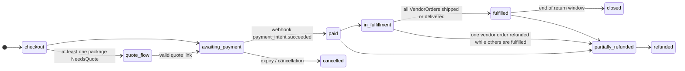

# 07 — Cart, checkout, orders, payments and returns

## 7.1 How it works today

- **A single WooCommerce `shop_order`** per checkout, with one row per vendor in the
  `wcfm_marketplace_orders` table (commissions) and shipping lines with `vendor_id`. There are no real
  vendor sub-orders: the vendor view is reconstructed after the fact from the commissions table.
- Custom states: `quote-pending`, `quote-ready`, `quote-converted` (legacy).
- Settings: net prices, VAT based on the billing country, prices shown VAT-inclusive in the shop
  and VAT-exclusive in the cart; geolocation at checkout disabled.
- Gateways: `stripe_split` (destination charges) **and** `stripe_cc` without split, both active.
- Emails: WCFM "New Store Order" (suppressed in the quote states) + custom quote emails.
- **Refunds**: no procedure and no code; only per-vendor text policies.
- Protections: rate limiting on accounts and registrations, Turnstile, GET `?add-to-cart` requests rejected.

## 7.2 How it will work

### Models

```python
class Cart(Model):
    session_key / user; language; country_hint; created_at; updated_at
class CartLine(Model):
    cart; product; variant; quantity; added_price_net   # to warn if the price changes

class StockReservation(Model):                 # oversell prevention
    variant_or_product; cart; quantity; expires_at      # 15 minutes, renewed at checkout

class Order(Model):
    number (sequential with configurable prefix, e.g. "2027-000123"); public_id; customer (null = guest); email; language
    # the number is an order reference, never an invoice number: the vendor invoices (spec 00)
    billing_address; shipping_address (structured JSON + ISO country)
    customer_tax_status (b2c | b2b) ; vat_validation snapshot
    state = FSMField(...)                      # see diagram
    totals: goods_net, shipping_net, tax_total, grand_total (snapshot)
    payment_intent_ref; transfer_group
    legacy_wp_order_id

class VendorOrder(Model):                      # explicit vendor sub-order
    order; vendor; state = FSMField(...)
    goods_net; shipping_net; tax_total; gross_total
    shipping_choice (snapshot: carrier, zone, rate or quote)
    commission_snapshot (JSON: rule, percentage, fee)  # from compute_commission
    tax_profile_snapshot (JSON)
    tracking_number; carrier; shipped_at; delivered_at

class OrderLine(Model):                        # immutable snapshot
    vendor_order; product (null if deleted); sku; title; variant_label   # sku: display snapshot of the vendor label, never a reference
    unit_price_net; quantity; discount_net
    tax_rate; tax_reason; tax_amount; legal_note_key

class OrderEvent(Model):                       # readable timeline for customer, vendor, staff
    order; vendor_order (null); kind; payload; actor; created_at

class ReturnRequest(Model):                    # withdrawal / return
    order; vendor_order; lines (M2M + quantity); reason; kind ("withdrawal" | "warranty" | "other")
    state (requested → authorized → received → refunded | rejected); refund_amount
```

### Order privacy fields (owner decisions D-29, D-30)
- `Order.tax_retention_until`: 31 December of the order year plus 10, computed at order build in
  the business time zone (D-31). `Order.privacy_status`: `active`, `restricted_tax_only`,
  `anonymized`, changed only by the scrub service (see [11](11-compliance.md), "Order data
  retention and archive").
- The VIES log in the snapshot keeps the consultation time, the consultation number and the name
  returned by VIES.
- `Order.user` is a foreign key with `SET NULL`. The snapshot never joins live user or address
  tables: names, addresses and email are copied at order build.

### State machines



`VendorOrder`: `pending` → `accepted` → `shipped` (tracking) → `delivered` → `completed`;
or `cancelled` / `refunded`. The `Order` state is derived from the states of its vendor sub-orders.

### Checkout (service)

```python
def build_checkout(cart, address, customer_tax_input) -> CheckoutPreview:
    """For each vendor: lines → resolve_goods_tax → quote_shipping → resolve_shipping_tax.
    Returns per-vendor and overall totals, plus any NeedsQuote/Blocked outcomes."""


def place_order(preview, payment_method) -> Order:
    """Transaction: verifies prices and stock, confirms the StockReservation, creates Order, VendorOrder and lines
    with snapshots; creates the PaymentIntent (or the quote request)."""


def on_payment_succeeded(event) -> None:  # idempotent per event.id
    """Order → paid; decrements stock; compute_commission per VendorOrder; ledger; transfer per vendor;
    customer and vendor emails."""
```

### Payments: abstraction and Stripe Connect

```python
class PaymentGateway(Protocol):
    def create_payment(self, order: Order) -> PaymentRef
    def transfer_to_vendor(self, vendor_order: VendorOrder, amount: Decimal) -> TransferRef
    def refund(self, order: Order, amount: Decimal, lines) -> RefundRef
    def reverse_transfer(self, transfer: TransferRef, amount: Decimal) -> ReversalRef
    def parse_webhook(self, request) -> GatewayEvent    # signature verification mandatory
```

- First implementation: **Stripe Connect, Express accounts, "separate charges and transfers"**.
  A single PaymentIntent on the platform with `transfer_group = order.number`, then one transfer per
  vendor for the `vendor_net` amount. This is the model suited to **multi-vendor** carts: destination
  charges allow only one destination account per payment.
- A single payment collection flow: no "non-split" gateway leaving orphaned vendor credits.
- Vendor not connected (currently Vendor E) → products not purchasable (`on_request`) until the account is active.
- Connected accounts are in EU countries at go-live, since only EU-established vendors are
  admitted (D-21, [11](11-compliance.md) CMP.13). Vendor countries outside the EU and cross-border
  payouts are CMP.22. UK consumer consignments of £135 or less create no charge at all (CMP.14).
- Customer funds do not sit in the platform's accounts (D-08, decided: adviser opinion 2026-11-11): no PSD2
  licence is needed while every customer payment goes through Stripe Connect. Each transfer to a
  connected account is created automatically and tied to the charge (`source_transaction`), so
  there is no free balance of third-party money; refunds use `reverse_transfer`. Customer money is
  never collected on the operator's bank account. The customer terms state that payment through
  the platform discharges the debt towards the vendor (Italian civil code art. 1188); the vendor
  terms carry the Stripe Connected Account Agreement and the set-off clause (art. 1252) (CMP.5).
- Launch scope (owner decision D-09, 2026-11-11): **Stripe Connect only**, split at source, so the
  platform fee and the vendor payout are separated by the provider. Other payment methods come
  later behind a documented hook, the `PaymentProvider` interface and the dev page "how to add a
  payment method" (PAY.5): a provider must support a split or a deferred collection of the platform
  fee, refunds, and payout reconciliation. For a method that cannot split at source (proposed
  follow-up PAY.6, spec only): the platform fee becomes a ledger receivable netted from the
  vendor's next Stripe payout, with a vendor SEPA debit mandate as the fallback when the balance
  does not cover it.
- Idempotent webhooks (`ProcessedEvent` table), verified signature, retries handled.

### Refunds, withdrawal and returns

- Full or partial refund by line; VAT reversed using the rates in the snapshot.
- Ledger: proportional `refund` and `commission_reversal`; `reverse_transfer` towards the vendor.
- **Fees on a refund (owner decision D-05, 2026-11-11).** The platform gives back everything it
  took on the refunded order (percentage commission, collection cost, order-handling fee) and
  charges the vendor a **refund fee** instead, a new ledger line type. Refund fee = the real
  provider cost of that refund or chargeback, read from the provider's balance transaction (never a
  fixed table), plus a surcharge (default 2 EUR), the total **rounded up to the whole euro** (the one ceil; every
  other line stays `ROUND_HALF_UP`); every refund event is charged cost plus surcharge. Examples:
  provider cost 3.15 EUR + 2 EUR = 5.15 EUR, charged 6 EUR; a second partial refund with cost
  1.20 EUR + 2 EUR = 3.20 EUR, charged 4 EUR. Surcharge and ceil are configurable per plan on the
  versioned CommissionRule (VEN.2, VEN.33). A partial refund gives the fees back pro rata and
  charges one refund fee per refund event; a chargeback uses the dispute cost as the provider
  cost. The refund fee is charged to the vendor on every refund, withdrawal included; there is
  no split by cause, and the vendor may pass it on in its own return terms within the law.
  The one exception (L-10, owner, 2026-11-11, adviser opinion 2026-11-11) is a refund caused by a platform
  malfunction or error: the refund carries an exclusion flag with a reason, audited, and no refund
  fee is charged. The contract states the exact fixed part (EUR 2.00 at signature); a change of it
  is notified on a durable medium at least 15 days before and applies only to orders created from
  its effective date (a versioned plan parameter, VEN.33). The refund fee is a platform service
  with the commission's VAT treatment and a line of its own on the periodic statement (T-8, CMP.2). The clause that lets the platform charge it sits in the vendor terms (CMP.5, VEN.33).
- **Online withdrawal function** in the customer area (button labelled "withdraw from contract
  here", in Italian "recedere dal contratto qui", then a confirmation labelled "confirm withdrawal",
  in Italian "conferma recesso", and an acknowledgement on a durable medium with the date and time):
  mandatory from 2026-06-19 (directive (EU) 2023/2673; Italy: article 54-bis of the Codice del
  Consumo, added by legislative decree 209/2025), see [11](11-compliance.md).
- Return: request per line → vendor authorization (or automatic within 14 days for withdrawal)
  → receipt → refund.

### Customer area

Orders with timeline and tracking, quotes to confirm, withdrawal and returns, addresses, data export and
deletion (anonymization, see GDPR), preferred language. Guest checkout allowed.

**Preferences and request history (ORD.11, P2, scope to be defined).** The owner wants one section
of the customer account where the customer sees all their product information and quote requests
and sets other preferences, including following vendors and event notifications (owner decision
Q-74; event notifications are EVT.16, [15](15-events.md)). The owner has still to review its
content, so it is not designed here: ORD.11 is a placeholder with a small estimate, re-estimated
and detailed in this section once the owner's answers are in.

### Free gifts (P2, ORD.12, owner decision MQ-9)

A price is never 0.00, neither on a product nor on a variant ([03](03-catalog.md), Q-31), so a gift
is not a zero-priced product. It is a promotion, triggered by a coupon code or by a cart condition
(for example a minimum amount or a given product in the cart). The gift enters the order as its
own line at full price plus a discount of 100% of that line (`discount_net`), so VAT and
commission are computed per line as for any other line. Who funds the discount (the vendor, the
marketplace or both) follows the bundle funding rules ([03](03-catalog.md), CAT.16 to CAT.18).
The promotion tracks the gift's stock and a per-customer limit. VAT treatment (T-7, adviser opinion 2026-11-11):
a gift is allowed only as an in-kind discount on a paid order, with the gift's value at most the
value of the paid goods; never a standalone free supply.

### Transactional emails (in the recipient's language)

The platform sends order confirmations and order summaries, never invoices or receipts. Each
order confirmation is per vendor, carries the vendor's identity, and is labelled "Documento non
fiscale / Non-fiscal document" in the recipient's language; the vendor issues the invoice or
receipt with its own tools ([00](00-vision-and-review.md)).

Customer: order received, payment confirmed, shipped (tracking), quote received/ready,
refund, withdrawal registered. Vendor: new order (only after payment), quote to be entered,
fulfillment reminder, return requested, payout. Staff: anomalies (payment without transfer, failed
webhooks, quotes about to expire).

### Proof of intra-EU dispatch (ORD.13, owner decision D-28, needs human review)

A reverse-charge intra-EU supply (spec [05](05-tax.md), nature code `N3.2`) is exempt only if the
goods really left for another member state. For every vendor order taxed that way the platform
collects at least **two non-contradictory proofs issued by independent parties** (Implementing
Regulation (EU) 282/2011 art. 45a): a signed CMR, the carrier's invoice, a transport insurance
document, or the carrier's tracking record. Two proofs from the same party count as one, and two
proofs that disagree on destination or date count as none.

When the **buyer arranges the transport**, the buyer also sends a written receipt declaration
(goods received, date, destination member state), due by the **10th day of the month following the
dispatch**. The platform sends reminders before and after the deadline. The vendor sees a status
per vendor order (`proof_missing`, `proof_partial`, `proof_complete`, `declaration_pending`,
`declaration_overdue`); a vendor order without complete proof is flagged for the vendor and for
staff. The proofs are stored as private documents on the vendor order, with the party that issued
each of them.

## 7.3 Tasks

| ID | Micro-task | Pri | Hours | Depends on | Done when |
|---|---|---|---|---|---|
| ORD.1 | Cart, CartLine, guest/user session, merge on login | P1 | 8 | CAT.1 | Cart merge test |
| ORD.2 | Order, VendorOrder, OrderLine with snapshots, numbering, FSM | P1 | 12 | ORD.1 | Illegal transitions impossible (test) |
| ORD.3 | `build_checkout` (tax + shipping per vendor), preview and blocking messages | P1 | 12 | TAX.4, SHP.4 | Mixed 3-vendor cart correct |
| ORD.4 | Transactional `place_order` with StockReservation and price verification | P1 | 10 | ORD.2 | Concurrency test on stock 1 |
| ORD.5 | Cart and checkout UI (HTMX), conditional B2B fields, VIES, Turnstile | P1 | 16 | ORD.3, TAX.5 | Checkout keyboard-accessible |
| PAY.1 | `PaymentGateway` + Stripe implementation (PaymentIntent, transfer_group); owner decision D-09 (2026-11-11): Stripe Connect is the only payment provider at launch, split at source (platform fee versus vendor payout); no other method is built or offered at checkout until PAY.5 and a provider that passes its checklist exist; D-08 decided (adviser opinion 2026-11-11): no PSD2 licence while every customer payment goes through Stripe Connect, and no payment flow collects customer money on an operator bank account | P1 | 12 | ORD.4 | End-to-end test payment; checkout offers only the methods the Stripe provider reports; the platform fee and the vendor payout are separated at the provider, with no platform-side deferred collection; no configured payment flow has an operator bank account as the payee (test on the provider configuration) |
| PAY.2 | Signed, idempotent webhooks, `on_payment_succeeded` | P1 | 8 | PAY.1, VEN.4 | Duplicate event has no effect |
| PAY.3 | Transfer per vendor, reverse transfer, reconciliation with the ledger (D-08, adviser opinion 2026-11-11): every transfer is created automatically on payment and tied to the charge with `source_transaction`, so no free platform balance of third-party money exists; a refund reverses the vendor's share with `reverse_transfer` | P1 | 10 | PAY.2 | 3 vendors in one order: 3 correct transfers; every transfer in the test carries `source_transaction` equal to the order's charge; a refund test calls `reverse_transfer` and leaves no unassigned platform balance |
| PAY.4 | Full/partial refunds with VAT and fees reversed (owner decision D-05, 2026-11-11): the platform gives back the commission, the collection cost and the order-handling fee of the refunded order and charges the vendor a refund fee instead; refund fee = real provider cost of the refund or chargeback taken from the provider's balance transaction + the plan's surcharge (default 2 EUR, charged on every refund event), the total rounded up to the whole euro, read from the VEN.2 CommissionRule in force on the order snapshot (VEN.33); partial refund: fees given back pro rata, one refund fee per refund event; chargeback: the dispute cost is the provider cost; the refund fee is charged to the vendor on every refund, withdrawal included (no cause-based split; the vendor may pass it on in its own return terms within the law), except a refund caused by a platform malfunction or error (L-10, adviser opinion 2026-11-11): an exclusion flag with a required reason on the refund, set only by platform staff, audited, charges no refund fee; the surcharge is read from the plan version whose effective date covers the order's creation (VEN.33); the refund fee is a platform service line for the CMP.2 statement (T-8); money rules (`Decimal`, `ROUND_HALF_UP` per line, the ceil to the euro the only exception); the service accepts `dry_run=True` and returns a `ChangeSet`, writes `AuditLog`; the PR is flagged for human review (ledger and payments code) | P1 | 10 | PAY.3, VEN.33 | Partial refund cases green; full refund returns all three fees and writes one refund fee line; a partial refund returns the fees pro rata and each further refund event writes its own refund fee; regression case (owner, 2026-11-11): provider cost 3.15 EUR + 2 EUR surcharge = 5.15 EUR, charged 6 EUR; provider cost 1.37 EUR plus surcharge 2.00 gives 4.00 EUR and an exact 3.00 EUR total stays 3.00 EUR (ceil to the euro); a second partial refund on the same order with provider cost 1.20 EUR + 2 EUR = 3.20 EUR is charged 4 EUR (every refund event carries the surcharge); a chargeback charges the dispute cost plus surcharge; the same refund charges the vendor whether the cause is a withdrawal, a defect or a vendor error; a refund flagged as a platform malfunction or error charges no refund fee and gives the fees back as usual; setting the flag without a reason is refused and setting it writes an `AuditLog` entry; an order created before a surcharge change keeps the old surcharge; the provider cost comes from the balance transaction fixture, not a constant; the plan's surcharge and ceil are read from the snapshot rule, never live; a dry run changes nothing and returns the ChangeSet; the ledger sums to zero for the order after the refund fee; every refund writes an `AuditLog` entry; the PR carries the human-review flag |
| PAY.5 | `PaymentProvider` interface (owner decision D-09, 2026-11-11; PAY.1 is its only implementation) and the dev page `docs/dev/payment-providers.md` "how to add a payment method": what a provider must support (split at source or a deferred collection of the platform fee, refunds with the balance-transaction cost for PAY.4, payout reconciliation for PAY.3, signed idempotent webhooks for PAY.2), the contract tests a new provider must pass, and the review steps (D-08 PSD2 check, CMP.5 terms); spec and docs only for now, the code lands with PAY.1 | P2 | 4 | PAY.1 | The dev page exists and lists the four capabilities, the contract-test checklist and the review steps; the interface in PAY.1 matches it and the Stripe provider is the only registered one; a provider missing a capability is refused at registration (test, when built) |
| PAY.6 | Non-split payment methods (proposed by lane-b on the owner's request for ideas, D-09, 2026-11-11; spec only, no code now, waits for the owner to schedule it; D-08 decided, adviser opinion 2026-11-11): allowed **only when the customer pays the vendor directly**, never with customer money collected on the operator's bank account; for such a method the platform fee becomes the platform's own receivable on the vendor, netted from the vendor's next Stripe payout; when the balance does not cover it, a vendor SEPA direct-debit mandate (signed in the Manager, audited, revocable) is the fallback; unpaid receivables are listed for staff and block nothing at checkout until the owner sets a ceiling; refunds of such orders reverse the receivable | P3 | 16 | PAY.5, PAY.4, VEN.4 | Owner schedules the build (counsel's D-08 answer is in); then: a non-split order is possible only with the vendor as the payee of the customer's payment (a test refuses a configuration where the operator receives it); it creates a receivable equal to the platform fee; the next payout is reduced by it; with too little balance a debit is requested under the mandate; a refund reverses the receivable; the ledger stays append-only and sums to the order |
| ORD.6 | Vendor fulfillment: accept, ship with tracking, delivered | P1 | 8 | ORD.2, CORE.9 | Vendor fulfills from its own panel |
| ORD.7 | Customer area: orders, timeline, tracking, quotes | P1 | 10 | ORD.2 | Parity with My Account |
| ORD.8 | Online withdrawal and returns flow | P1 | 12 | PAY.4, CMP.6, ARC.16 | Withdrawal button "withdraw from contract here" (IT "recedere dal contratto qui") visible for the whole withdrawal period, confirmation "confirm withdrawal" (IT "conferma recesso"), acknowledgement email with content, date and time |
| ORD.9 | Transactional emails per language (customer, vendor, staff); per-vendor order confirmation as a non-fiscal document | P1 | 10 | ORD.2, ARC.16 | All emails in EN, IT, DE, FR and ES with snapshot tests; the order confirmation (email and PDF) is per vendor, labelled "Documento non fiscale / Non-fiscal document" in all five languages, carries the order reference and never an invoice number, and no email or document calls itself an invoice or receipt |
| ORD.10 | Checkout and payments kill-switch, alert on payment without transfer | P1 | 4 | ARC.8, PAY.3 | Kill-switch verified on STAGE |
| ORD.11 | Customer account: preferences and request history (scope to be defined with the owner): one section listing the customer's product information and quote requests and holding preferences such as followed vendors and event notifications; placeholder, hours to be re-estimated once the scope is agreed | P2 | 4 | ORD.7, SHP.10 | The owner has agreed the scope, this row is re-estimated and the section is detailed in §7.2 before any code is written |
| ORD.12 | Free-gift promotion (owner decision MQ-9): triggered by a coupon code or a cart condition; adds the gift product at full price plus a 100% discount line; discount funding by the bundle funding rules (vendor, marketplace or split), gift stock reserved like any line, a per-customer limit; VAT and commission per line; gift rule (T-7, adviser opinion 2026-11-11): a gift is allowed only as an in-kind discount on a paid order, with the gift's value at most the value of the paid goods, never a standalone free supply | P2 | 10 | ORD.4, CAT.17 | A qualifying cart gets the gift line at full price and a 100% discount line; no line is priced 0.00; a vendor-funded and a marketplace-funded gift give the expected ledger rows; a customer over the limit gets no second gift; an out-of-stock gift is not added; VAT and commission are computed per line; a cart whose gift value would exceed the value of its paid goods gets no gift; an order with no paid goods line gets no gift |
| ORD.13 | Proof of intra-EU dispatch (owner decision D-28, art. 45a Reg. 282/2011): for every reverse-charge vendor order, at least two non-contradictory proofs from independent parties (signed CMR, carrier invoice, transport insurance, tracking) stored as private documents with the issuing party; when the buyer arranges transport, the buyer's written receipt declaration is due by the 10th of the following month, with reminders and a vendor-visible status | P1 | 10 | ORD.2, TAX.3, ARC.16 | A reverse-charge vendor order with one proof, or two from the same party, or two contradictory ones, shows `proof_partial` to the vendor; two independent consistent proofs give `proof_complete`; a buyer-arranged order without the declaration shows `declaration_pending`, gets reminders and is `declaration_overdue` after the 10th of the next month; a domestic or VAT-charged order needs none |
| ORD.14 | Order privacy masking, the vendor "accounting" role and the Tax/Audit permission (D-29, D-30): in `restricted_tax_only` the personal fields (name, addresses, email, phone, tax ids) are masked (for example `j***@example.com`) in every ordinary vendor, support and customer-facing UI, in the API and in exports; in clear only for the vendor owner, a new vendor role "accounting" (assigned by the owner, own orders only) and the platform Tax/Audit permission (a CORE.18 role); every in-clear view needs a reason and writes an `AuditLog` entry with actor, order, time and reason; Support impersonation never reveals the clear fields | P1 | 10 | ORD.2, CORE.18, CORE.17, ARC.9 | A `restricted_tax_only` seed order is masked for a vendor member, a Support user, the API and the CSV export, and in clear for the vendor owner, a vendor accounting member (own vendor only) and a platform Tax/Audit holder; a reasonless reveal is refused; each reveal writes an `AuditLog` entry with actor, order, time and reason; an `active` order is shown normally; the owner can assign and remove the accounting role and no other member can |
| ORD.15 | Vendor fiscal evidence package (D-30): a download per order for the vendor, while the order is `active` or `restricted_tax_only`, holding the order snapshot, the VIES log (time, number, returned name) and the transport proofs; personal fields in clear only to those allowed by ORD.14 (every download audited with a reason); no invoices, the platform issues none; refused once the order is `anonymized` | P1 | 6 | ORD.2, ORD.14, VEN.12 | A seed order's package holds the snapshot, the VIES log with the returned name and the transport proofs; a vendor member without the owner or accounting role gets the masked version; the download is in the `AuditLog`; an `anonymized` order has no package |
| ORD.16 | Email language follow-ups (coherence check 19, ORD.9 1/2 leftovers): the German, French and Spanish bodies of every ORD.9 email are translated (today they fall back to English); vendors get a mail language setting, and vendor mails use it, with the platform language as the fallback | P2 | 4 | ORD.9, I18N.7 | Each ORD.9 email renders in the five languages with no English fallback in de, fr and es (snapshot tests); a vendor with a language set receives mails in it, a vendor with none in the platform language |
