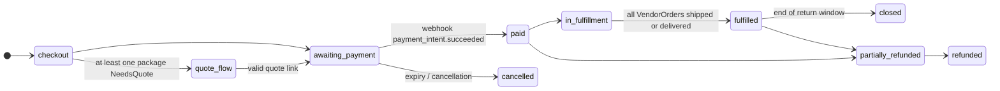

# 07 — Cart, checkout, orders, payments and returns

## 7.1 How it works today

- **A single WooCommerce `shop_order`** per checkout, with one row per vendor in the
  `wcfm_marketplace_orders` table (commissions) and shipping lines with `vendor_id`. There are no real
  vendor sub-orders: the vendor view is reconstructed after the fact from the commissions table.
- Custom states: `quote-pending`, `quote-ready`, `quote-converted` (legacy).
- Settings: net prices, VAT based on the billing country, prices shown VAT-inclusive in the shop
  and VAT-exclusive in the cart; geolocation at checkout disabled.
- Gateways: `stripe_split` (destination charges) **and** `stripe_cc` without split, both active.
- Emails: WCFM "New Store Order" (suppressed in the quote states) + custom quote emails.
- **Refunds**: no procedure and no code; only per-vendor text policies.
- Protections: rate limiting on accounts and registrations, Turnstile, GET `?add-to-cart` requests rejected.

## 7.2 How it will work

### Models

```python
class Cart(Model):
    session_key / user; language; country_hint; created_at; updated_at
class CartLine(Model):
    cart; product; variant; quantity; added_price_net   # to warn if the price changes

class StockReservation(Model):                 # oversell prevention
    variant_or_product; cart; quantity; expires_at      # 15 minutes, renewed at checkout

class Order(Model):
    number (sequential with configurable prefix, e.g. "2027-000123"); public_id; customer (null = guest); email; language
    # the number is an order reference, never an invoice number: the vendor invoices (spec 00)
    billing_address; shipping_address (structured JSON + ISO country)
    customer_tax_status (b2c | b2b) ; vat_validation snapshot
    state = FSMField(...)                      # see diagram
    totals: goods_net, shipping_net, tax_total, grand_total (snapshot)
    payment_intent_ref; transfer_group
    legacy_wp_order_id

class VendorOrder(Model):                      # explicit vendor sub-order
    order; vendor; state = FSMField(...)
    goods_net; shipping_net; tax_total; gross_total
    shipping_choice (snapshot: carrier, zone, rate or quote)
    commission_snapshot (JSON: rule, percentage, fee)  # from compute_commission
    tax_profile_snapshot (JSON)
    tracking_number; carrier; shipped_at; delivered_at

class OrderLine(Model):                        # immutable snapshot
    vendor_order; product (null if deleted); sku; title; variant_label   # sku: display snapshot of the vendor label, never a reference
    unit_price_net; quantity; discount_net
    tax_rate; tax_reason; tax_amount; legal_note_key

class OrderEvent(Model):                       # readable timeline for customer, vendor, staff
    order; vendor_order (null); kind; payload; actor; created_at

class ReturnRequest(Model):                    # withdrawal / return
    order; vendor_order; lines (M2M + quantity); reason; kind ("withdrawal" | "warranty" | "other")
    state (requested → authorized → received → refunded | rejected); refund_amount
```

### State machines



`VendorOrder`: `pending` → `accepted` → `shipped` (tracking) → `delivered` → `completed`;
or `cancelled` / `refunded`. The `Order` state is derived from the states of its vendor sub-orders.

### Checkout (service)

```python
def build_checkout(cart, address, customer_tax_input) -> CheckoutPreview:
    """For each vendor: lines → resolve_goods_tax → quote_shipping → resolve_shipping_tax.
    Returns per-vendor and overall totals, plus any NeedsQuote/Blocked outcomes."""


def place_order(preview, payment_method) -> Order:
    """Transaction: verifies prices and stock, confirms the StockReservation, creates Order, VendorOrder and lines
    with snapshots; creates the PaymentIntent (or the quote request)."""


def on_payment_succeeded(event) -> None:  # idempotent per event.id
    """Order → paid; decrements stock; compute_commission per VendorOrder; ledger; transfer per vendor;
    customer and vendor emails."""
```

### Payments: abstraction and Stripe Connect

```python
class PaymentGateway(Protocol):
    def create_payment(self, order: Order) -> PaymentRef
    def transfer_to_vendor(self, vendor_order: VendorOrder, amount: Decimal) -> TransferRef
    def refund(self, order: Order, amount: Decimal, lines) -> RefundRef
    def reverse_transfer(self, transfer: TransferRef, amount: Decimal) -> ReversalRef
    def parse_webhook(self, request) -> GatewayEvent    # signature verification mandatory
```

- First implementation: **Stripe Connect, Express accounts, "separate charges and transfers"**.
  A single PaymentIntent on the platform with `transfer_group = order.number`, then one transfer per
  vendor for the `vendor_net` amount. This is the model suited to **multi-vendor** carts: destination
  charges allow only one destination account per payment.
- A single payment collection flow: no "non-split" gateway leaving orphaned vendor credits.
- Vendor not connected (currently Vendor E) → products not purchasable (`on_request`) until the account is active.
- Connected accounts are in EU countries at go-live, since only EU-established vendors are
  admitted (D-21, [11](11-compliance.md) CMP.13). Vendor countries outside the EU and cross-border
  payouts are CMP.22. UK consumer consignments of £135 or less create no charge at all (CMP.14).
- Customer funds do not sit in the platform's accounts beyond the technical time needed for the
  transfer (PSD2 constraint, to be confirmed with the advisor: D-08).
- Methods: cards, Apple Pay and Google Pay; other Stripe methods (SEPA, PayPal via Stripe) to be checked
  for compatibility with transfers (D-09).
- Idempotent webhooks (`ProcessedEvent` table), verified signature, retries handled.

### Refunds, withdrawal and returns

- Full or partial refund by line; VAT reversed using the rates in the snapshot.
- Ledger: proportional `refund` and `commission_reversal`; `reverse_transfer` towards the vendor.
- **Online withdrawal function** in the customer area (button labelled "withdraw from contract
  here", in Italian "recedere dal contratto qui", then a confirmation labelled "confirm withdrawal",
  in Italian "conferma recesso", and an acknowledgement on a durable medium with the date and time):
  mandatory from 2026-06-19 (directive (EU) 2023/2673; Italy: article 54-bis of the Codice del
  Consumo, added by legislative decree 209/2025), see [11](11-compliance.md).
- Return: request per line → vendor authorization (or automatic within 14 days for withdrawal)
  → receipt → refund.

### Customer area

Orders with timeline and tracking, quotes to confirm, withdrawal and returns, addresses, data export and
deletion (anonymization, see GDPR), preferred language. Guest checkout allowed.

**Preferences and request history (ORD.11, P2, scope to be defined).** The owner wants one section
of the customer account where the customer sees all their product information and quote requests
and sets other preferences, including following vendors and event notifications (owner decision
Q-74; event notifications are EVT.16, [15](15-events.md)). The owner has still to review its
content, so it is not designed here: ORD.11 is a placeholder with a small estimate, re-estimated
and detailed in this section once the owner's answers are in.

### Free gifts (P2, ORD.12, owner decision MQ-9)

A price is never 0.00, neither on a product nor on a variant ([03](03-catalog.md), Q-31), so a gift
is not a zero-priced product. It is a promotion, triggered by a coupon code or by a cart condition
(for example a minimum amount or a given product in the cart). The gift enters the order as its
own line at full price plus a discount of 100% of that line (`discount_net`), so VAT and
commission are computed per line as for any other line. Who funds the discount (the vendor, the
marketplace or both) follows the bundle funding rules ([03](03-catalog.md), CAT.16 to CAT.18).
The promotion tracks the gift's stock and a per-customer limit. The VAT treatment of gifts (free
transfers of goods) is confirmed by the operator's accountant before the row is built (⚖️).

### Transactional emails (in the recipient's language)

The platform sends order confirmations and order summaries, never invoices or receipts. Each
order confirmation is per vendor, carries the vendor's identity, and is labelled "Documento non
fiscale / Non-fiscal document" in the recipient's language; the vendor issues the invoice or
receipt with its own tools ([00](00-vision-and-review.md)).

Customer: order received, payment confirmed, shipped (tracking), quote received/ready,
refund, withdrawal registered. Vendor: new order (only after payment), quote to be entered,
fulfillment reminder, return requested, payout. Staff: anomalies (payment without transfer, failed
webhooks, quotes about to expire).

## 7.3 Tasks

| ID | Micro-task | Pri | Hours | Depends on | Done when |
|---|---|---|---|---|---|
| ORD.1 | Cart, CartLine, guest/user session, merge on login | P1 | 8 | CAT.1 | Cart merge test |
| ORD.2 | Order, VendorOrder, OrderLine with snapshots, numbering, FSM | P1 | 12 | ORD.1 | Illegal transitions impossible (test) |
| ORD.3 | `build_checkout` (tax + shipping per vendor), preview and blocking messages | P1 | 12 | TAX.4, SHP.4 | Mixed 3-vendor cart correct |
| ORD.4 | Transactional `place_order` with StockReservation and price verification | P1 | 10 | ORD.2 | Concurrency test on stock 1 |
| ORD.5 | Cart and checkout UI (HTMX), conditional B2B fields, VIES, Turnstile | P1 | 16 | ORD.3, TAX.5 | Checkout keyboard-accessible |
| PAY.1 | `PaymentGateway` + Stripe implementation (PaymentIntent, transfer_group) | P1 | 12 | ORD.4 | End-to-end test payment |
| PAY.2 | Signed, idempotent webhooks, `on_payment_succeeded` | P1 | 8 | PAY.1, VEN.4 | Duplicate event has no effect |
| PAY.3 | Transfer per vendor, reverse transfer, reconciliation with the ledger | P1 | 10 | PAY.2 | 3 vendors in one order: 3 correct transfers |
| PAY.4 | Full/partial refunds with VAT and commissions reversed | P1 | 10 | PAY.3 | Partial refund cases green |
| ORD.6 | Vendor fulfillment: accept, ship with tracking, delivered | P1 | 8 | ORD.2, CORE.9 | Vendor fulfills from its own panel |
| ORD.7 | Customer area: orders, timeline, tracking, quotes | P1 | 10 | ORD.2 | Parity with My Account |
| ORD.8 | Online withdrawal and returns flow | P1 | 12 | PAY.4, CMP.6, ARC.16 | Withdrawal button "withdraw from contract here" (IT "recedere dal contratto qui") visible for the whole withdrawal period, confirmation "confirm withdrawal" (IT "conferma recesso"), acknowledgement email with content, date and time |
| ORD.9 | Transactional emails per language (customer, vendor, staff); per-vendor order confirmation as a non-fiscal document | P1 | 10 | ORD.2, ARC.16 | All emails in EN, IT, DE, FR and ES with snapshot tests; the order confirmation (email and PDF) is per vendor, labelled "Documento non fiscale / Non-fiscal document" in all five languages, carries the order reference and never an invoice number, and no email or document calls itself an invoice or receipt |
| ORD.10 | Checkout and payments kill-switch, alert on payment without transfer | P1 | 4 | ARC.8, PAY.3 | Kill-switch verified on STAGE |
| ORD.11 | Customer account: preferences and request history (scope to be defined with the owner): one section listing the customer's product information and quote requests and holding preferences such as followed vendors and event notifications; placeholder, hours to be re-estimated once the scope is agreed | P2 | 4 | ORD.7, SHP.10 | The owner has agreed the scope, this row is re-estimated and the section is detailed in §7.2 before any code is written |
| ORD.12 | Free-gift promotion (owner decision MQ-9): triggered by a coupon code or a cart condition; adds the gift product at full price plus a 100% discount line; discount funding by the bundle funding rules (vendor, marketplace or split), gift stock reserved like any line, a per-customer limit; VAT and commission per line; the gift VAT treatment confirmed by the accountant (⚖️) | P2 | 10 | ORD.4, CAT.17 | A qualifying cart gets the gift line at full price and a 100% discount line; no line is priced 0.00; a vendor-funded and a marketplace-funded gift give the expected ledger rows; a customer over the limit gets no second gift; an out-of-stock gift is not added; VAT and commission are computed per line |
| ORD.14 | Archive masking and the Tax/Audit permission (D-29): orders past the active phase (default 24 months) show masked personal fields (name, addresses, email, phone, tax ids) in the ordinary vendor and support UI and in exports; a dedicated Tax/Audit permission, in a platform variant (platform space) and a vendor variant (own orders only), reveals them; every reveal is in the `AuditLog` with actor, order and reason; Support impersonation never reveals them | P1 | 8 | ORD.2, CORE.18, CORE.17, ARC.9 | A seed order of 25 months is masked for a vendor member and a Support user and readable for a vendor Tax/Audit holder (own order only) and a platform Tax/Audit holder; a vendor variant cannot read another vendor's order; each reveal writes an `AuditLog` entry; an order of 3 months is shown normally; masking also applies to the API and CSV export |
