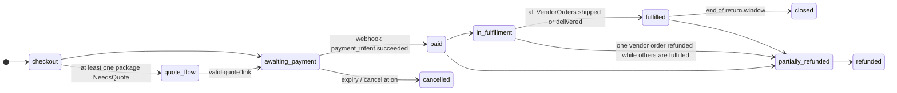

# 07 — Cart, checkout, orders, payments and returns

## 7.1 How it works today

- **A single WooCommerce `shop_order`** per checkout, with one row per vendor in the
  `wcfm_marketplace_orders` table (commissions) and shipping lines with `vendor_id`. There are no real
  vendor sub-orders: the vendor view is reconstructed after the fact from the commissions table.
- Custom states: `quote-pending`, `quote-ready`, `quote-converted` (legacy).
- Settings: net prices, VAT based on the billing country, prices shown VAT-inclusive in the shop
  and VAT-exclusive in the cart; geolocation at checkout disabled.
- Gateways: `stripe_split` (destination charges) **and** `stripe_cc` without split, both active.
- Emails: WCFM "New Store Order" (suppressed in the quote states) + custom quote emails.
- **Refunds**: no procedure and no code; only per-vendor text policies.
- Protections: rate limiting on accounts and registrations, Turnstile, GET `?add-to-cart` requests rejected.

## 7.2 How it will work

### Models

```python
class Cart(Model):
    session_key / user; language; country_hint; created_at; updated_at
class CartLine(Model):
    cart; product; variant; quantity; added_price_net   # to warn if the price changes

class StockReservation(Model):                 # oversell prevention
    variant_or_product; cart; quantity; expires_at      # 15 minutes, renewed at checkout

class Order(Model):
    number (sequential with configurable prefix, e.g. "2027-000123"); public_id; customer (null = guest); email; language
    # the number is an order reference, never an invoice number: the vendor invoices (spec 00)
    billing_address; shipping_address (structured JSON + ISO country)
    customer_tax_status (b2c | b2b) ; vat_validation snapshot
    state = FSMField(...)                      # see diagram
    totals: goods_net, shipping_net, tax_total, grand_total (snapshot)
    payment_intent_ref; transfer_group
    legacy_wp_order_id

class VendorOrder(Model):                      # explicit vendor sub-order
    order; vendor; state = FSMField(...)
    goods_net; shipping_net; tax_total; gross_total
    shipping_choice (snapshot: carrier, zone, rate or quote)
    commission_snapshot (JSON: rule, percentage, fee)  # from compute_commission
    tax_profile_snapshot (JSON)
    tracking_number; carrier; shipped_at; delivered_at

class OrderLine(Model):                        # immutable snapshot
    vendor_order; product (null if deleted); sku; title; variant_label   # sku: display snapshot of the vendor label, never a reference
    unit_price_net; quantity; discount_net
    tax_rate; tax_reason; tax_amount; legal_note_key

class OrderEvent(Model):                       # readable timeline for customer, vendor, staff
    order; vendor_order (null); kind; payload; actor; created_at

class ReturnRequest(Model):                    # withdrawal / return
    order; vendor_order; lines (M2M + quantity); reason; kind ("withdrawal" | "warranty" | "other")
    state (requested → authorized → received → refunded | rejected); refund_amount
```

### Order privacy fields (owner decisions D-29, D-30)
- `Order.tax_retention_until`: 31 December of the order year plus 10, computed at order build in
  the business time zone (D-31). `Order.privacy_status`: `active`, `restricted_tax_only`,
  `anonymized`, changed only by the scrub service (see [11](11-compliance.md), "Order data
  retention and archive").
- The VIES log in the snapshot keeps the consultation time, the consultation number and the name
  returned by VIES.
- `Order.user` is a foreign key with `SET NULL`. The snapshot never joins live user or address
  tables: names, addresses and email are copied at order build.

### State machines



`VendorOrder`: `pending` → `accepted` → `shipped` (tracking) → `delivered` → `completed`;
or `cancelled` / `refunded`. The `Order` state is derived from the states of its vendor sub-orders.

### Checkout (service)

```python
def build_checkout(cart, address, customer_tax_input) -> CheckoutPreview:
    """For each vendor: lines → resolve_goods_tax → quote_shipping → resolve_shipping_tax.
    Returns per-vendor and overall totals, plus any NeedsQuote/Blocked outcomes."""


def place_order(preview, payment_method) -> Order:
    """Transaction: verifies prices and stock, confirms the StockReservation, creates Order, VendorOrder and lines
    with snapshots; creates the PaymentIntent (or the quote request)."""


def on_payment_succeeded(event) -> None:  # idempotent per event.id
    """Order → paid; decrements stock; compute_commission per VendorOrder; ledger; transfer per vendor;
    customer and vendor emails."""
```

### Payments: abstraction and Stripe Connect

```python
class PaymentGateway(Protocol):
    def create_payment(self, order: Order) -> PaymentRef
    def transfer_to_vendor(self, vendor_order: VendorOrder, amount: Decimal) -> TransferRef
    def refund(self, order: Order, amount: Decimal, lines) -> RefundRef
    def reverse_transfer(self, transfer: TransferRef, amount: Decimal) -> ReversalRef
    def parse_webhook(self, request) -> GatewayEvent    # signature verification mandatory
```

- First implementation: **Stripe Connect, Express accounts, "separate charges and transfers"**.
  A single PaymentIntent on the platform with `transfer_group = order.number`, then one transfer per
  vendor for the `vendor_net` amount. This is the model suited to **multi-vendor** carts: destination
  charges allow only one destination account per payment.
- A single payment collection flow: no "non-split" gateway leaving orphaned vendor credits.
- Vendor not connected (currently Vendor E) → products not purchasable (`on_request`) until the account is active.
- Connected accounts are in EU countries at go-live, since only EU-established vendors are
  admitted (D-21, [11](11-compliance.md) CMP.13). Vendor countries outside the EU and cross-border
  payouts are CMP.22. UK consumer consignments of £135 or less create no charge at all (CMP.14).
- Customer funds do not sit in the platform's accounts (D-08, decided: adviser opinion 2026-11-11): no PSD2
  licence is needed while every customer payment goes through Stripe Connect. Each transfer to a
  connected account is created automatically and tied to the charge (`source_transaction`), so
  there is no free balance of third-party money; refunds use `reverse_transfer`. Customer money is
  never collected on the operator's bank account. The customer terms state that payment through
  the platform discharges the debt towards the vendor (Italian civil code art. 1188); the vendor
  terms carry the Stripe Connected Account Agreement and the set-off clause (art. 1252) (CMP.5).
- Launch scope (owner decision D-09, 2026-11-11): **Stripe Connect only**, split at source, so the
  platform fee and the vendor payout are separated by the provider. Other payment methods come
  later behind a documented hook, the `PaymentProvider` interface and the dev page "how to add a
  payment method" (PAY.5): a provider must support a split or a deferred collection of the platform
  fee, refunds, and payout reconciliation. For a method that cannot split at source (proposed
  follow-up PAY.6, spec only): the platform fee becomes a ledger receivable netted from the
  vendor's next Stripe payout, with a vendor SEPA debit mandate as the fallback when the balance
  does not cover it.
- Idempotent webhooks (`ProcessedEvent` table), verified signature, retries handled.

### Refunds, withdrawal and returns

- Full or partial refund by line; VAT reversed using the rates in the snapshot.
- Ledger: proportional `refund` and `commission_reversal`; `reverse_transfer` towards the vendor.
- **Fees on a refund (owner decision D-05, 2026-11-11).** The platform gives back everything it
  took on the refunded order (percentage commission, collection cost, order-handling fee) and
  charges the vendor a **refund fee** instead, a new ledger line type. Refund fee = the real
  provider cost of that refund or chargeback, read from the provider's balance transaction (never a
  fixed table), plus a surcharge (default 2 EUR), the total **rounded up to the whole euro** (the one ceil; every
  other line stays `ROUND_HALF_UP`); every refund event is charged cost plus surcharge. Examples:
  provider cost 3.15 EUR + 2 EUR = 5.15 EUR, charged 6 EUR; a second partial refund with cost
  1.20 EUR + 2 EUR = 3.20 EUR, charged 4 EUR. Surcharge and ceil are configurable per plan on the
  versioned CommissionRule (VEN.2, VEN.33). A partial refund gives the fees back pro rata and
  charges one refund fee per refund event; a chargeback uses the dispute cost as the provider
  cost. The refund fee is charged to the vendor on every refund, withdrawal included; there is
  no split by cause, and the vendor may **not** pass it on to consumers in its return terms (owner's legal review 2026-11-13: Codice del consumo artt. 56-57 forbid charging the consumer refund handling costs).
  The one exception (L-10, owner, 2026-11-11, adviser opinion 2026-11-11) is a refund caused by a platform
  malfunction or error: the refund carries an exclusion flag with a reason, audited, and no refund
  fee is charged. The contract states the exact fixed part (EUR 2.00 at signature); a change of it
  is notified on a durable medium at least 15 days before and applies only to orders created from
  its effective date (a versioned plan parameter, VEN.33). The refund fee is a platform service
  with the commission's VAT treatment and a line of its own on the periodic statement (T-8, CMP.2). The clause that lets the platform charge it sits in the vendor terms (CMP.5, VEN.33).
- **Online withdrawal function** in the customer area (button labelled "withdraw from contract
  here", in Italian "recedere dal contratto qui", then a confirmation labelled "confirm withdrawal",
  in Italian "conferma recesso", and an acknowledgement on a durable medium with the date and time):
  mandatory from 2026-06-19 (directive (EU) 2023/2673; Italy: article 54-bis of the Codice del
  Consumo, added by legislative decree 209/2025), see [11](11-compliance.md).
- Return: request per line → vendor authorization (or automatic within 14 days for withdrawal)
  → receipt → refund.

### Customer area

Orders with timeline and tracking, quotes to confirm, withdrawal and returns, addresses, data export and
deletion (anonymization, see GDPR), preferred language. Guest checkout allowed.

**Preferences and request history (ORD.11, P2, scope to be defined).** The owner wants one section
of the customer account where the customer sees all their product information and quote requests
and sets other preferences, including following vendors and event notifications (owner decision
Q-74; event notifications are EVT.16, [15](15-events.md)). The owner has still to review its
content, so it is not designed here: ORD.11 is a placeholder with a small estimate, re-estimated
and detailed in this section once the owner's answers are in.

### Free gifts (P2, ORD.12, owner decision MQ-9)

A price is never 0.00, neither on a product nor on a variant ([03](03-catalog.md), Q-31), so a gift
is not a zero-priced product. It is a promotion, triggered by a coupon code or by a cart condition
(for example a minimum amount or a given product in the cart). The gift enters the order as its
own line at full price plus a discount of 100% of that line (`discount_net`), so VAT and
commission are computed per line as for any other line. Who funds the discount follows the coupon rules of [18](18-promotions-coupons.md) §18.3: the
gift's issuer (the vendor or the platform) is its only funder, with no co-funding in v1, and a
platform-funded gift reduces the commission (Q-90). The split funding of bundles (CAT.16 to
CAT.18) stays a bundle rule.
The promotion tracks the gift's stock and a per-customer limit. VAT treatment (T-7, adviser opinion 2026-11-11):
a gift is allowed only as an in-kind discount on a paid order, with the gift's value at most the
value of the paid goods; never a standalone free supply.
Proposal D-39 ([18](18-promotions-coupons.md)) would build the gift as the `gift` kind of a general
coupon engine (PRM.1 to PRM.5), funded by whoever sets the promotion up (decided).

### Transactional emails (in the recipient's language)

The platform sends order confirmations and order summaries, never invoices or receipts. Each
order confirmation is per vendor, carries the vendor's identity, and is labelled "Documento non
fiscale / Non-fiscal document" in the recipient's language; the vendor issues the invoice or
receipt with its own tools ([00](00-vision-and-review.md)).

Customer: order received, payment confirmed, shipped (tracking), quote received/ready,
refund, withdrawal registered. Vendor: new order (only after payment), quote to be entered,
fulfillment reminder, return requested, payout. Staff: anomalies (payment without transfer, failed
webhooks, quotes about to expire).

### Proof of intra-EU dispatch (ORD.13, owner decision D-28, needs human review)

A reverse-charge intra-EU supply (spec [05](05-tax.md), nature code `N3.2`) is exempt only if the
goods really left for another member state. For every vendor order taxed that way the platform
collects at least **two non-contradictory proofs issued by independent parties** (Implementing
Regulation (EU) 282/2011 art. 45a): a signed CMR, the carrier's invoice, a transport insurance
document, or the carrier's tracking record. Two proofs from the same party count as one, and two
proofs that disagree on destination or date count as none.

When the **buyer arranges the transport**, the buyer also sends a written receipt declaration
(goods received, date, destination member state), due by the **10th day of the month following the
dispatch**. The platform sends reminders before and after the deadline. The vendor sees a status
per vendor order (`proof_missing`, `proof_partial`, `proof_complete`, `declaration_pending`,
`declaration_overdue`); a vendor order without complete proof is flagged for the vendor and for
staff. The proofs are stored as private documents on the vendor order, with the party that issued
each of them.

### Checkout legal step (ORD.17, owner decision D-40)

The last step before payment, in the core checkout and in any checkout module, follows the counsel opinion of
2026-11-13 (questions L-1 to L-6, D-40). Each seller's sales terms must be readable **before** the button: sending them
only after payment would leave them out of the contract (art. 1341(1) c.c.; artt. 49 and 51 Codice del consumo), and the
right of withdrawal does not cure missing pre-contractual information (art. 53 extends withdrawal by 12 months; art. 57
moves the return costs to the seller; the platform answers for its interface under art. 31 DSA).

**Per seller, in that seller's block of the recap** (in clear or in an accordion that opens on the same page):

- the goods, quantities, prices, VAT and that seller's shipping cost;
- identity: full legal name, "professional seller" status (or not, art. 49-bis), geographic address, VAT or registration
  number, contact email;
- the split of obligations: the sales contract is concluded directly with the seller, who is responsible for shipping,
  conformity, invoicing, returns and withdrawals; the platform provides the marketplace service and collects the payment;
- the delivery time the seller commits to (a date or a range);
- withdrawal for consumers: 14 days from delivery, also through the online withdrawal button; who pays the direct cost
  of returning the goods; for goods that cannot normally be returned by post (pallet, bulky), a reasonable estimate of
  the maximum return cost (art. 49(1)(i)); if it is missing, the seller pays the return;
- the legal guarantee reminder (24 months for consumers) and, when the buyer used the garage, the selected item with
  "Compatibility declared by the seller" (D-38);
- a link "Sales terms of <seller> (version <n> of <date>, download PDF)" that opens a printable page or downloads the
  version in force (art. 12(3) D.Lgs. 70/2003, mandatory for business buyers too).

**Right above the button, with no long text in between** (art. 51(2); CJEU C-249/21):

- the short list of goods and the final total with VAT, shipping and every other charge, with the share of each seller;
- **box 1**, mandatory for every buyer, unticked: the buyer declares to have read and to accept the platform's terms of
  use **and the sales terms of each seller named in the recap** (one link per seller), and to have read the privacy
  notice (an acknowledgement, not a consent: the order runs on the contract basis; any marketing consent is a separate,
  optional, unticked box);
- **box 2**, only between businesses: a **business buyer** (one who chose to buy as a business and gave a VAT number;
  the VIES result drives the tax treatment, not box 2: an unverified number still shows box 2, because the buyer
  declared to act as a business) **and** an Italian party, that
  is the operator established in Italy (`current_operator()`, never a literal) and/or at least one seller in the cart
  established in Italy (owner, 2026-11-13). It is the specific approval under artt. 1341 and 1342 c.c. of the onerous
  clauses, each named by **article number and title** (a generic "I approve all onerous clauses" is not valid): the
  platform terms' list when the operator is Italian (declared per version of the customer terms of use in the same
  structured form as VEN.35, kept with the CMP.5 versioned terms; the vendor-contract clauses of CMP.5 are not part of it), then the list each seller in the cart declared for the version
  in force (VEN.35) when that seller is established in Italy **or its terms choose Italian law**. Any other foreign
  seller's B2B terms follow its own law (Reg. (EC) 593/2008) and its court clause is valid through the pre-contract
  link and box 1 (art. 25 Reg. (EU) 1215/2012), so its clauses are not listed (owner chose this variant A, 2026-11-13).
  The owner chose counsel's option A (2026-11-13): box 2 is never shown to a consumer, because asking a consumer to
  approve clauses that are void for them (artt. 33-36 Codice del consumo) is a misleading practice;
- the button, whose label names the obligation to pay: "Confirm order and pay now – EUR <total>" (IT "Conferma ordine e
  paga ora – EUR <totale>"); never "Complete order" or "Send";
- after a redirect back from the provider (3-D Secure) and before the webhook: a "payment received, confirming" state
  with a short HTMX poll; only the webhook marks the order paid.

**Competent court and applicable law** (counsel confirmed the rule):

- consumer: the court of the consumer's residence, never moved by any term (art. 66-bis Codice del consumo; artt. 17-19
  Reg. (EU) 1215/2012), and the mandatory law of the consumer's habitual residence is kept (art. 6(2) Reg. (EC)
  593/2008);
- business: for disputes with the operator, the court of the operator's seat; for the sales contract, the court in the
  seller's terms, or, when the seller names none, the court of the seller's registered office (the fallback clause in
  the platform terms). In box 2 the court clause is one of the listed onerous clauses;
- the terms never link the retired EU ODR platform (Reg. (EU) 2024/3228 repealed Reg. 524/2013 from 2025-07-20).

The confirmation email carries, on a durable medium (the text or a PDF, not only a link), the accepted platform terms and
each seller's sales terms in the version of the order (art. 51(7)): this is the confirmation duty, never a substitute for
the information before the button. The ready-made texts of box 1, box 2 and the court clauses are in counsel's opinion
(kept private); the legal pages and the translations use them.

### Order amendments (ORD.20 to ORD.23, owner decision D-47)

Owner decision D-47 (2026-11-16, Q-99). After payment a vendor sometimes cannot ship exactly what
was sold: a line is out of stock, the price was wrong, the carrier changed, or the customer asks to
fix the address. Today the only tools are a refund (PAY.4, PAY.7) or a cancellation. An
**amendment** is a typed change to one `VendorOrder`, recomputed with the checkout engines, that is
either applied at once (minor) or proposed to the customer (substantial). Every rule below is a
service rule tested in the service, never only in a view. The PRs touch orders, payments, ledger,
tax and consumer law and carry the human-review flag.

**When.** Only on a paid vendor order in `pending` or `accepted`, never once it is `shipped`,
`delivered`, `completed`, `cancelled` or `refunded`. Before payment the quote flow (SHP.9 revisions)
handles changes, not amendments. While an amendment is open the vendor cannot mark the package
shipped (the ship action is refused with a message naming the open amendment); the vendor may
withdraw its own proposal first.

**Versions, never edits.** The `OrderLine` rows and the `VendorOrder` snapshot fields of the
placed order stay immutable. They are **version 1**. Each applied amendment writes a new
`VendorOrderVersion` (v2, v3…) holding the full snapshot of that version: lines (product, sku,
title, variant, unit price, quantity, discount, tax rate, reason, nature code, tax amount), shipping
choice (carrier, method, zone, special area, rate or quote with its revision), shipping address,
tax profile snapshot, totals and the commission snapshot. `VendorOrder.current_version` points to
the last applied one; a version is append-only (a database trigger refuses updates, as for the
order snapshot). Each version line carries a stable `line_key` that links it to the line it
replaces, so PAY.4 refunds, ORD.8 returns and the ORD.13 proofs work on the current version. The
shipping address becomes per vendor order from v2 on: an address change on one package of a
multi-vendor order never touches the other packages. `Order` totals are the sum of the current
versions. The commission rule stays the one frozen at payment (v1), and the refund-fee surcharge
stays the plan version of the order's creation (VEN.33): an amendment never re-reads a live rule.

```python
class VendorOrderVersion(Model):          # append-only; v1 is the placed order
    vendor_order; number; amendment (null for v1); snapshot (JSON, as above); totals; created_at

class OrderAmendment(Model):
    public_id; vendor_order; from_version; to_version (null until applied)
    changes (JSON, typed: carrier, address, price, remove_line, quantity_down, quantity_up,
             add_line, substitute, delivery_time)
    kind ("minor" or "substantial")       # set by classify_amendment, never by the actor
    initiator ("vendor_owner", "vendor_member", "platform_owner", "support")
    actor; reason (required); staff_note (required for platform staff)
    customer_request (channel, date, text; required for an address change on the customer's request)
    state                                 # see below
    preview (the ChangeSet: per-line before and after, tax, shipping, commission, money delta)
    fallback ("keep", "remove_unavailable_lines", "cancel_package")   # what a decline or expiry does
    expires_at; reminded_at; decided_at; decision_channel ("email_link", "customer_area")
    quote (FK ShippingQuote, null; ORD.23); payment_ref; refund_ref

class AmendmentLink(Model):               # one-time token, like QuoteLink: only the HMAC hash is stored
    amendment; token_hash; expires_at; used_at
```

`OrderAmendment` states: `draft` → `applied` (minor), or `draft` → `awaiting_quote` (ORD.23) →
`proposed` → `accepted` → `awaiting_payment` → `applied`; side exits `declined`, `expired`,
`withdrawn` (by the actor, or by the customer's withdrawal), `superseded` (the version moved under
it) and `discarded` (a draft never sent). The open states are `draft`, `awaiting_quote`, `proposed`,
`accepted` and `awaiting_payment`.

**One engine.** `engine.recompute_vendor_order(version, changes, ctx) -> AmendmentPreview` is a
pure function that replays the checkout: `resolve_goods_tax` per line, `quote_shipping` for the
package, `resolve_shipping_tax` (shipping follows the goods, TAX.17, so removing a line can move the
shipping VAT split), `compute_commission` with the frozen rule, and the money delta (gross to pay
or to refund). The tax date `TaxContext.on` stays the order's date for every version, so one vendor
order never mixes two rate tables (⚖️ (T) to confirm with the tax adviser, see D-47). The customer's
tax status (B2C or B2B and the VIES snapshot) is never amended; a destination change re-runs the
reverse-charge and OSS decisions and the ORD.13 proofs follow the final destination. A destination
that the engines answer with `Blocked`, a CMP.14 lead-only UK consignment or a TAX.21 block makes
the change impossible: the draft is refused with the engine's reason and never proposed.
`engine.classify_amendment(before, after, changes, initiator) -> "minor" | "substantial"` is pure
and decides the kind; the actor never picks it.

**Minor changes** (applied at once, the customer is told by email and in the order history):

1. A carrier or method change of the same vendor at the **same or a lower** shipping price, with a
   comparable delivery time: the new method's maximum delivery days exceed the old by at most the
   operator setting `amendment_comparable_delay_days` (default 2). If the new method costs more,
   the vendor absorbs it: the customer's shipping amount stays the same and no money moves. If it
   costs less, the difference is refunded.
2. A lower unit price, a lower quantity, or a line removed as unavailable: an automatic partial
   refund through PAY.4. The notice offers the customer "cancel the rest of this package", and the
   package cannot be marked shipped until the operator setting `amendment_cancel_hold_hours`
   (default 24) has passed since the notice, unless the customer answered earlier. A cancel of the
   rest is a full refund of the package under PAY.4 (refund fee charged to the vendor, D-05).
3. An address correction **requested by the customer** inside the same country and the same tax
   territory (TAX.1 `Territory`: Livigno, the Canary Islands or Northern Ireland count as a
   territory change), such as the house number or the intercom, when the recompute neither changes
   the tax nor raises the shipping. The request is recorded (channel, date, the customer's words).

A minor change never raises what the customer owes. If the recompute of a change listed as minor
gives a higher gross for the package (for example a removed line moves the shipping VAT split up by
more than the goods go down, or a cheaper carrier lands in a special area), the change is
classified substantial. Discounts stay per line as snapshotted: a removed line takes its own
discount share with it, and a coupon or free-shipping threshold that the amended package no longer
meets is kept (the customer never pays more because of a vendor's change).

**Substantial changes** (need the customer's acceptance, ORD.21):

- a substitute product (never shipped without the customer's consent);
- a higher price, a higher quantity or an added line; the difference is paid through a new
  PaymentIntent, because a captured Stripe payment cannot be increased;
- an address change made on the vendor's or staff's own initiative (fraud risk), or any address
  change to another country or tax territory, whoever asks; tax and shipping are recomputed; an
  other-country change is substantial even when the new total is lower (the customer then gets the
  difference back when accepting);
- a much slower delivery: the new maximum delivery days exceed the old by more than
  `amendment_comparable_delay_days`;
- any minor change whose recompute raises the gross (above).

One amendment may combine changes; it is substantial if any part is.

**The 72-hour answer (ORD.21).** A substantial amendment is sent as a proposal: email and customer
area, with what changes, the new total, the amount to pay or to refund, the deadline (72 hours,
operator setting `amendment_answer_hours`, shown in the customer's language and the business time
zone, D-31) and what a decline means (the `fallback`). The email links open a page with **Accept**
and **Decline** buttons; the decision is a POST, never the GET of the link, so mail scanners that
prefetch links decide nothing. A guest decides through the link; a signed-in customer also from the
customer area. One reminder 24 hours before the deadline. The `AmendmentLink` is single use, bound
to the amendment and the from-version, and dies with it.

- **Accept** with money to refund or nothing to pay: the new version is applied at once and any
  refund runs through PAY.4.
- **Accept** with money to pay: the amendment goes to `awaiting_payment` and the customer pays the
  difference on our payment page (a new PaymentIntent in the same `transfer_group`, metadata
  `amendment = public_id`). The version is applied only by the signed, idempotent webhook (PAY.2).
  The payment must succeed before the deadline, or within 24 hours of an acceptance given in the
  last 24 hours. If it does not, the amendment expires as a decline. A supplement that succeeds
  after the amendment closed is a duplicate-payment case (PAY.4: refunded in full, audited).
- **Decline or no answer**: the order stays as it was (the current version does not change). If the
  vendor can still fulfil it that way, it ships it. If it cannot, the `fallback` applies:
  `remove_unavailable_lines` removes the unavailable lines with a refund (a minor change, the
  customer may cancel the rest), and `cancel_package` cancels the package with a full refund. A
  substitute is never shipped without the customer's consent, and unavailable goods are refunded,
  never replaced by default (⚖️ (L): the owner's rule is a refund within 30 days at the latest; the
  platform starts the refund at once). A declined higher price does not let the vendor cancel for
  convenience: `cancel_package` after a declined price increase needs the vendor's declared reason
  "cannot be fulfilled as ordered", is audited, and such cancellations are counted per vendor on
  the staff dashboard.

**Money: ledger and commission.**

- A decrease is a PAY.4 refund event: the same arithmetic as a refund by line, quantity or amount
  (VAT reversed with the version's snapshot rates, fees given back pro rata with cumulative
  rounding, one refund fee per refund event, D-05), with `refund_ref` and the amendment in the
  memo. An amendment that removes a line and a refund of the same line through PAY.7 give the same
  ledger rows.
- An increase writes `sale`, `shipping`, `commission` and `payment_fee` rows for the supplement,
  tied to the supplement charge, and a transfer of the vendor's share with `source_transaction`
  equal to that charge (PAY.3, D-08). Commission rounds **cumulatively**: the commission added is
  `round(base_new × pct) − round(base_old × pct)` on the version bases, so several small increases
  add up to the commission of the final base and never drift by a cent per step. The supplement's
  collection cost is the percentage part on the supplement's gross; the fixed part is charged once
  per vendor order (D-43) and is not charged again (the provider's fixed cost of the second charge
  stays with the platform; an owner point in D-47).
- The ledger stays append-only and sums to zero for the vendor order after every applied version.
- **DAC7** (CMP.1) reads the ledger, so the reported consideration is that of the final version: the
  original payment plus supplements minus refunds, net of fees. The vendor order counts as one
  transaction however many versions it has.
- **Invoicing.** The vendor invoices (spec 00); the platform sends only the non-fiscal order summary
  (ORD.9), regenerated for each version and labelled "version n, replaces version n−1". The vendor
  may record `invoice_issued_at` on the vendor order. If it is set, the amendment screen warns that
  the vendor must issue a credit note or a new invoice for the change: that is the vendor's job and
  the amendment is not blocked. The periodic statement (CMP.2) follows the versions through the
  ledger.

**Stock.** Proposing a substitute reserves its stock with a `StockReservation` linked to the
amendment and expiring at the amendment's deadline. Accepting confirms it and decrements stock
when the version is applied; declining, expiry or withdrawal release it. A line removed as
unavailable restores no stock; a line removed or reduced for any other reason restores the units.

**Concurrency.** At most one open amendment per vendor order (a partial unique index on
`vendor_order` over the open states). A second actor who opens the amendment page sees who holds
the draft and since when, and cannot start another. A draft idle for 60 minutes is discarded. Each
apply locks the vendor order (`select_for_update`) and checks `current_version == from_version`;
otherwise the amendment becomes `superseded` and nothing moves. A refund, a return or a withdrawal
recorded on the vendor order while an amendment is open supersedes it.

**Withdrawal in the meantime (CMP.6, ORD.8).** A consumer may withdraw before delivery. A
withdrawal registered while an amendment is open closes it as `withdrawn`, releases its stock
reservation and voids its link; the withdrawal and its refund run on the current (last applied)
version. A link opened after that shows the amendment as closed. An amendment cannot be drafted on
a vendor order with a registered withdrawal.

**Roles and the passkey (ORD.20, ORD.22, CORE.25).**

| Change | Vendor owner and members with `VendorAction.ORDERS` (own shop only) | Platform owner and Support (mandatory note) |
|---|---|---|
| Carrier or method of the same vendor | Yes | Yes, only at the same or a lower price; a dearer method is the vendor's call |
| Address on the customer's request | Yes | Yes |
| Address on own initiative | Yes (substantial) | No |
| Price, quantity, line removal, substitute, delivery time | Yes | No: the vendor is the seller, the platform is the intermediary |
| Cancel the package (full refund) | Yes | Yes |

The vendor-side lookup is scoped in the service as in PAY.7 (a vendor order of another shop answers
404). Platform staff work from the platform space, never through impersonation for this, and the
vendor is told of every staff change. Three kinds of amendment are **critical** (a fresh passkey
each time, even with the passkey window open): `order_amend_price_up` (any money to collect),
`order_amend_address` (any address change, customer-requested included) and every amendment that
refunds money, which spends the PAY.7 `vendor_refund` grant for vendor members or a new
`order_amend_cancel` grant for platform staff. An amendment that is critical on several counts asks
**one** passkey, bound to the amendment's digest (vendor order, from-version, changes, amounts) and
the shop; any change to the draft voids the grant. The other changes (a carrier at the same price,
a substitute or a slower delivery without a higher price) are everyday actions: the customer's
acceptance is their control. API keys can read amendments but cannot apply a critical one.

**Audit and history.** Every step writes an `AuditLog` entry (`orders.amendment_drafted`,
`_applied`, `_proposed`, `_reminded`, `_accepted`, `_declined`, `_expired`, `_withdrawn`,
`_superseded`, `_payment_received`, `_package_cancelled`) with actor, role, shop, the before and
after version digests and diff, reason, staff note, customer request, proposal sent, customer
answer with channel and time, and money moved (refund and supplement references and amounts). The
customer sees an `OrderEvent` timeline of versions in the customer area ("version 2, 17 Nov: line
removed as unavailable, EUR 36.60 refunded"), without internal notes. Personal data in these
entries follow the order retention rules (D-29, D-30, ORD.14 masking).

**Emails (ORD.9, five languages).** Customer: minor change applied (with the cancel-the-rest action
when a line was removed or reduced), proposal, reminder, outcome (accepted, declined, expired,
payment received), package cancelled. Vendor (its mail language, ORD.16): proposal accepted,
declined, expired, payment received, staff changed your package, quote needed (ORD.23). Staff: an
amendment waiting for a vendor quote for 48 hours, a package cancelled after a declined price
increase.

**Quote-priced shipping (ORD.23, the owner's point).**

- **A change that lands in a quote case.** A carrier or address change whose recompute gives
  `NeedsQuote` or `IndicativeRates` (a `quote_only` or default-indicative special area of SHP.14 and
  SHP.15, a remote zone such as Northern Ireland `BT*`, a weight above the last band with the
  `quote` policy, or a method priced "indicative, subject to quote") cannot be classified until the
  vendor enters a quote. The vendor enters it in the draft, against the indicative estimate when
  there is one (a `ShippingQuote` with `source = "amendment"`, the same validators as SHP.9). The
  tax engine computes the VAT on it. If the quoted shipping gross is **higher** than the shipping
  paid, the change is substantial: the customer must accept and pay the difference. If it is
  **equal or lower**, it is minor and the difference is refunded (unless another part of the
  amendment is substantial). An address change on the vendor's or staff's initiative stays
  substantial whatever the quote.
- **Support or customer-requested changes.** Support cannot enter prices, so a support change that
  needs a quote goes to `awaiting_quote` and the vendor gets "quote to be entered". The vendor has
  `amendment_answer_hours` (72 hours) to quote; a reminder goes at 48 hours and staff are alerted.
  If no quote comes, the amendment **expires**: the order stays as it was (the original address or
  carrier), and the customer and staff are told that the change could not be made; the customer
  keeps the right of withdrawal. Once quoted, the customer's own 72 hours start.
- **An order whose shipping was a quote.** Version 1 then holds the quoted shipping (the SHP.9
  `ShippingQuote` and its revision) as its shipping price; bands are never used to reprice it. A
  change that leaves the package's destination, carrier and weight alone (a lower price on a line)
  keeps the quoted shipping as it is. A change that touches them (a line removed, a new address or
  carrier) needs a new vendor quote, or the vendor's explicit "the quote stays" confirmation; the
  quoted shipping discount stays distributed over the remaining lines (the removed line's share
  goes with it).
- **Expiry and validity.** A quote entered in an amendment is valid only for that amendment and
  its fingerprint (address, lines, carrier, as in SHP.9): any later edit of the draft voids it and
  asks for a new one. The SHP.9 `QuoteLink` and its 168-hour expiry play no part after payment;
  the amendment's own deadlines apply.

## 7.3 Tasks

| ID | Micro-task | Pri | Hours | Depends on | Done when |
|---|---|---|---|---|---|
| ORD.1 | Cart, CartLine, guest/user session, merge on login | P1 | 8 | CAT.1 | Cart merge test |
| ORD.2 | Order, VendorOrder, OrderLine with snapshots, numbering, FSM | P1 | 12 | ORD.1 | Illegal transitions impossible (test) |
| ORD.3 | `build_checkout` (tax + shipping per vendor), preview and blocking messages | P1 | 12 | TAX.4, SHP.4 | Mixed 3-vendor cart correct |
| ORD.4 | Transactional `place_order` with StockReservation and price verification | P1 | 10 | ORD.2 | Concurrency test on stock 1 |
| ORD.5 | Cart and checkout UI (HTMX), conditional B2B fields, VIES, Turnstile | P1 | 16 | ORD.3, TAX.5 | Checkout keyboard-accessible |
| PAY.1 | `PaymentGateway` + Stripe implementation (PaymentIntent, transfer_group); owner decision D-09 (2026-11-11): Stripe Connect is the only payment provider at launch, split at source (platform fee versus vendor payout); no other method is built or offered at checkout until PAY.5 and a provider that passes its checklist exist; D-08 decided (adviser opinion 2026-11-11): no PSD2 licence while every customer payment goes through Stripe Connect, and no payment flow collects customer money on an operator bank account | P1 | 12 | ORD.4 | End-to-end test payment; checkout offers only the methods the Stripe provider reports; the platform fee and the vendor payout are separated at the provider, with no platform-side deferred collection; no configured payment flow has an operator bank account as the payee (test on the provider configuration) |
| PAY.2 | Signed, idempotent webhooks, `on_payment_succeeded` | P1 | 8 | PAY.1, VEN.4 | Duplicate event has no effect |
| PAY.3 | Transfer per vendor, reverse transfer, reconciliation with the ledger (D-08, adviser opinion 2026-11-11): every transfer is created automatically on payment and tied to the charge with `source_transaction`, so no free platform balance of third-party money exists; a refund reverses the vendor's share with `reverse_transfer` | P1 | 10 | PAY.2 | 3 vendors in one order: 3 correct transfers; every transfer in the test carries `source_transaction` equal to the order's charge; a refund test calls `reverse_transfer` and leaves no unassigned platform balance |
| PAY.4 | Full/partial refunds with VAT and fees reversed (owner decision D-05, 2026-11-11): the platform gives back the commission, the collection cost and the order-handling fee of the refunded order and charges the vendor a refund fee instead; refund fee = real provider cost of the refund or chargeback taken from the provider's balance transaction + the plan's surcharge (default 2 EUR, charged on every refund event), the total rounded up to the whole euro, read from the VEN.2 CommissionRule in force on the order snapshot (VEN.33); partial refund: fees given back pro rata, one refund fee per refund event; chargeback: the dispute cost is the provider cost; the refund fee is charged to the vendor on every refund, withdrawal included (no cause-based split; the vendor may **not** pass it on to consumers in its return terms (owner's legal review 2026-11-13: Codice del consumo artt. 56-57 forbid charging the consumer refund handling costs)), except a refund caused by a platform malfunction or error (L-10, adviser opinion 2026-11-11): an exclusion flag with a required reason on the refund, set only by platform staff, audited, charges no refund fee; the surcharge is read from the plan version whose effective date covers the order's creation (VEN.33); the refund fee is a platform service line for the CMP.2 statement (T-8); money rules (`Decimal`, `ROUND_HALF_UP` per line, the ceil to the euro the only exception); the service accepts `dry_run=True` and returns a `ChangeSet`, writes `AuditLog`; the PR is flagged for human review (ledger and payments code); channel and initiative per D-41 (2026-11-13): the platform refunds on its own only for its own error or a vendor default; withdrawal and conformity refunds are started by the vendor, who chooses through the platform (by line, quantity or amount, reverse transfer from its share) or outside it (no ledger movement, optional "refunded outside the platform" mark on the line); the choices and the reversal of commission and collection cost are `PlatformOperator` settings (ARC.7), default D-05; a second payment that succeeds on an order already paid (also while the first transfer is still pending) is a **platform-error case** (D-05/L-10), auto-flagged with its reason: audited as `orders.payment_duplicate`, staff alerted, refunded in full by the platform, no vendor share reversed, no transfer, no refund fee (#438 review); a refund that arrives **before a pending transfer** (PAY.3 settles through a deferred job) reduces or cancels that transfer, and no reverse transfer is issued for a transfer never created; a refund by line or quantity converts to `refunded_gross` before `refund_lines(RefundEvent)`; an outside refund (D-41): the platform is not liable for it, the mark requires the vendor's declared refund date and method and is audited, a buyer complaint of non-refund escalates to the vendor-default path (platform-initiated refund), and the mark does not change the DAC7 consideration (CMP.1 reports what the platform paid or credited; the vendor is told; tax advisor, 2026-11-13, D.Lgs. 32/2023 art. 2(1)(q) and art. 12; vendor clause (i), CMP.5) | P1 | 10 | PAY.3, VEN.33 | Partial refund cases green; full refund returns all three fees and writes one refund fee line; a partial refund returns the fees pro rata and each further refund event writes its own refund fee; regression case (owner, 2026-11-11): provider cost 3.15 EUR + 2 EUR surcharge = 5.15 EUR, charged 6 EUR; provider cost 1.37 EUR plus surcharge 2.00 gives 4.00 EUR and an exact 3.00 EUR total stays 3.00 EUR (ceil to the euro); a second partial refund on the same order with provider cost 1.20 EUR + 2 EUR = 3.20 EUR is charged 4 EUR (every refund event carries the surcharge); a chargeback charges the dispute cost plus surcharge; the same refund charges the vendor whether the cause is a withdrawal, a defect or a vendor error; a refund flagged as a platform malfunction or error charges no refund fee and gives the fees back as usual; setting the flag without a reason is refused and setting it writes an `AuditLog` entry; an order created before a surcharge change keeps the old surcharge; the provider cost comes from the balance transaction fixture, not a constant; the plan's surcharge and ceil are read from the snapshot rule, never live; a dry run changes nothing and returns the ChangeSet; the ledger sums to zero for the order after the refund fee; every refund writes an `AuditLog` entry; the PR carries the human-review flag; D-41 cases: a vendor refund through the platform by line, by quantity and by amount each issues one reverse transfer; an outside refund writes zero ledger lines and one audited mark with date and method; with the operator setting off an outside mark is refused, and with commission reversal off no commission or collection-cost reversal lines are written; the defaults reproduce D-05 with the #409 numbers (61.00 of 122.00, provider cost 1.20: reversals 10.00 and 3.44, fee 4.00, clawback 51.56); a duplicate PaymentIntent on a paid order writes `orders.payment_duplicate`, alerts staff, refunds in full, creates no transfer and no refund-fee line; a refund before the pending transfer leaves a reduced transfer, or none when fully refunded, and no reverse transfer |
| PAY.5 | `PaymentProvider` interface (owner decision D-09, 2026-11-11; PAY.1 is its only implementation) and the dev page `docs/dev/payment-providers.md` "how to add a payment method": what a provider must support (split at source or a deferred collection of the platform fee, refunds with the balance-transaction cost for PAY.4, payout reconciliation for PAY.3, signed idempotent webhooks for PAY.2), the contract tests a new provider must pass, and the review steps (D-08 PSD2 check, CMP.5 terms); spec and docs only for now, the code lands with PAY.1 | P2 | 4 | PAY.1 | The dev page exists and lists the four capabilities, the contract-test checklist and the review steps; the interface in PAY.1 matches it and the Stripe provider is the only registered one; a provider missing a capability is refused at registration (test, when built) |
| PAY.6 | Non-split payment methods (proposed by lane-b on the owner's request for ideas, D-09, 2026-11-11; spec only, no code now, waits for the owner to schedule it; D-08 decided, adviser opinion 2026-11-11): allowed **only when the customer pays the vendor directly**, never with customer money collected on the operator's bank account; for such a method the platform fee becomes the platform's own receivable on the vendor, netted from the vendor's next Stripe payout; when the balance does not cover it, a vendor SEPA direct-debit mandate (signed in the Manager, audited, revocable) is the fallback; unpaid receivables are listed for staff and block nothing at checkout until the owner sets a ceiling; refunds of such orders reverse the receivable | P3 | 16 | PAY.5, PAY.4, VEN.4 | Owner schedules the build (counsel's D-08 answer is in); then: a non-split order is possible only with the vendor as the payee of the customer's payment (a test refuses a configuration where the operator receives it); it creates a receivable equal to the platform fee; the next payout is reduced by it; with too little balance a debit is requested under the mandate; a refund reverses the receivable; the ledger stays append-only and sums to the order |
| PAY.7 | Vendor refund action through the platform, PAY.4 part b (owner decision on Q7, 2026-11-14, D-41 channel "through the platform"): a shop member with `VendorAction.ORDERS` on that shop may start a refund of a vendor order of that shop, confirming **each** refund with their own passkey; a new action `vendor_refund` in the critical group, so it needs a fresh passkey every time, even with a confirmation window open; built on the CORE.25 seam (`levels.may_confirm(user, action, shop)`), which gains a per-action rule (`vendor_refund` allows a member with ORDERS on that shop, not only the owner); the permission is checked again when the grant is spent; the lookup is scoped in the service, not only in the view (`VendorOrder.objects.filter(vendor=shop, public_id=...)`), and the service checks `vendor_order.vendor == shop` again; staff refunds (platform error, vendor default) stay with the platform finance role; the confirmation page and the passkey prompt read "Refund for <shop> - order <n> - EUR <amount>"; the service calls the PAY.4 refund service (`dry_run=True` returns a `ChangeSet`) and writes `AuditLog` with user, shop, vendor order and amount; the PR is flagged for human review (payments and access code) | P1 | 6 | PAY.4, CORE.25 | Owner's mandatory isolation tests (2026-11-14): (1) a member of shop A who asks to refund a vendor order of shop B, by a tampered URL or public_id and by a forged POST, gets a 404, not a 403, with no provider call, no `Refund` row and no ledger line; (2) a passkey grant obtained for a refund in shop A cannot be spent in shop B (the grant is bound to action, digest and shop); (3) a user who is a member of shops A and B with ORDERS on both refunds in A only with A in context and a fresh passkey, then in B only with B in context and another fresh passkey; a window opened in A never covers B; switching the active shop closes the open shop window; (4) a member without ORDERS on shop B cannot refund in B even with ORDERS on A; (5) the confirmation page and the passkey prompt name the shop, the order number and the amount, and the audit entry records user, shop, vendor order and amount; also: a member with ORDERS but an expired or reused grant is refused; staff cannot use this action for a platform-error refund |
| ORD.6 | Vendor fulfillment: accept, ship with tracking, delivered | P1 | 8 | ORD.2, CORE.9 | Vendor fulfills from its own panel |
| ORD.7 | Customer area: orders, timeline, tracking, quotes | P1 | 10 | ORD.2 | Parity with My Account |
| ORD.8 | Online withdrawal and returns flow | P1 | 12 | PAY.4, CMP.6, ARC.16 | Withdrawal button "withdraw from contract here" (IT "recedere dal contratto qui") visible for the whole withdrawal period, confirmation "confirm withdrawal" (IT "conferma recesso"), acknowledgement email with content, date and time |
| ORD.9 | Transactional emails per language (customer, vendor, staff); per-vendor order confirmation as a non-fiscal document | P1 | 10 | ORD.2, ARC.16 | All emails in EN, IT, DE, FR and ES with snapshot tests; the order confirmation (email and PDF) is per vendor, labelled "Documento non fiscale / Non-fiscal document" in all five languages, carries the order reference and never an invoice number, and no email or document calls itself an invoice or receipt |
| ORD.10 | Checkout and payments kill-switch, alert on payment without transfer | P1 | 4 | ARC.8, PAY.3 | Kill-switch verified on STAGE |
| ORD.11 | Customer account: preferences and request history (scope to be defined with the owner): one section listing the customer's product information and quote requests and holding preferences such as followed vendors and event notifications; placeholder, hours to be re-estimated once the scope is agreed; scope decided by the owner (Q-84, 2026-11-13): the customer's information and quote requests with their history; the vendors the customer follows and their news; event notifications (EVT.16); email preferences and newsletter consent (language, frequency; every marketing consent separate, optional and unticked); wish lists and **gift lists** of products the customer would like to receive, shareable by a private link; other marketing preferences, each an explicit opt-in | P2 | 4 | ORD.7, SHP.10 | The owner has agreed the scope, this row is re-estimated and the section is detailed in §7.2 before any code is written |
| ORD.12 | Free-gift promotion (owner decision MQ-9): triggered by a coupon code or a cart condition; adds the gift product at full price plus a 100% discount line; discount funded by its issuer only (vendor, or platform on the Q-90 model; spec 18 §18.3, no co-funding in v1), gift stock reserved like any line, a per-customer limit; VAT and commission per line; gift rule (T-7, adviser opinion 2026-11-11): a gift is allowed only as an in-kind discount on a paid order, with the gift's value at most the value of the paid goods, never a standalone free supply | P2 | 10 | ORD.4, CAT.17 | A qualifying cart gets the gift line at full price and a 100% discount line; no line is priced 0.00; a vendor-funded and a platform-funded gift give the CPN-VENDOR and CPN-PLATFORM ledger rows; a customer over the limit gets no second gift; an out-of-stock gift is not added; VAT and commission are computed per line; a cart whose gift value would exceed the value of its paid goods gets no gift; an order with no paid goods line gets no gift |
| ORD.13 | Proof of intra-EU dispatch (owner decision D-28, art. 45a Reg. 282/2011): for every reverse-charge vendor order, at least two non-contradictory proofs from independent parties (signed CMR, carrier invoice, transport insurance, tracking) stored as private documents with the issuing party; when the buyer arranges transport, the buyer's written receipt declaration is due by the 10th of the following month, with reminders and a vendor-visible status | P1 | 10 | ORD.2, TAX.3, ARC.16 | A reverse-charge vendor order with one proof, or two from the same party, shows `proof_partial` to the vendor; two contradictory proofs count as none and show `proof_missing`; two independent consistent proofs give `proof_complete`; a buyer-arranged order without the declaration shows `declaration_pending`, gets reminders and is `declaration_overdue` after the 10th of the next month; a domestic or VAT-charged order needs none |
| ORD.14 | Order privacy masking, the vendor "accounting" role and the Tax/Audit permission (D-29, D-30): in `restricted_tax_only` the personal fields (name, addresses, email, phone, tax ids) are masked (for example `j***@example.com`) in every ordinary vendor, support and customer-facing UI, in the API and in exports; in clear only for the vendor owner, a new vendor role "accounting" (assigned by the owner, own orders only) and the platform Tax/Audit permission (a CORE.18 role); every in-clear view needs a reason and writes an `AuditLog` entry with actor, order, time and reason; Support impersonation never reveals the clear fields | P1 | 10 | ORD.2, CORE.18, CORE.17, ARC.9 | A `restricted_tax_only` seed order is masked for a vendor member, a Support user, the API and the CSV export, and in clear for the vendor owner, a vendor accounting member (own vendor only) and a platform Tax/Audit holder; a reasonless reveal is refused; each reveal writes an `AuditLog` entry with actor, order, time and reason; an `active` order is shown normally; the owner can assign and remove the accounting role and no other member can |
| ORD.15 | Vendor fiscal evidence package (D-30): a download per order for the vendor, while the order is `active` or `restricted_tax_only`, holding the order snapshot, the VIES log (time, number, returned name) and the transport proofs; personal fields in clear only to those allowed by ORD.14 (every download audited with a reason); no invoices, the platform issues none; refused once the order is `anonymized` | P1 | 6 | ORD.2, ORD.14, VEN.12 | A seed order's package holds the snapshot, the VIES log with the returned name and the transport proofs; a vendor member without the owner or accounting role gets the masked version; the download is in the `AuditLog`; an `anonymized` order has no package |
| ORD.16 | Email language follow-ups (coherence check 19, ORD.9 1/2 leftovers): the German, French and Spanish bodies of every ORD.9 email are translated (today they fall back to English); vendors get a mail language setting, and vendor mails use it, with the platform language as the fallback | P2 | 4 | ORD.9, I18N.7 | Each ORD.9 email renders in the five languages with no English fallback in de, fr and es (snapshot tests); a vendor with a language set receives mails in it, a vendor with none in the platform language |
| ORD.17 | Checkout legal step (owner decision D-40 and counsel opinion of 2026-11-13, §Checkout legal step): per-seller recap block (identity, professional status, address, VAT number, contact, split of obligations, delivery time, withdrawal and who pays the return, maximum return-cost estimate for goods not returnable by post, legal guarantee, garage item, link to the seller's terms version with PDF); total with each seller's share right above the button; box 1 for every buyer (platform terms plus each named seller's terms, privacy notice read); box 2 only between businesses with an Italian operator and/or a seller established in Italy or choosing Italian law, built from the Italian operator's and those sellers' declared onerous clauses by article number and title (VEN.35); button "Confirm order and pay now – EUR <total>"; accepted versions (platform terms, one per seller, box 2 text) and the time stored on the order; terms on a durable medium in the confirmation email; "payment received, confirming" state after a provider redirect (only the webhook marks paid); ⚖️ (L) counsel answered L-1 to L-6; phase note: this F2 task waits for the F3 rows VEN.35 and CMP.5, so the checkout legal step ships after them | P1 | 14 | ORD.5, ORD.9, PAY.2, CMP.5, CMP.6, VEN.35 | The order cannot be placed without box 1, nor without box 2 for a business buyer when the operator is Italian or a seller in the cart is established in Italy or chooses Italian law (server-side too); a consumer never sees box 2, also when buying from an Italian seller on an Italian operator; a business with an unverified VAT number still sees it; the operator condition reads `current_operator()` and a test with a non-Italian operator and a foreign seller shows no box 2; a business buying only from a foreign seller on a foreign operator sees no box 2; box 2 names every article by number and title for the Italian operator and each seller in the cart that is established in Italy or whose terms choose Italian law, and no other seller; each seller block shows identity, delivery time, return cost and, for a bulky item, the return-cost estimate, and links a downloadable PDF of the terms version in force; the order stores the platform version, one version per seller, the box 2 text and the time; the button label contains the total; the confirmation email attaches the terms; a redirect before the webhook shows the confirming state and the order stays unpaid until the webhook |
| ORD.18 | Single-page accordion checkout, the **first paid module** (owner decision D-40): one page with a compact order summary on top; billing, delivery ("same as billing" ticked by default), shipping per vendor package, courier notes and payment as steps; a finished step closes into an editable summary row; totals recalculate after billing (country, VIES); the Stripe Payment Element opens inline before the payment exists and the order and PaymentIntent are created on "Pay now"; progress (addresses, choices, notes, step) saved server-side with the cart and expiring with it, across devices when signed in; keyboard and phone first; Turnstile survives the steps; ORD.17's legal step is reused, not copied; UI only over the core services, which re-check everything; lives in a private module package (ARC.33); its activation option picks the mixed-cart policy (whole marketplace by default, every vendor entitled, or at least one) | P2 | 24 | ARC.33, ORD.17, PAY.3, PAY.4 | With the module on, a mixed 3-vendor cart pays on one page and a reload resumes at the same step; with it off, the core checkout runs; a tampered step (skipped terms, changed price) is refused by the core services |
| ORD.19 | Add to cart from the product page | P1 | 6 | CAT.7, ORD.5, VEN.6 | A POST form on the product page (variants, quantity) calls `apps.cart.services.add_to_cart`; HTMX updates the cart count and the message without a reload, with a no-JS fallback (a plain POST plus redirect); `add_to_cart` errors are shown to the user; the cart rate-limit budget is applied; the button shows only when `sells_online(product)`; CSRF on; an e2e from the product page to the payment page with the fake provider |
| ORD.20 | Order amendments 1/4, model, engine and minor changes (owner decision D-47, Q-99; §Order amendments): `VendorOrderVersion` (v1 = the placed order, append-only, trigger-guarded; per-package shipping address from v2; stable `line_key`), `OrderAmendment` with its states and one open amendment per vendor order (partial unique index, `select_for_update`, from-version check, `superseded`), the pure `recompute_vendor_order` (goods tax, shipping, shipping tax, frozen commission rule, money delta; tax date = the order date) and `classify_amendment`; minor changes applied at once by the vendor owner and members with ORDERS (carrier at the same or a lower price with a comparable delivery time, the vendor absorbing a dearer one; lower price, lower quantity, line removed as unavailable, with the PAY.4 refund and the cancel-the-rest offer and hold; a customer-requested address correction in the same country and tax territory); amendments only in `pending` or `accepted`, shipping refused while one is open; decreases are PAY.4 refund events; critical actions per CORE.25 (address change, any refund through the PAY.7 `vendor_refund` grant) with one passkey bound to the amendment digest and shop; `AuditLog` entries and the customer's version timeline; minor-change emails in five languages; `invoice_issued_at` warning; `dry_run=True` returns the `ChangeSet`; the PR is flagged for human review (orders, payments, ledger, tax) | P1 | 24 | ORD.6, ORD.9, PAY.4, PAY.7, SHP.4, CORE.25 | Regression cases on a seed vendor order (A 2 × 50.00 and B 1 × 30.00 net at 22 %, shipping 10.00 net, gross 170.80, 10 % commission rule): removing B as unavailable applies v2 at once, refunds 36.60 (VAT 6.60 reversed at the snapshot rate), reverses 3.00 commission and writes one refund fee, the same ledger rows as a PAY.7 refund of line B; lowering A to 45.00 refunds 12.20 and reverses 1.00; with A at 100.00 net 22 % and B at 50.00 net 10 % and shipping 10.00, removing B refunds 54.60 because the shipping VAT re-split goes from 1.80 to 2.20; a removal whose recompute would raise the gross is classified substantial; a carrier at the same price with max delivery +2 days is minor and +3 days is substantial; a dearer carrier keeps the customer's shipping and moves no money; a lower one refunds the difference; a customer-requested house-number fix applies at once, and a postcode that moves the address to another tax territory (IT to Livigno, GB to `BT*`) is not minor; v1 rows cannot be updated (trigger test); a second draft on the same vendor order is refused; an apply whose from-version is stale becomes `superseded` and moves nothing; a shipped vendor order cannot be amended and an open amendment blocks shipping; a member of shop A amending shop B gets 404; an address change and a refund each ask a fresh passkey even with the window open, one prompt per amendment, and a grant is void after a draft edit; a coupon threshold no longer met keeps the discount; every step writes its `AuditLog` entry with before, after, role and money; the customer sees the new version in the timeline; the dry run moves nothing; the ledger sums to zero after each version |
| ORD.21 | Order amendments 2/4, proposals with the customer's acceptance (owner decision D-47; §Order amendments): substantial changes (substitute product, higher price or quantity or an added line, address changed on the vendor's or staff's initiative or to another country or tax territory, a much slower delivery, a minor change that would raise the gross) are proposed with a 72-hour deadline (`amendment_answer_hours`), a reminder 24 hours before, Accept and Decline from a one-time `AmendmentLink` (POST only, the GET decides nothing) and from the customer area; the declared `fallback` on decline or expiry (keep, remove the unavailable lines with a refund, or cancel the package with a full refund; a substitute never ships without consent); a higher price is paid through a new PaymentIntent in the same `transfer_group`, applied only by the PAY.2 webhook, with its own transfer tied by `source_transaction`, commission added cumulatively and the collection cost's percentage part only; the substitute's stock reserved until the deadline; a withdrawal (ORD.8) closes an open proposal as `withdrawn`; `order_amend_price_up` is a critical action; the vendor's "cannot be fulfilled as ordered" cancellations counted for staff; proposal, reminder and outcome emails in five languages; the PR is flagged for human review (orders, payments, ledger, tax, consumer law) | P1 | 24 | ORD.20, PAY.2, PAY.3, ORD.8 | On the ORD.20 seed: raising A to 55.00 sends a proposal, applies nothing, and after Accept and a test payment of 12.20 the webhook applies v2 with commission +1.00 and a collection-cost line of 0.18 (1.5 % rule, no second fixed part) and a transfer whose `source_transaction` is the supplement charge; a duplicated webhook applies nothing twice; three successive increases of 0.05 net on a 100.00 base at 10 % post commission 0.01, 0.00 and 0.01 (total 0.02, never 0.03); Decline and no answer at 72 hours both leave the current version unchanged; a decline with `cancel_package` refunds the package in full and with `remove_unavailable_lines` refunds only those lines; a prefetching GET of the link decides nothing and a used or expired link is refused; Accept with no payment by the deadline expires as a decline; a supplement paid after the amendment closed is refunded in full as a duplicate payment; a substitute reserves its stock, Accept decrements it and decline, expiry or withdrawal release it; a withdrawal during an open proposal closes it as `withdrawn` and the refund runs on the last applied version; a move from IT to DE with a lower total still asks acceptance and refunds the difference on Accept; an address change that the engines answer `Blocked`, CMP.14 or TAX.21 refuses is never proposed; each email renders in the five languages (snapshot tests) |
| ORD.22 | Order amendments 3/4, platform staff tools (owner decision D-47; §Order amendments, roles table): in the platform space the platform owner and the Support role may change the carrier (only methods of the same vendor at the same or a lower price), change the address on the customer's request (with the request recorded) and cancel a package with a full refund, each with a mandatory note; never products, prices, quantities or delivery time; not through impersonation; the vendor is told of every staff change; staff cancellation spends the critical `order_amend_cancel` grant; the CORE.18 matrix gains the amendment actions (A for Support and the platform owner on "orders and customers"); a staff list of open amendments, those waiting for a vendor quote and the per-vendor count of cancellations after a declined price increase; the PR is flagged for human review (orders, payments, access) | P1 | 8 | ORD.21, CORE.18 | Support changes the carrier to a cheaper method of the same vendor and the address on a recorded customer request, each with a note; a change without a note is refused; Support cannot change a price, a quantity, a product or the delivery time, nor pick a dearer method (service tests, not only the view); a Catalog or Finance role member cannot amend; a staff cancellation asks a fresh passkey, refunds in full and writes its `AuditLog` entry with role and note; the vendor receives the staff-change email; the matrix sweep test covers the new actions |
| ORD.23 | Order amendments 4/4, quote-priced shipping in amendments (owner decision D-47, the owner's point; §Order amendments): a carrier or address change answered `NeedsQuote` or `IndicativeRates` (SHP.14 and SHP.15 special areas, remote zones such as `BT*`, over-band `quote` policy, indicative carriers) waits for a vendor quote (`ShippingQuote` with `source = "amendment"`, SHP.9 validators, VAT by the tax engine); a quote above the shipping paid makes the change substantial, an equal or lower one minor with the difference refunded; a support or customer-requested change goes to `awaiting_quote` with 72 hours for the vendor, a 48-hour reminder and staff alert, and expires leaving the order as it was; an order whose shipping was a quote keeps it for changes that do not touch destination, carrier or weight and needs a new quote or an explicit "the quote stays" otherwise; a quote is bound to the amendment's fingerprint; the PR is flagged for human review (orders, payments, tax) | P1 | 10 | ORD.21, ORD.22, SHP.9, SHP.14, SHP.15 | Shipping paid 10.00 net at 22 %, customer-requested correction to a Sardinia postcode: the draft waits for a quote; a quote of 25.00 net makes it substantial with 18.30 to pay; a quote of 8.00 makes it minor with 2.44 refunded; a vendor-initiated address change with an 8.00 quote stays substantial; a support change to `BT1 1AA` goes to `awaiting_quote`, reminds at 48 hours, alerts staff and after 72 hours without a quote expires with the original address kept and the customer told; a quoted-shipping order amended by a lower line price keeps its quote, and a line removal asks for a new quote or the explicit confirmation; editing the draft after quoting voids the quote; the SHP.9 168-hour link expiry has no effect on an amendment |
