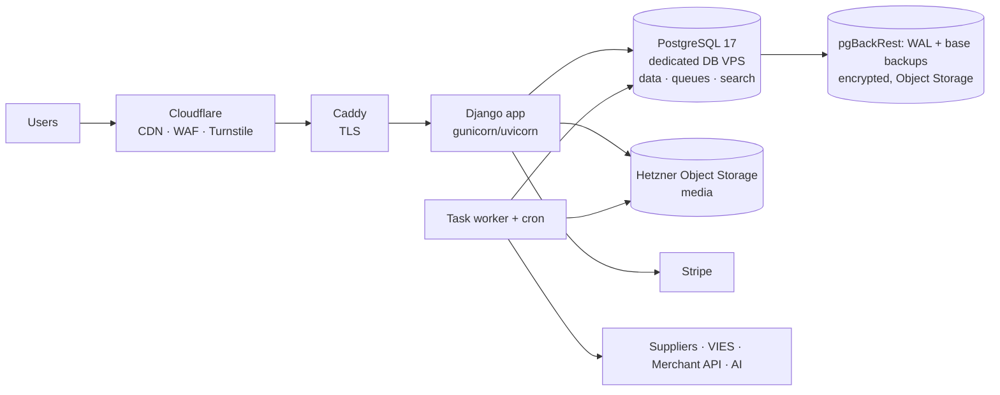

# 12 — Security, infrastructure and operations

## 12.1 Immediate actions (independent of the rebuild)

The analysis of the current repository surfaced some security actions to carry out immediately on the
production system. The list is **confidential** and is not part of the public repository.

## 12.2 Current baseline to improve on

| Area | Today | New system |
|---|---|---|
| Surface | A CMS with a commerce plugin, a marketplace plugin, translation and SEO plugins, custom plugins and a legacy PHP API | A single Python codebase, dependencies inventoried (SBOM) and scanned in CI |
| Admin access | One shared admin area | One Manager with a gated shop space for vendors and a gated platform space for staff roles, MFA for everyone; Django admin behind a restricted network ([02](02-core-identity-permissions.md)) |
| API | Legacy PHP API, to be replaced | `ApiClient` with hash, scopes, expiry, rotation, rate limiting |
| Executable code | Traditional PHP CMS model | No code in media directories; media on object storage |
| Operational scripts | Ad hoc scripts | Versioned management commands with dry-run and audit, or MCP tools |
| Data at rest | Legacy model (see private spec) | Field-level encryption for IBAN and KYC documents, keys outside the DB |
| Traceability | No audit on prices, VAT, shipping | Append-only `AuditLog` |
| Environments | Legacy model (see private spec) | Synthetic or anonymized data |

## 12.3 Security requirements

The IDs below are requirement IDs, not task IDs: the tasks are in §12.6 (SEC.0 to SEC.6, then
SEC.11 and up, which skip the requirement numbers), and the same number means different things in
the two tables (requirement SEC.1 is the access model, task SEC.1 is HTTP hardening). Renaming the
requirements is an open owner question.

| ID | Requirement | Detail |
|---|---|---|
| SEC.1 | Access model | MFA, step-up, per-role sessions (see [02](02-core-identity-permissions.md)) |
| SEC.2 | Tenant isolation as a tested invariant | Automated negative tests for every endpoint, view and MCP tool |
| SEC.3 | HTTP hardening | CSP without `unsafe-inline` (native since Django 6.0), HSTS, `Secure`/`HttpOnly`/`SameSite` cookies, security headers |
| SEC.4 | Uploads | Server-side MIME validation, size limits, image re-encoding, no unsanitized SVG |
| SEC.5 | Secrets | Env or vault only; secret scanning in pre-commit and CI; documented rotation |
| SEC.6 | Field-level encryption | IBAN, KYC documents, DAC7 data; key in KMS or in a file outside the DB, rotatable |
| SEC.7 | Audit trail | Logins, credentials, prices, rates, zones, commissions, IBAN, vendor status, payouts, data exports |
| SEC.8 | Incoming webhooks | Mandatory signature, idempotency, time window |
| SEC.9 | Untrusted input | Feeds, scraping, AI output and webhooks validated against a schema before reaching the DB; product texts never interpreted as instructions by agents; outbound fetches of staff- or vendor-entered URLs (connectors, feeds) only through the shared client that refuses loopback, private, link-local, CGNAT and metadata addresses and redirects to them (MIG.12) |
| SEC.10 | Continuous verification | Security tests in CI, mandatory manual review on payments, tax and permissions, external penetration test before go-live |

**Vendor upload location (SEC.2).** Uploads made on behalf of a vendor (images in storefront profiles, events and products) are stored in that vendor's own Wagtail collection, the root-level collection `vendor-<vendor public id>` and the collections below it (`apps.events.engine.vendor_collection_name`; rule and use in spec [15](15-events.md)). Services that accept an image reference from a vendor refuse any image outside it.

## 12.4 Infrastructure

- **Environments**: local (Apple `container`, same OCI images), STAGE, LIVE; differences only via env; STAGE with synthetic data.
  STAGE and LIVE run on Hetzner Cloud, EU region, servers (Arm64 recommended)
  ([ADR-0007](../adr/0007-hosting-hetzner-self-managed-postgres.md)). LIVE has an app VPS (app,
  worker and Caddy as Podman Quadlets) and a dedicated database VPS running self-managed
  PostgreSQL 17, reachable only over the Hetzner private network. STAGE (synthetic data only) runs
  all of this on one VPS, with PostgreSQL listening on the loopback interface only (owner
  decision 2026-11-08); STAGE and LIVE never share a machine, keys or database. The release
  image is multi-arch (amd64 and arm64). The app still connects with
  TLS and `sslmode=verify-full`: the database is not public, so no public certificate is needed,
  and a free internal certificate authority (openssl or step-ca) signs the server certificate;
  the app container mounts its root certificate (owner decision MQ-11, ARC.13).

  STAGE may run as a public demo (ARC.22): published demo accounts without superuser rights or user, permission and key management, exempt from MFA and lockout but rate limited per IP; no outbound email (in-app demo mailbox) and payment test mode only; hourly reset from the synthetic seed with uploads wiped and a banner showing the next reset; no search engine indexing (noindex header, robots meta tag, robots.txt). A `MPMV_DEMO_MODE` setting is off by default and a system check refuses it in LIVE settings.

- **Deploy**: versioned image built by CI, migrations in a dedicated step, rollback by tag; no
  `git pull` on the servers.
- **Backup**: run by us, since PostgreSQL is self-managed. pgBackRest archives WAL continuously and
  takes scheduled base backups to Hetzner Object Storage (S3 compatible, EU), encrypted, with a
  documented retention policy, in a bucket separate from media; versioned object storage for media;
  documented quarterly restore test to an empty server at a chosen point in time. RPO ≤ 15 min,
  RTO ≤ 4 h (to be confirmed). Database operations are ours too: OS and PostgreSQL patching on a
  schedule, major upgrades tested on STAGE first, alerts on disk space, WAL archive lag or failure
  and backup age (OPS.2).
- **Observability**: JSON logs, error tracking, healthchecks, business metrics (orders per day,
  checkout errors, failed webhooks, failed jobs, translation queues), alerts via email or chat.
  A worker whose ARC.9 heartbeat stops is restarted automatically and staff are alerted (owner
  decision MQ-10, ARC.13).
- **Security operations dashboard** (P2, OPS.6, owner idea MQ-4): a live view for management of
  what is happening in the system, with anomalies and spikes per API key or per user, and
  suggested corrective commands (revoke a key, raise a limit, unlock a user) that run only after
  a staff member confirms them with MFA. The commands are the existing audited services, never
  new shortcuts.
- **Initial sizing**: per environment, an app VPS with 4 vCPUs and 8 GB for app and workers, and a
  database VPS with 4 vCPUs and 8–16 GB for PostgreSQL, are enough at the current scale.

## 12.5 Operations: replacing the scripts

| Today | Tomorrow |
|---|---|
| Scripts that refresh the test environment from production, plus a safety plugin | `make seed-stage` with synthetic data; no LIVE clone |
| Shell scripts that patch configuration options | Settings in the DB with audit, editable from admin |
| Legacy diagnostic and fix scripts | Admin reports, health checks, read-only MCP tools; fixes as commands with dry-run |
| CMS, marketplace and translation plugin updates with a test matrix | Python dependency updates via automated PRs + CI |
| A caching plugin to be disabled on the test environment | Application cache controlled by settings |

## 12.6 Tasks

| ID | Micro-task | Pri | Hours | Depends on | Done when |
|---|---|---|---|---|---|
| SEC.0 | Immediate actions from §12.1 on the current system | P1 | 3 | — | Confidential §12.1 checklist completed and recorded |
| SEC.1 | HTTP hardening + CSP + cookies + headers (automated tests) | P1 | 6 | ARC.3 | Header scan passed |
| SEC.2 | Secure uploads and image re-encoding | P1 | 4 | CAT.4, ARC.15 | Tests with malicious files |
| SEC.3 | Field-level encryption (IBAN, KYC, DAC7) with key rotation | P1 | 8 | VEN.1 | DB dump with no cleartext data |
| SEC.4 | AuditLog extended to all sensitive mutations + staff view with filters | P1 | 6 | ARC.6 | Rate change visible with before/after |
| SEC.5 | Security tests in CI, run on every PR (the security wave planned by lane-a on the Lane board, items 1 to 10): (1-3) an endpoint sweep over every URL pattern and API v1 operation against a declared matrix (`tests/security_registry.py`): anonymous access, CSRF on state-changing views, GET without side effects, staff-only routes refused to a customer, tenant confinement, API key scopes, IDOR review of every route carrying an identifier (#169); (4) rate limits of login, action links and API keys, including the per-IP limit on refused keys of CORE.20 (#171); (5) the security header set on every response type: pages, 403, 404, 500, redirects, static files, API JSON and problem+json, both admins, the health check, plus the Caddy media block (#162); (6) supply chain: pip-audit, ruff `S` rules and the secret scan in CI; (7) no settings module falls back to a hard-coded secret on STAGE or LIVE; (8) a hostile-input corpus with Hypothesis property tests over every admin and page form, the API v1 schemas, the shipping importers and the email, JSON-LD and CSV outputs (#166); (9) nightly and weekly scheduled security runs that report failures as an issue (#160); (10) an attack-scenario suite in `tests/security/`. Findings that need other work are strict xfails owned by SEC.11, SEC.12, CMS.12 and I18N.10 | P1 | 8 | CORE.3 | An undeclared public, CSRF-exempt, GET-writing or untested-identifier endpoint turns CI red (`tests/integration/test_endpoint_security.py`, with a meta-test that proves the sweep catches an unprotected view); every response type carries the LIVE header set and no `Server` or `X-Powered-By` (`tests/integration/test_security_headers_by_response_type.py`); each rate limit triggers and resets (`tests/integration/test_rate_limits.py`); the hostile-input corpus never gives a 500, active markup or a formula cell, with the derandomized Hypothesis `ci` profile (`tests/unit/test_hostile_input.py`, `tests/integration/test_hostile_input_*.py`); a known-vulnerable dependency, a bandit finding or a committed secret fails CI; a settings module with a hard-coded secret fallback fails a test; a failing scheduled run opens or updates one `security` issue |
| SEC.6 | External penetration test and remediation | P1 | 16 | MIG.5 | Report with no open critical findings |
| SEC.11 | Admin routes per vendor member role and CSRF tightening (proposed as SEC.5b on PR #169, registered by coherence check 7; needed before vendor members get `wagtailadmin.access_admin`): the staff-only refusal check of the SEC.5 sweep runs for every `VendorMember.Role`, not only as a customer; hook-registered `csrf_exempt` admin views are no longer accepted wholesale but declared one by one with their reason; the vendor-role confinement test stops skipping silently | P1 | 6 | SEC.5, CORE.3 | Each vendor member role is refused on every staff-only admin route; an undeclared `csrf_exempt` admin view turns CI red; `test_every_vendor_role_is_confined_to_its_vendor` fails when a `VendorScoped` web endpoint exists and its parameter set is still empty |
| SEC.12 | Reverse proxy security headers (SEC.5 header findings, recorded as strict xfails on PR #162, registered by coherence check 7): Caddy drops the `Server` header (its own and the app server's) on every response; public media served by Caddy carry HSTS, Referrer-Policy and `frame-ancestors 'none'`; the app's own HTTP-to-HTTPS 301 either carries the full header set or is tested as the documented exception (in LIVE the proxy redirects plain HTTP first). Open PR #159 covers the Caddy part; lane-a may fold this row into ARC.13 | P1 | 2 | ARC.13, SEC.5 | The strict xfails `test_proxy_drops_the_server_header` and `test_media_carries_the_transport_and_framing_headers` (`tests/unit/test_proxy_security_headers.py`) pass with their marks removed; `test_https_redirect_301_full_header_set` (`tests/integration/test_security_headers_by_response_type.py`) passes or is replaced by a plain test of the documented behaviour |
| OPS.1 | Self-managed PITR with pgBackRest (continuous WAL archiving + base backups) to Hetzner Object Storage, encrypted, with retention + restore test; least-privilege DB roles (app role without DDL or TRUNCATE, so the audit log stays append-only) | P1 | 8 | ARC.13 | Documented point-in-time restore on an empty database VPS; app role cannot TRUNCATE `core_auditlog` |
| OPS.2 | Observability: JSON logs, error tracking, healthchecks, alerts (including database disk space, WAL archiving and backup age) | P1 | 8 | ARC.5 | Alert on a simulated checkout error |
| OPS.3 | Runbooks: incidents (including 72 h data breach), payouts, rate updates, vendor onboarding | P2 | 8 | — | Runbooks in the repo |
| OPS.4 | Automated dependency updates (PRs) + SBOM | P2 | 3 | ARC.4 | Weekly update PRs |
| OPS.5 | Technical Django admin reachable only from a restricted network (owner decision Q-18): allow-list at the reverse proxy plus an app-level check on the Django admin path (defence in depth), the allowed networks as environment configuration, staff operations moved to the Manager platform space (CORE.17) and editors to the Wagtail admin (CORE.8) | P1 | 3 | ARC.13, CORE.8 | On STAGE the Django admin answers 404 from outside the allowed networks and works from inside; a test covers the app-level check |
| OPS.6 | Security operations dashboard (owner idea MQ-4): live view of system actions from the AuditLog, the API mutation log and the rate-limit counters, with anomalies and per-key and per-user spikes, and suggested corrective commands (revoke a key, raise a limit, unlock a user) that staff confirm with an MFA step-up; each command calls the existing audited service | P2 | 12 | SEC.4, CORE.16, CORE.8 | A simulated spike on one key shows up with a "revoke key" or "raise limit" suggestion; a suggestion runs only after step-up and writes the same AuditLog entry as the service it calls; a staff member without the permission sees no dashboard |
| OPS.7 | Upgrade deprecations and slow tests (proposed by coherence check 7, no work yet): set `MAILERS` explicitly in the settings (base and test) before Django 2028 removes the default mailer (`RemovedInDjango2028Warning`, raised through Wagtail's admin mail); replace action-tuple indexing (`get_actions(request)[name][0]`) with the action attribute in the vendor claim admin tests; replace `wagtail.images.permissions.permission_policy` with `wagtail.permissions.policy_registry.get_by_type(get_image_model())` in `apps/cms/admin_views.py` (`RemovedInWagtail90Warning`); a module-scoped seed fixture so `apps/seed` tests stop rebuilding the full seed per test (about 5 min of the suite) and a `slow` marker for the migration round-trip tests (about 4 min) so PR runs can shard or defer them | P2 | 4 | ARC.10, ARC.11 | `make test` runs with no `RemovedInDjango2028Warning` or `RemovedInWagtail90Warning`, and `make check` prints none; the seed tests build the seed once per module; the migration round-trips carry the `slow` marker and the CI job still runs them |
