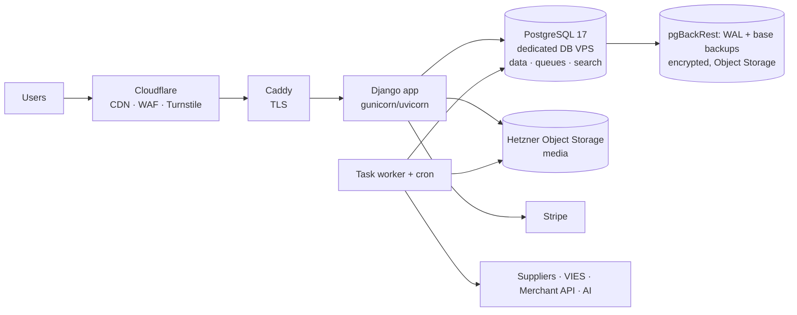

# 12 — Security, infrastructure and operations

## 12.1 Immediate actions (independent of the rebuild)

The analysis of the current repository surfaced some security actions to carry out immediately on the
production system. The list is **confidential** and is not part of the public repository.

## 12.2 Current baseline to improve on

| Area | Today | New system |
|---|---|---|
| Surface | WP core + WooCommerce + WCFM (7 add-ons) + WPML (4) + WPSSO (15) + ~20 mu-plugins + 132 routes | A single Python codebase, dependencies inventoried (SBOM) and scanned in CI |
| Admin access | A single `/wp-admin` for all roles | Staff admin behind MFA and a restricted network or proxy; separate vendor area |
| API | Legacy PHP API, to be replaced | `ApiClient` with hash, scopes, expiry, rotation, rate limiting |
| Executable code | Traditional PHP/WordPress model | No code in media directories; media on object storage |
| Operational scripts | Ad hoc fix scripts outside version control | Versioned management commands with dry-run and audit, or MCP tools |
| Data at rest | No field-level encryption | Field-level encryption for IBAN and KYC documents, keys outside the DB |
| Traceability | No audit on prices, VAT, shipping | Append-only `AuditLog` |
| Environments | STAGE synced from LIVE | Synthetic or anonymized data |

## 12.3 Security requirements

The IDs below are requirement IDs, not task IDs: the tasks are in §12.6 (SEC.0 to SEC.6), and
the same number means different things in the two tables (requirement SEC.1 is the access model,
task SEC.1 is HTTP hardening). Renaming the requirements is an open owner question.

| ID | Requirement | Detail |
|---|---|---|
| SEC.1 | Access model | MFA, step-up, per-role sessions (see [02](02-core-identity-permissions.md)) |
| SEC.2 | Tenant isolation as a tested invariant | Automated negative tests for every endpoint, view and MCP tool |
| SEC.3 | HTTP hardening | CSP without `unsafe-inline` (native since Django 6.0), HSTS, `Secure`/`HttpOnly`/`SameSite` cookies, security headers |
| SEC.4 | Uploads | Server-side MIME validation, size limits, image re-encoding, no unsanitized SVG |
| SEC.5 | Secrets | Env or vault only; secret scanning in pre-commit and CI; documented rotation |
| SEC.6 | Field-level encryption | IBAN, KYC documents, DAC7 data; key in KMS or in a file outside the DB, rotatable |
| SEC.7 | Audit trail | Logins, credentials, prices, rates, zones, commissions, IBAN, vendor status, payouts, data exports |
| SEC.8 | Incoming webhooks | Mandatory signature, idempotency, time window |
| SEC.9 | Untrusted input | Feeds, scraping, AI output and webhooks validated against a schema before reaching the DB; product texts never interpreted as instructions by agents |
| SEC.10 | Continuous verification | Security tests in CI, mandatory manual review on payments, tax and permissions, external penetration test before go-live |

## 12.4 Infrastructure

- **Environments**: local (Apple `container`, same OCI images), STAGE, LIVE; differences only via env; STAGE with synthetic data.
  STAGE and LIVE run on Hetzner Cloud, EU region, Arm64 (aarch64) servers
  ([ADR-0007](../adr/0007-hosting-hetzner-self-managed-postgres.md)). LIVE has an app VPS (app,
  worker and Caddy as Podman Quadlets) and a dedicated database VPS running self-managed
  PostgreSQL 17, reachable only over the Hetzner private network. STAGE (synthetic data only) runs
  all of this on one VPS, with PostgreSQL listening on the loopback interface only (owner
  decision 2026-11-08); STAGE and LIVE never share a machine, keys or database. The release
  image is multi-arch (amd64 and arm64). The app still connects with
  TLS and `sslmode=verify-full`: the database is not public, so no public certificate is needed,
  and a free internal certificate authority (openssl or step-ca) signs the server certificate;
  the app container mounts its root certificate (owner decision MQ-11, ARC.13).
- **Deploy**: versioned image built by CI, migrations in a dedicated step, rollback by tag; no
  `git pull` on the servers.
- **Backup**: run by us, since PostgreSQL is self-managed. pgBackRest archives WAL continuously and
  takes scheduled base backups to Hetzner Object Storage (S3 compatible, EU), encrypted, with a
  documented retention policy, in a bucket separate from media; versioned object storage for media;
  documented quarterly restore test to an empty server at a chosen point in time. RPO ≤ 15 min,
  RTO ≤ 4 h (to be confirmed). Database operations are ours too: OS and PostgreSQL patching on a
  schedule, major upgrades tested on STAGE first, alerts on disk space, WAL archive lag or failure
  and backup age (OPS.2).
- **Observability**: JSON logs, error tracking, healthchecks, business metrics (orders per day,
  checkout errors, failed webhooks, failed jobs, translation queues), alerts via email or chat.
  A worker whose ARC.9 heartbeat stops is restarted automatically and staff are alerted (owner
  decision MQ-10, ARC.13).
- **Security operations dashboard** (P2, OPS.6, owner idea MQ-4): a live view for management of
  what is happening in the system, with anomalies and spikes per API key or per user, and
  suggested corrective commands (revoke a key, raise a limit, unlock a user) that run only after
  a staff member confirms them with MFA. The commands are the existing audited services, never
  new shortcuts.
- **Initial sizing**: per environment, an app VPS with 4 vCPUs and 8 GB for app and workers, and a
  database VPS with 4 vCPUs and 8–16 GB for PostgreSQL, are enough at the current scale.

## 12.5 Operations: replacing the scripts

| Today | Tomorrow |
|---|---|
| `refresh_stage_from_live.sh`, `legacy-stage-safety` | `make seed-stage` with synthetic data; no LIVE clone |
| `disable_live_checkout_location.sh` and other option patches | Settings in the DB with audit, editable from admin |
| `diagnose_*` / `fix_*` (dozens) | Admin reports, health checks, read-only MCP tools; fixes as commands with dry-run |
| WP/WCFM/WPML plugin updates with a test matrix | Python dependency updates via automated PRs + CI |
| WP-Optimize cache to be disabled on STAGE | Application cache controlled by settings |

## 12.6 Tasks

| ID | Micro-task | Pri | Hours | Depends on | Done when |
|---|---|---|---|---|---|
| SEC.0 | Immediate actions from §12.1 on the current system | P1 | 3 | — | Confidential §12.1 checklist completed and recorded |
| SEC.1 | HTTP hardening + CSP + cookies + headers (automated tests) | P1 | 6 | ARC.3 | Header scan passed |
| SEC.2 | Secure uploads and image re-encoding | P1 | 4 | CAT.4, ARC.15 | Tests with malicious files |
| SEC.3 | Field-level encryption (IBAN, KYC, DAC7) with key rotation | P1 | 8 | VEN.1 | DB dump with no cleartext data |
| SEC.4 | AuditLog extended to all sensitive mutations + staff view with filters | P1 | 6 | ARC.6 | Rate change visible with before/after |
| SEC.5 | Security tests in CI (permissions by role and tenant, unauthenticated endpoints) | P1 | 8 | CORE.3 | Undeclared public endpoint → CI red |
| SEC.6 | External penetration test and remediation | P1 | 16 | MIG.5 | Report with no open critical findings |
| OPS.1 | Self-managed PITR with pgBackRest (continuous WAL archiving + base backups) to Hetzner Object Storage, encrypted, with retention + restore test; least-privilege DB roles (app role without DDL or TRUNCATE, so the audit log stays append-only) | P1 | 8 | ARC.13 | Documented point-in-time restore on an empty database VPS; app role cannot TRUNCATE `core_auditlog` |
| OPS.2 | Observability: JSON logs, error tracking, healthchecks, alerts (including database disk space, WAL archiving and backup age) | P1 | 8 | ARC.5 | Alert on a simulated checkout error |
| OPS.3 | Runbooks: incidents (including 72 h data breach), payouts, rate updates, vendor onboarding | P2 | 8 | — | Runbooks in the repo |
| OPS.4 | Automated dependency updates (PRs) + SBOM | P2 | 3 | ARC.4 | Weekly update PRs |
| OPS.5 | Technical Django admin reachable only from a restricted network (owner decision Q-18): allow-list at the reverse proxy plus an app-level check on the Django admin path (defence in depth), the allowed networks as environment configuration, staff operations moved to the Wagtail admin (CORE.8) | P1 | 3 | ARC.13, CORE.8 | On STAGE the Django admin answers 404 from outside the allowed networks and works from inside; a test covers the app-level check |
| OPS.6 | Security operations dashboard (owner idea MQ-4): live view of system actions from the AuditLog, the API mutation log and the rate-limit counters, with anomalies and per-key and per-user spikes, and suggested corrective commands (revoke a key, raise a limit, unlock a user) that staff confirm with an MFA step-up; each command calls the existing audited service | P2 | 12 | SEC.4, CORE.16, CORE.8 | A simulated spike on one key shows up with a "revoke key" or "raise limit" suggestion; a suggestion runs only after step-up and writes the same AuditLog entry as the service it calls; a staff member without the permission sees no dashboard |
