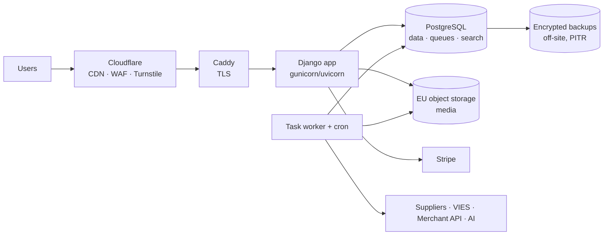

# 12 — Security, infrastructure and operations

## 12.1 Immediate actions (independent of the rebuild)

The analysis of the current repository surfaced some security actions to carry out immediately on the
production system: credentials to rotate, debug files to remove, authentication of the PHP API
to strengthen. The detailed list is **confidential** and is not part of the public repository.

## 12.2 Current baseline to improve on

| Area | Today | New system |
|---|---|---|
| Surface | WP core + WooCommerce + WCFM (7 add-ons) + WPML (4) + WPSSO (15) + ~20 mu-plugins + 132 routes | A single Python codebase, dependencies inventoried (SBOM) and scanned in CI |
| Admin access | A single `/wp-admin` for all roles | Staff admin behind MFA and a restricted network or proxy; separate vendor area |
| API | Authentication to be redone | `ApiClient` with hash, scopes, expiry, rotation, rate limiting |
| Executable code | Traditional PHP/WordPress model | No code in media directories; media on object storage |
| Operational scripts | Ad hoc fix scripts outside version control | Versioned management commands with dry-run and audit, or MCP tools |
| Data at rest | No field-level encryption | Field-level encryption for IBAN and KYC documents, keys outside the DB |
| Traceability | No audit on prices, VAT, shipping | Append-only `AuditLog` |
| Environments | STAGE synced from LIVE | Synthetic or anonymized data |

## 12.3 Security requirements

| ID | Requirement | Detail |
|---|---|---|
| SEC.1 | Access model | MFA, step-up, per-role sessions (see [02](02-core-identity-permissions.md)) |
| SEC.2 | Tenant isolation as a tested invariant | Automated negative tests for every endpoint, view and MCP tool |
| SEC.3 | HTTP hardening | CSP without `unsafe-inline` (native since Django 6.0), HSTS, `Secure`/`HttpOnly`/`SameSite` cookies, security headers |
| SEC.4 | Uploads | Server-side MIME validation, size limits, image re-encoding, no unsanitized SVG |
| SEC.5 | Secrets | Env or vault only; secret scanning in pre-commit and CI; documented rotation |
| SEC.6 | Field-level encryption | IBAN, KYC documents, DAC7 data; key in KMS or in a file outside the DB, rotatable |
| SEC.7 | Audit trail | Logins, credentials, prices, rates, zones, commissions, IBAN, vendor status, payouts, data exports |
| SEC.8 | Incoming webhooks | Mandatory signature, idempotency, time window |
| SEC.9 | Untrusted input | Feeds, scraping, AI output and webhooks validated against a schema before reaching the DB; product texts never interpreted as instructions by agents |
| SEC.10 | Continuous verification | Security tests in CI, mandatory manual review on payments, tax and permissions, external penetration test before go-live |

## 12.4 Infrastructure

- **Environments**: local (Apple `container`, same OCI images), STAGE, LIVE; differences only via env; STAGE with synthetic data.
- **Deploy**: versioned image built by CI, migrations in a dedicated step, rollback by tag; no
  `git pull` on the servers.
- **Backup**: PostgreSQL with PITR (WAL) and encrypted daily off-site dumps; versioned object storage;
  documented quarterly restore test. RPO ≤ 15 min, RTO ≤ 4 h (to be confirmed).
- **Observability**: JSON logs, error tracking, healthchecks, business metrics (orders per day,
  checkout errors, failed webhooks, failed jobs, translation queues), alerts via email or chat.
- **Initial sizing**: one VPS with 4 vCPUs and 8–16 GB is enough for app, workers and Postgres at the current
  scale; managed Postgres as an option if we prefer to delegate backups and upgrades.

## 12.5 Operations: replacing the scripts

| Today | Tomorrow |
|---|---|
| `refresh_stage_from_live.sh`, `legacy-stage-safety` | `make seed-stage` with synthetic data; no LIVE clone |
| `disable_live_checkout_location.sh` and other option patches | Settings in the DB with audit, editable from admin |
| `diagnose_*` / `fix_*` (dozens) | Admin reports, health checks, read-only MCP tools; fixes as commands with dry-run |
| WP/WCFM/WPML plugin updates with a test matrix | Python dependency updates via automated PRs + CI |
| WP-Optimize cache to be disabled on STAGE | Application cache controlled by settings |

## 12.6 Tasks

| ID | Micro-task | Pri | Hours | Depends on | Done when |
|---|---|---|---|---|---|
| SEC.0 | Immediate actions from §12.1 on the current system | P1 | 3 | — | Credentials rotated, files cleaned up |
| SEC.1 | HTTP hardening + CSP + cookies + headers (automated tests) | P1 | 6 | ARC.3 | Header scan passed |
| SEC.2 | Secure uploads and image re-encoding | P1 | 4 | CAT.4 | Tests with malicious files |
| SEC.3 | Field-level encryption (IBAN, KYC, DAC7) with key rotation | P1 | 8 | VEN.1 | DB dump with no cleartext data |
| SEC.4 | AuditLog extended to all sensitive mutations + staff view with filters | P1 | 6 | ARC.6 | Rate change visible with before/after |
| SEC.5 | Security tests in CI (permissions by role and tenant, unauthenticated endpoints) | P1 | 8 | CORE.3 | Undeclared public endpoint → CI red |
| SEC.6 | External penetration test and remediation | P1 | 16 | MIG.5 | Report with no open critical findings |
| OPS.1 | PITR backup + encrypted off-site dumps + restore test | P1 | 8 | ARC.5 | Documented restore on an empty environment |
| OPS.2 | Observability: JSON logs, error tracking, healthchecks, alerts | P1 | 8 | ARC.5 | Alert on a simulated checkout error |
| OPS.3 | Runbooks: incidents (including 72 h data breach), payouts, rate updates, vendor onboarding | P2 | 8 | — | Runbooks in the repo |
| OPS.4 | Automated dependency updates (PRs) + SBOM | P2 | 3 | ARC.4 | Weekly update PRs |
