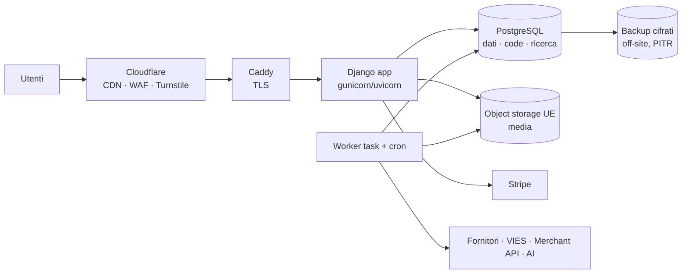

# 12 — Sicurezza, infrastruttura e operatività

## 12.1 Azioni immediate (indipendenti dalla ricostruzione)

L'analisi del repository attuale ha fatto emergere alcune azioni di sicurezza da eseguire subito sul
sistema in produzione: credenziali da ruotare, file di debug da rimuovere, autenticazione dell'API
PHP da rafforzare. L'elenco dettagliato è **riservato** e non fa parte del repository pubblico.

## 12.2 Baseline attuale da superare

| Area | Oggi | Nuovo sistema |
|---|---|---|
| Superficie | Core WP + WooCommerce + WCFM (7 add-on) + WPML (4) + WPSSO (15) + ~20 mu-plugin + 132 route | Una codebase Python, dipendenze inventariate (SBOM) e scansionate in CI |
| Accesso admin | Un unico `/wp-admin` per tutti i ruoli | Admin staff dietro MFA e rete o proxy ristretti; area vendor separata |
| API | Autenticazione da rifare | `ApiClient` con hash, scope, scadenza, rotazione, rate limit |
| Codice eseguibile | Modello PHP/WordPress tradizionale | Nessun codice nelle directory media; media su object storage |
| Script operativi | Script di correzione ad hoc fuori dal versionamento | Management command versionati con dry-run e audit, o tool MCP |
| Dati a riposo | Nessuna cifratura di campo | Cifratura di campo per IBAN e documenti KYC, chiavi fuori dal DB |
| Tracciabilità | Nessun audit su prezzi, IVA, spedizioni | `AuditLog` append-only |
| Ambienti | STAGE allineato da LIVE | Dati sintetici o anonimizzati |

## 12.3 Requisiti di sicurezza

| ID | Requisito | Dettaglio |
|---|---|---|
| SEC.1 | Modello di accesso | MFA, step-up, sessioni per ruolo (vedi [02](02-core-identita-permessi.md)) |
| SEC.2 | Isolamento tenant come invariante testata | Test negativi automatici per ogni endpoint, view e tool MCP |
| SEC.3 | Hardening HTTP | CSP senza `unsafe-inline` (nativa da Django 6.0), HSTS, cookie `Secure`/`HttpOnly`/`SameSite`, header di sicurezza |
| SEC.4 | Upload | Validazione MIME lato server, limiti di dimensione, ri-encoding delle immagini, nessun SVG non sanificato |
| SEC.5 | Segreti | Solo env o vault; secret scanning in pre-commit e CI; rotazione documentata |
| SEC.6 | Cifratura di campo | IBAN, documenti KYC, dati DAC7; chiave in KMS o file esterno al DB, rotabile |
| SEC.7 | Audit trail | Login, credenziali, prezzi, aliquote, zone, commissioni, IBAN, stato vendor, payout, export dati |
| SEC.8 | Webhook in ingresso | Firma obbligatoria, idempotenza, finestra temporale |
| SEC.9 | Input non fidato | Feed, scraping, output AI e webhook validati con schema prima del DB; testi di prodotto mai interpretati come istruzioni dagli agenti |
| SEC.10 | Verifica continua | Test di sicurezza in CI, revisione manuale obbligatoria su pagamenti, fiscale e permessi, penetration test esterno prima del go-live |

## 12.4 Infrastruttura

- **Ambienti**: locale (Apple `container`, stesse immagini OCI), STAGE, LIVE; differenze solo via env; STAGE con dati sintetici.
- **Deploy**: immagine versionata da CI, migrazioni in un passo dedicato, rollback per tag; nessun
  `git pull` sui server.
- **Backup**: PostgreSQL con PITR (WAL) e dump giornalieri cifrati off-site; object storage versionato;
  prova di ripristino trimestrale documentata. RPO ≤ 15 min, RTO ≤ 4 h (da confermare).
- **Osservabilità**: log JSON, error tracking, healthcheck, metriche di business (ordini al giorno,
  errori di checkout, webhook falliti, job falliti, code di traduzione), alert via email o chat.
- **Dimensionamento iniziale**: una VPS da 4 vCPU e 8–16 GB basta per app, worker e Postgres alla scala
  attuale; Postgres gestito come opzione se si preferisce delegare backup e aggiornamenti.

## 12.5 Operatività: sostituzione degli script

| Oggi | Domani |
|---|---|
| `refresh_stage_from_live.sh`, `mp-stage-safety` | `make seed-stage` con dati sintetici; nessun clone LIVE |
| `disable_live_checkout_location.sh` e altre patch di opzioni | Impostazioni a DB con audit, modificabili da admin |
| `diagnose_*` / `fix_*` (decine) | Report in admin, health check, tool MCP di sola lettura; correzioni come comandi con dry-run |
| Aggiornamenti plugin WP/WCFM/WPML con matrice di test | Aggiornamenti delle dipendenze Python via PR automatiche + CI |
| Cache WP-Optimize da disattivare su STAGE | Cache applicativa controllata da settings |

## 12.6 Task

| ID | Micro-task | Pri | Ore | Dipende da | Done quando |
|---|---|---|---|---|---|
| SEC.0 | Azioni immediate del §12.1 sul sistema attuale | P1 | 3 | — | Credenziali ruotate, file ripuliti |
| SEC.1 | Hardening HTTP + CSP + cookie + header (test automatici) | P1 | 6 | ARC.3 | Scansione header superata |
| SEC.2 | Upload sicuri e ri-encoding immagini | P1 | 4 | CAT.4 | Test con file malevoli |
| SEC.3 | Cifratura di campo (IBAN, KYC, DAC7) con rotazione chiave | P1 | 8 | VEN.1 | Dump DB senza dati in chiaro |
| SEC.4 | AuditLog esteso a tutte le mutazioni sensibili + vista staff con filtri | P1 | 6 | ARC.6 | Modifica aliquota visibile con prima/dopo |
| SEC.5 | Test di sicurezza in CI (permessi per ruolo e tenant, endpoint senza auth) | P1 | 8 | CORE.3 | Endpoint pubblico non dichiarato → CI rossa |
| SEC.6 | Penetration test esterno e remediation | P1 | 16 | MIG.5 | Report senza criticità aperte |
| OPS.1 | Backup PITR + dump cifrati off-site + prova di ripristino | P1 | 8 | ARC.5 | Ripristino documentato su ambiente vuoto |
| OPS.2 | Osservabilità: log JSON, error tracking, healthcheck, alert | P1 | 8 | ARC.5 | Alert su errore di checkout simulato |
| OPS.3 | Runbook: incidenti (con data breach 72 h), payout, aggiornamento aliquote, onboarding vendor | P2 | 8 | — | Runbook nel repo |
| OPS.4 | Aggiornamenti dipendenze automatici (PR) + SBOM | P2 | 3 | ARC.4 | PR di aggiornamento settimanali |
