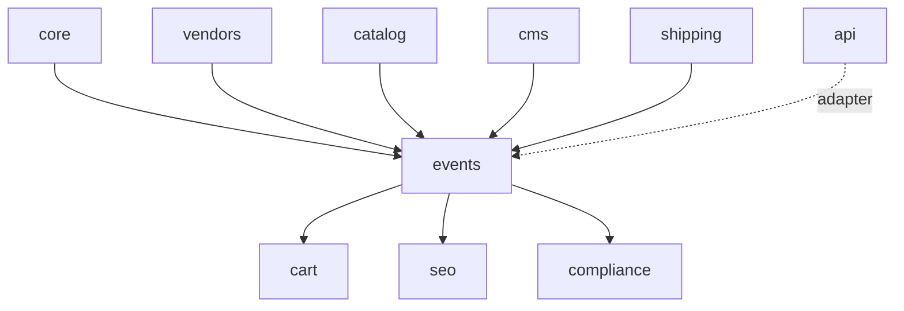

# 15 — Events: closures, promotions, trade fairs

Vendors (mainly) and staff publish **events** from time to time: periodic closures and holidays,
promotional announcements, trade-fair appearances and meetings. Each event is a Wagtail page with
structured fields and a StreamField body. Events have an RSS feed and an ICS calendar, both
discoverable automatically, and a vendor closure moves the dispatch date and the delivery
estimate shown at checkout.

This module supersedes owner decision Q-61, which said that events would only be blog articles
([10](10-content-seo-ai.md), [14](14-frontend-themes.md) §14.9). Blog articles can still tell the
story of an event; the event itself, with its dates, feeds and checkout effect, is an `EventPage`.

## 15.1 How it works today

- Legacy: no events feature. Vendors announce holidays in their storefront description or in a
  blog article, by hand. The checkout knows nothing about closures, so a buyer who orders during a
  closure learns about the delay only from the vendor, after paying.
- Trade fairs and promotions appear as blog articles or social posts. There is no feed and no
  calendar.
- MPMV: nothing yet. The pieces to build on are the CMS.1 page tree and conventions, the CMS.2
  block library, wagtail-localize (I18N.3), the vendor area (CORE.9), the vendor API keys
  (CORE.13), the vendor storefront (VEN.10), the product page (CAT.7) and the shipping outcome of
  SHP.3.

## 15.2 How it will work

### Page types in a small `events` app

Events are Wagtail pages (owner decision): an `EventIndexPage` (the `/events/` page) with child
pages of type `EventPage`. They follow the CMS.1 conventions: one page tree per locale under that
locale's `HomePage`, linked as translations by wagtail-localize, `TranslatableMixin`, templates
resolved by the theme loader.

The page types live in a new app, `apps/events/`, not in `cms`, because of the dependency graph
of spec 01 §1.3: an event links products and categories (`catalog`) and its closures feed the
checkout (`cart`). `cms` and `catalog` are independent siblings in the same import-linter layer,
so a page type in `cms` could not validate product links or query the catalog, and the checkout
would depend on the CMS app to read closures. A small app one layer up solves both, and the
shipping engine still only receives data:



- `events` may import `core`, `vendors`, `catalog` (product and category links), `cms` (the
  StreamField block library of CMS.2 and the page conventions) and the shipping **dataclasses**
  of `apps/shipping/engine.py` (`ClosedPeriod`, below).
- `cart` imports `events` to build the vendor dispatch calendars for the checkout (ORD.3).
- `seo` imports `events` for JSON-LD and sitemaps; `compliance` imports it to hide an event after a
  DSA notice (CMP.5); `api` exposes it.
- `shipping`, `tax`, `catalog` and `cms` **never import `events`**. `cms.HomePage` allows the index
  page with the string `"events.EventIndexPage"` in `subpage_types`, which is not an import. The
  storefront and product page show event content through the `events` template tags
  (``) inside theme templates, which adds no Python import to `catalog` or `cms`.
- Import-linter (added by EVT.1): `apps.events` becomes its own layer between `apps.cart` and
  `apps.catalog | apps.tax | apps.shipping | apps.cms` in the "Domain layers" contract, and
  `apps.events` joins the forbidden modules of the "Tax and shipping engines stay independent"
  contract.

### Page models

```python
class EventIndexPage(RoutablePageMixin, Page):  # /events/ in each locale
    intro (rich text)
    parent_page_types = ["cms.HomePage"]; subpage_types = ["events.EventPage"]; max_count_per_parent = 1
    # routes: list (default), calendar/YYYY-MM/, past/, feed.rss, calendar.ics,
    #         vendor/<vendor-slug>/feed.rss|calendar.ics, type/<type>/feed.rss|calendar.ics

class EventPage(RoutablePageMixin, Page):      # /events/<slug>/ ; route calendar.ics (one event)
    objects = EventPageManager()               # PageManager over a PageQuerySet with the CORE.3
                                               # for_actor() scoping: staff all, vendor members own, others none
    vendor = FK(Vendor, null=True)             # null = platform event (staff only)
    event_type = CharField(choices=["closure", "promotion", "fair", "other"])  # "fair" = trade fair or meeting
    summary (≤ 300)                            # listing, feeds and meta description
    all_day: bool                              # closures are always all day (check constraint)
    starts_at, ends_at (timestamptz)           # timed events; ends_at > starts_at
    start_date, end_date (date)                # all-day events, inclusive end; end_date ≥ start_date
    timezone = CharField                       # IANA name; default: the platform local time zone (spec 01)
    rrule = CharField(blank=True)              # RFC 5545 RRULE, validated subset (below)
    exdates = ArrayField(DateTimeField | DateField)  # excluded occurrences
    attendance = CharField(choices=["in_person", "online", "mixed"])   # fair / other; closures: none
    online_url                                 # https only, online and mixed events
    venue_name; address (street, postcode, city, region, country ISO alpha-2); booth  # fair / other
    latitude, longitude = DecimalField(9, 6, null=True)   # both or neither; -90..90, -180..180
    geo_source = CharField(choices=["", "geocoded", "map", "manual"])
    geo_provider; geo_precision; geo_confidence (0–1, null); geo_at   # set when geocoded, kept on adjustment
    products = ParentalManyToManyField(catalog.Product)    # same vendor only; platform events: any
    categories = ParentalManyToManyField(catalog.Category)
    listing_image = FK(image model, null=True) # licence metadata per CMS.8; used in lists and JSON-LD
    closure_notice_days = PositiveSmallInt(default=14)     # closure only: banner lead time, 0–60
    status = CharField(choices=["draft", "pending", "published", "cancelled", "hidden"])  # denormalised
    sequence = PositiveInteger(default=0)      # ICS SEQUENCE
    cancelled_at; hidden_at; hidden_by; hidden_reason; dsa_notice_ref (null)   # CMP.5
    content_changed_at                         # last published change of a field the feeds show
    body = StreamField(event_blocks())         # the CMS.2 block library (below)

class VendorEventPolicy(Model):                # per-vendor moderation override, audited
    vendor = OneToOne(Vendor)
    mode = CharField(choices=["default", "always_review", "trusted"])

class EventSettings(BaseSiteSetting):          # Wagtail site setting, staff-editable, audited
    moderation_threshold = PositiveSmallInt(default=3)
    cancelled_retention_days = PositiveSmallInt(default=30)
```

- **Structured fields versus body.** Type, dates, time zone, recurrence, location and coordinates,
  vendor, links and status are page fields, synchronised across locales by wagtail-localize
  (`SynchronizedField`); title, summary, body and venue name are translatable. Feeds, the
  checkout, JSON-LD and listings read only the structured fields and the summary, never the body.
- **Body.** A StreamField built from the site's block library (CMS.2): rich text, images and
  galleries with the licence metadata of CMS.8, CTA, product grid, FAQ, the launch countdown block
  of CMS.9 (promotions: its target defaults to the event start), and the embeds that the CSP and
  the consent rules allow (SEO.5). Staff get every block; vendors get the vendor-safe subset below.
- **Status.** `live`, the Wagtail workflow state, `cancelled_at` and `hidden_at` are the source of
  truth; `status` is a denormalised column for filters in the vendor area, the API and the admin,
  kept in sync by one function called from the services and from the Wagtail signals
  (`page_published`, `page_unpublished`, workflow approved, rejected and cancelled):

  | `status` | Wagtail state |
  |---|---|
  | `draft` | never published, no workflow in progress |
  | `pending` | a workflow in progress on the first publication (an edit of a live page in review keeps `published`, with a "change in review" flag) |
  | `published` | `live`, `cancelled_at` and `hidden_at` empty |
  | `cancelled` | `live`, `cancelled_at` set: the page stays online with a "Cancelled" message |
  | `hidden` | unpublished by staff, `hidden_at` set |

- Public queries use `EventPage.objects.live().public()`: `live`, `hidden_at` empty, vendor
  active, cancelled pages only inside the retention window. A vendor member previews its own
  unpublished page through Wagtail's preview of the latest revision from the vendor area; everyone
  else gets a 404.
- **Slugs and routes.** Wagtail keeps slugs unique among siblings; the service adds a suffix on a
  collision and refuses the route names of the index page (`calendar`, `past`, `vendor`, `type`,
  `feed.rss`, `calendar.ics`).
- Links to products and categories are validated in the service: a vendor event links only to
  the vendor's own products. A product that is retired later drops out of the rendered links.

### How vendors author an `EventPage`

Vendors **do not get the Wagtail admin** (the first of the two options the owner considered). Spec 02 gives vendor
owners and vendor staff the vendor dashboard only; the Wagtail admin is for editors and staff. The
Wagtail admin's image library, snippets, reports and page explorer are not tenant-scoped, so
per-vendor subtree permissions (`GroupPagePermission` on `/events/<vendor>/`) would still expose
other vendors' data and bypass the CORE.3 `VendorScopedQuerySet` rule and its negative tests.

- The **vendor area** (CORE.9, `/vendor/events/`) and the **vendor API** create and edit
  `EventPage` drafts through `apps/events/services.py`, which calls `save_revision()` on the page
  as the acting user. Every change is a Wagtail revision, so staff see the history and the diff in
  the admin like for any page.
- The vendor area edits the structured fields with a normal form and the body with a small
  server-rendered block editor (HTMX partials: add a block of an allowed type, edit it, move it up
  or down, remove it). Each block form is validated by the block's own `clean()`, so the stored
  StreamField JSON is the same as if it came from the admin.
- **Vendor-safe block subset**: rich text (headings, emphasis, lists, links), image and gallery
  (uploads stored in the vendor's own Wagtail image collection, licence fields required), CTA (internal path or `https://` URL),
  product grid (own products only), FAQ, launch countdown. Not allowed for vendors: embeds, raw
  HTML, page choosers outside the vendor's own events and storefront. The service refuses any
  other block type, also through the API.
- Links in vendor rich text get `rel="nofollow ugc"`; `javascript:` and `data:` URLs are refused.
- Staff edit any event in the Wagtail admin with the full block library.

### Moderation with Wagtail workflows

Moderation uses Wagtail's built-in **Workflow** with one `GroupApprovalTask` assigned to the
"Event moderators" group (CORE.8 roles), named "Event review".

```python
# apps/events/engine.py
def needs_review(approved_count: int, threshold: int, mode: str, is_staff: bool) -> bool:
    """Staff and platform events: never. mode "always_review": always. mode "trusted": never.
    Otherwise: approved_count < threshold."""


# apps/events/models.py
class EventPage(...):
    def get_workflow(self):  # Wagtail hook, overrides the tree-based lookup
        return EVENT_REVIEW_WORKFLOW if needs_review(...) else None
```

- **Threshold** (owner decision): a vendor's first `moderation_threshold` events (default 3, a
  staff-editable setting) go through "Event review". `approved_count` is the number of the
  vendor's distinct event pages with at least one approved workflow state; rejected or withdrawn
  submissions do not count. From then on `get_workflow()` returns none and the service publishes
  the revision at once.
- Submitting: the service saves the revision, then starts the workflow (`workflow.start(page,
  user)`) when one applies, or publishes the revision when none does.
- Approving and rejecting happen in the standard Wagtail moderation UI: approval publishes the
  revision; "request changes" sends the page back with the moderator's comment, which the vendor
  area shows. While the threshold is not reached, an edit of a live event waits in the workflow and
  the public page and the feeds keep the approved revision.
- **Hiding**: staff use a "Hide event" action (page action menu and listing button) that asks for
  a reason, unpublishes the page (`page.unpublish()`), sets `hidden_at`, `hidden_by`,
  `hidden_reason` and, after a DSA notice (CMP.5), `dsa_notice_ref`; CMP.5 issues the statement of
  reasons. A hidden page cannot be submitted or published again by the vendor; only staff restore
  it ("Restore", which republishes the latest approved revision). Staff can set a vendor's policy
  to `always_review`, for example after a hidden event; every change is audited.
- **Cancelling** (vendor or staff) copies the live revision, sets `cancelled_at`, bumps
  `sequence` and publishes it without review, because it only withdraws information.
- Each public event page has a "Report this event" link to the CMP.5 notice form with the event
  prefilled as the target.

### Services

`apps/events/services.py`. Every mutation accepts `dry_run=True` and returns a `ChangeSet`, and
writes an `AuditLog` entry (actor, before and after, source: vendor area, admin or API) next to the
Wagtail revision and log entry:

```python
def save_event_draft(actor, data: EventInput, page: EventPage | None = None, *, dry_run=False) -> ChangeSet
def submit_event(actor, page, *, dry_run=False) -> ChangeSet       # workflow or direct publish
def hide_event(staff, page, reason: str, dsa_notice_ref=None, *, dry_run=False) -> ChangeSet
def restore_event(staff, page, *, dry_run=False) -> ChangeSet
def cancel_event(actor, page, *, dry_run=False) -> ChangeSet
def set_vendor_policy(staff, vendor, mode, *, dry_run=False) -> ChangeSet
def occurrences(page, start, end) -> list[Occurrence]
def vendor_closed_periods(vendor_ids, start: date, end: date) -> dict[int, tuple[ClosedPeriod, ...]]
```

- Approval and rejection are Wagtail workflow actions; a signal handler writes their `AuditLog`
  entry and syncs `status`.
- `sequence` goes up by one each time a revision is published that changes a field the ICS shows
  (dates, time zone, recurrence, exdates, title, summary, location, coordinates, status). A publish that changes
  none of them leaves it as it is.
- Permissions: vendor members with the events permission (owner and staff roles by default,
  CORE.2) manage their vendor's events; only platform staff create platform events, moderate,
  hide, restore and change policies.

### Vendor area, staff admin and API

- **Vendor area** (`/vendor/events/`): list with status, the moderator's comment and the hide
  reason; create and edit form (type-dependent fields, recurrence presets, block editor, product
  and category choosers limited to the vendor), preview, submit, cancel. No JavaScript is needed
  to complete a task.
- **Staff admin**: the Wagtail page explorer and edit view for event pages, the moderation
  dashboard and "Awaiting your review" panel for "Event review", the hide and restore actions, a
  ViewSet for `VendorEventPolicy` and the `EventSettings` setting.
- **API** (`/api/v1/events`, django-ninja on CORE.7): list, get, create, update, submit, cancel,
  with scopes `events:read` and `events:write`; the body is StreamField JSON limited to the
  vendor-safe blocks. A vendor-scoped key (CORE.13) sees and changes only its vendor's events;
  another vendor's event is a 404. Mutations accept `?dry_run=true` and return the diff; errors are
  RFC 9457. Moderation and hiding stay staff actions in the admin.

### Recurrence: an RFC 5545 subset

`rrule` holds one RRULE in RFC 5545 syntax. The supported subset covers the real cases ("closed
every August", "every Monday", "first Saturday of the month"):

| Part | Allowed |
|---|---|
| `FREQ` | `DAILY`, `WEEKLY`, `MONTHLY`, `YEARLY` |
| `INTERVAL` | 1–12 |
| `COUNT` or `UNTIL` | at most one of them; `UNTIL` in UTC for timed events, a date for all-day events (RFC 5545 §3.3.10) |
| `BYDAY` | weekdays, with an ordinal (`1SA`, `-1FR`) only for `MONTHLY` and `YEARLY` |
| `BYMONTHDAY` | 1–31 and -1 |
| `BYMONTH` | 1–12 |
| `WKST` | accepted, passed through |

Everything else (`SECONDLY`, `MINUTELY`, `HOURLY`, `BYSETPOS`, `BYYEARDAY`, `BYWEEKNO`,
`BYHOUR`, `BYMINUTE`, `BYSECOND`, `RDATE`) is refused with a field error. The vendor area offers
presets (every year on these dates, every week on these days, every month on this day) and writes
the RRULE; the API and the admin accept the RRULE text.

Expansion is a pure function in `apps/events/engine.py`, built on `dateutil.rrule` (python-dateutil
as a direct dependency):

```python
@dataclass(frozen=True)
class Occurrence:
    start: datetime | date; end: datetime | date   # aware datetimes in the event's zone, or dates

def expand(spec: RecurrenceSpec, window_start: datetime, window_end: datetime,
           limit: int = 500) -> list[Occurrence]
def validate_rrule(text: str, all_day: bool) -> RRuleSubset      # raises RecurrenceError
```

- Timed occurrences are computed in **local time of the event's zone** and converted to UTC
  afterwards, so a weekly 10:00 meeting stays at 10:00 local across daylight saving changes.
- A local time that does not exist (spring forward) moves forward by the gap, and an ambiguous
  one (fall back) takes the first instance, as RFC 5545 §3.3.5 requires.
- The duration of each occurrence is the duration of the first one; for all-day events it is the
  number of days.
- Listings and the month view expand up to 18 months ahead; the checkout expands up to 180 days
  ahead. `limit` caps runaway rules. The ICS feed does not expand: it passes the RRULE through.

### Location, coordinates and geocoding

- **Validation** (model `clean()` and a check constraint): `latitude` and `longitude` are both set
  or both empty, latitude in −90..90, longitude in −180..180, six decimal places (about 0.1 m).
  Closures have no location, no coordinates and no attendance mode; `online` events have no
  venue and no coordinates; `in_person` and `mixed` events may have a venue, an address and
  coordinates, all optional.
- **Privacy**: coordinates are only the ones the event author enters or confirms for a public
  venue. The services never fill a location or coordinates from the vendor's registered or legal
  address (VEN.12), a warehouse or pickup address (SHP.1), or any member's address.
- **Geocoding is server side only**, behind our own interface. It never runs in the visitor's
  browser, and the admin and vendor area call our endpoint, not a provider:

```python
# apps/core/geocoding/__init__.py
@dataclass(frozen=True)
class GeocodeResult:
    latitude: Decimal; longitude: Decimal; label: str
    precision: str                 # "rooftop", "street", "postcode", "locality", "region"
    confidence: float | None       # 0–1 when the provider gives one
    provider: str

class Geocoder(Protocol):
    name: str
    def geocode(self, query: AddressQuery, *, language: str, limit: int = 5) -> list[GeocodeResult]: ...

def geocode(query: AddressQuery, *, language: str) -> GeocodeOutcome   # chain + cache, below
```

- **Provider chain**, in this order and configurable in the settings (`GEOCODING_PROVIDERS`):
  1. Nominatim (OSM);
  2. Photon (OSM-based);
  3. LocationIQ, free tier, only when an API key is set;
  4. OpenCage, free tier, only when an API key is set.

  No Google at go-live (owner decision Q-76): a Google adapter is the P2 row EVT.17. The protocol and
  the chain setting are pluggable, so adding a provider is a new adapter and a settings entry, not
  a refactoring.

  The chain moves to the next provider when one fails, times out, is rate-limited, has its circuit
  open or returns no result, and records which providers it tried.
- **Usage policies per provider** (adapter settings): Nominatim at most 1 request per second for the
  whole platform, an identifying `User-Agent` with the operator contact from the settings, no bulk
  or batch geocoding, results cached; the others with their own published limits. Throttling is a
  PostgreSQL-backed limiter shared by every process (no Redis, spec 01). Each call has a 3-second
  timeout and the whole chain a 10-second budget. A **circuit breaker** per provider opens after 5
  consecutive failures or rate-limit answers and retries after 5 minutes.
- **Who triggers it**: only a person, with the "Find coordinates" button next to the address in
  the Wagtail admin and in the vendor area (per-user limit: 10 lookups per minute). Never on save,
  never in a loop, never in a migration or import job. The endpoint is open only to staff and
  vendor members.
- **Cache**: `GeocodeCacheEntry` keyed by the normalised address (country, postcode, city, street,
  case folded, whitespace collapsed) and language, storing every candidate and its provider; 180
  days, or less where a provider's terms say so.
- **Confirmation**: the UI lists up to 5 candidates. The author picks one, may adjust the point on
  the map picker, and confirms; the page stores the coordinates with `geo_source`, the provider,
  the precision or confidence and the timestamp. The author can always type or correct latitude and
  longitude by hand (`geo_source = "manual"`).
- **Secrets**: provider API keys come from the settings, filled from environment variables; none
  is committed. Tests use a `FakeGeocoder` through the protocol; no test calls a real provider.
- The providers receive only the venue address typed in the event form. They are listed in the
  sub-processor register (CMP.4).

**Map picker (staff and vendors).** One widget for the Wagtail admin panel and the vendor-area
form: the address fields, "Find coordinates" with the candidate list, latitude and longitude
inputs, and a map where a click places the marker and the marker can be dragged. A click is the
single-pointer alternative to dragging (WCAG 2.2 SC 2.5.7), and the inputs are the keyboard
alternative. EVT.13 evaluates `wagtailgeowidget` and uses it only if it runs with the vendored
Leaflet, without inline script or a CDN, with our tile proxy and with our server-side geocoder;
otherwise it builds this small widget on the same map module as the public pages.

### Maps

A map appears **only when the event has both latitude and longitude**. Without coordinates the
page shows the text address only, plus a plain "Open in maps" link that searches the address on
OpenStreetMap when there is an address, and nothing when there is none.

- **Leaflet 1.9.4, vendored** under `static/vendor/leaflet/` with its hash in `VENDORED.toml` and
  its BSD-2-Clause licence recorded (THM.3, §14.8 of [14](14-frontend-themes.md)). Never a CDN: the
  CSP is `script-src 'self'`.
- **No inline script.** The map container carries `data-lat`, `data-lng`, `data-zoom` and
  `data-label`; an external theme ES module (`events/map.js`) reads them and builds the map.
  Leaflet positions elements through CSSOM properties, which `style-src 'self'` allows; the e2e
  CSP check proves there is no violation.
- **Tiles through a `TileProvider` setting** (owner question Q-75). Recommended
  default: a **caching tile proxy on our own domain**, `/maps/tiles/{z}/{x}/{y}.png`, so
  `img-src 'self'` holds and the visitor's IP address never reaches a third party (GDPR). The proxy
  sends a valid identifying `User-Agent`, caches tiles in object storage (ARC.15) for at least 7
  days or the upstream's cache headers if longer, serves them with long cache headers through the
  CDN, accepts only integer `z`, `x`, `y` within range (zoom 2–18, no other URL input, so no
  request forgery), and rate-limits per IP. The upstream URL and the attribution text are
  settings, so the upstream can switch from OpenStreetMap's public tile servers to a paid EU tile
  provider without code changes. OpenStreetMap's tile usage policy allows light use only: heavy
  or bulk commercial traffic on the public tiles is against it, so the upstream request count is
  monitored and the switch is planned before traffic grows. The alternative is a paid EU tile
  provider loaded directly, with its origin added to `img-src` and listed in the privacy notice.
- **Attribution** "© OpenStreetMap contributors", linked to the OSM copyright page, is always
  visible: in the map's attribution control and in the no-JavaScript fallback.
- **Event page map**: one marker with a popup (venue name and address). The text address is always
  shown above the map; a skip link ("Skip map") jumps past it. The container has
  `role="region"` and an `aria-label` naming the place ("Map: <venue name>"); the marker is
  keyboard focusable with the venue name as its title; scroll-wheel zoom is off until the map has
  focus; no zoom or fade animation under `prefers-reduced-motion: reduce`; zoom buttons meet the
  24 px target size (SC 2.5.8). The map is supplementary: all its information is in the text.
- **No-JavaScript fallback**, rendered by the server inside the container: the address, the
  directions links and the OSM attribution. The module replaces it with the map.
- **Directions links** (only with coordinates), plain external links: Google Maps
  `https://www.google.com/maps/dir/?api=1&destination=<lat>,<lng>`, OpenStreetMap directions to the
  point, and a `geo:<lat>,<lng>` URI (RFC 5870) for mobile apps.
- **Index map**: `/events/` shows, above the list and as an enhancement, a map of the upcoming
  events in the current filter that have coordinates, read from `data-lat` and `data-lng` on the
  list items (no extra endpoint). Events without coordinates are listed but not plotted. When no
  listed event has coordinates, the map is not rendered at all.

### Later option: Google geocoder and Google base layer (P2, EVT.17)

No Google at go-live (owner decision): the P1 chain is Nominatim and the free or open providers,
and the P1 map is Leaflet with the OSM tile proxy. After go-live the owner reconsiders a Google
option, so that Google geocoder results can be shown on a Google map as Google's terms require.
The `Geocoder` protocol and the `TileProvider` setting stay pluggable for it. When it is built
(one P2 row, EVT.17), these constraints apply; the OSM proxy layer stays the default and the
fallback.

- **Geocoder adapter**: Google Geocoding API, last in the chain, off unless a key is configured.
  Its results are cached for at most 30 days, the limit Google's terms set for latitude and
  longitude: the page stores `geo_expires_at = geo_at + 30 days` (a field added by EVT.17).

- **Official API only**: the Leaflet GoogleMutant plugin (vendored like Leaflet) on top of the
  official Google Maps JavaScript API with an API key. Never Google tile URLs fetched directly,
  which Google's terms forbid.
- **Enabled per site** in the settings, and only when a key is configured.
- **Consent first**: the visitor's IP address goes to Google, so the Google layer loads only after
  consent for a "Google Maps" purpose in the consent tool (SEO.5). Before consent a click-to-load
  placeholder explains this ("Google receives your IP address") and offers the button; without
  consent the visitor sees the OSM proxy layer, or, for a Google-geocoded point, the text address
  and the links. After the click, the consent is recorded and the page reloads in its Google
  variant, because the CSP is set per response.
- **CSP only where needed**: the extra sources for the Maps JavaScript API (Google's hosts, with
  the nonce and `'strict-dynamic'` pattern that Google documents for a strict policy) are added
  only to responses that render a Google map, only when the feature is on and the visitor has
  consented. The loader is a nonce-bearing external script tag, still no inline code. Google's
  documented policy may need allowances that spec 14 forbids elsewhere (for example `'unsafe-eval'`
  or inline styles); EVT.17 lists the exact sources from Google's current documentation, keeps
  them to those responses, and the exception is signed off in the security review.
- With the layer available and consented, Google-geocoded points render on the Google layer; the
  other points may switch to it with a layer control.
- **Google-geocoded points** (`geo_provider = "google"` and `geo_expires_at` set) are never shown on
  a non-Google map, and never leave the site in the ICS `GEO`, the RSS `georss:point`, the JSON-LD
  `geo` or the index map. They are shown on the Google layer when it is available,
  and otherwise as the text address and the directions links only. Seven days before
  `geo_expires_at` the vendor area and an email (ARC.16) ask the author to confirm or adjust the
  pin; a confirmed pin counts as author-entered (`geo_source = "map"` or `"manual"`) and stops
  expiring. A daily job (ARC.9) clears unconfirmed Google coordinates at `geo_expires_at` and
  notifies the author; it does not geocode again, because only a person triggers geocoding.

### Promotions are announcements

A `promotion` event announces a sale or a launch: dates, text, images, links to the products or
categories concerned, a CTA and, if the author adds it, the launch countdown block of CMS.9. It
**never changes a price**. Sale prices, the 30-day price history and the Omnibus strikethrough
belong to the catalog price tools (CAT.10, the `/prices` API) and to CMP.6. A vendor who announces
a discount sets the prices there; the announcement does not check or compute them.

### Closures, storefront notices and the checkout

A `closure` is an all-day event (one-off or recurring) during which the vendor does not dispatch.
The buyer can still order.

**Public notices.** From `closure_notice_days` before the start until the end of an occurrence,
the vendor storefront (VEN.10) shows a closure banner and each product page of the vendor (CAT.7)
shows a notice next to the add-to-cart button. The text is an interface string, translated into
all five languages, with the dates: "This vendor is closed from 1 to 31 August 2027. Orders placed
now will be dispatched from 1 September 2027." The event's summary, if any, follows it, with a
link to the event page. The banner is a `role="region"` landmark with a heading (not an alert: it
does not interrupt), and does not rely on colour.

**Dispatch date (shipping, pure).** `apps/shipping/engine.py` gets a dataclass and two pure
functions; it knows nothing about events:

```python
@dataclass(frozen=True)
class ClosedPeriod:
    start: date; end: date                       # inclusive, in the vendor's local dates

def earliest_dispatch_date(ordered_on: date, closed: Sequence[ClosedPeriod]) -> date:
    """Merge overlapping and adjacent periods (next.start <= current.end + 1 day); if ordered_on
    falls inside a merged period, return its end + 1 day, else ordered_on."""

def delivery_window(dispatch_on: date, min_days: int, max_days: int) -> tuple[date, date]
```

- `cart.build_checkout` (ORD.3) asks `events.services.vendor_closed_periods` for the vendors in
  the cart (occurrences from today to 180 days ahead) and passes each package's periods to
  `earliest_dispatch_date`. The delivery estimate of the package then counts from the dispatch
  date instead of the order date (the method's indicative delivery time of SHP.12 and any extra
  days of a special area of SHP.14 are added on top).
- The checkout shows, per affected vendor package, the closure notice with the dispatch date and
  the shifted delivery estimate. Ordering stays possible; there is no extra confirmation step.
- The order snapshot (ORD.2) stores the expected dispatch date per `VendorOrder`, so a later edit
  of the closure does not rewrite what the buyer was told. Vendor order emails (ORD.9) show it.
- Closures count for the dispatch date in the statuses `pending`, `published` and `hidden`,
  because the vendor is really closed in all three; in `pending` and `hidden` the notices show the
  dates only, never the event's text (owner question Q-73). `draft` and
  `cancelled` closures have no effect.
- A recurring closure is expanded in the event's time zone, and `ordered_on` is today's date in
  the same zone.
- The anonymous page cache (SEO.6) is invalidated for the vendor's storefront and product pages
  when a closure is published, changed, hidden or cancelled, and a page with a closure notice is
  never cached past the notice's start or end.

### Public pages

| URL (under the language prefix) | Content |
|---|---|
| `/events/` | Upcoming and ongoing events, list first: grouped by month, one `<article>` per event with a heading, `<time datetime>` dates, type as text (not colour only), vendor link. Filters as a plain GET form (vendor, type, month) with labels and a results count; pagination. Map of the listed events that have coordinates (see Maps) |
| `/events/calendar/YYYY-MM/` | Month view as an enhancement: a server-rendered `<table>` with `<caption>`, weekday `<th scope="col">`, event links in the day cells, previous and next month links. Below the small breakpoint it shows the list layout. It has the same filters and links back to the list |
| `/events/past/` | Archive of events that ended, newest first |
| `/events/<slug>/` | `EventPage`: title, dates with the time zone name, type, vendor, venue, address and booth, map and directions links when the event has coordinates, body, linked products and categories, "Add to calendar" (single-event ICS), subscribe links, report link. A cancelled event shows a "Cancelled" status message |
| Vendor storefront | "Upcoming events" section (next 3 published events other than closures, link to the vendor's events) and the closure banner |
| Product page | Closure notice |

- Templates are part of the `base` theme (spec 14): components from the THM.4 library, WCAG 2.2
  AA, keyboard reachable, visible focus, and the CSP rules of §14.5: no inline script or style.
  Maps use the vendored Leaflet and same-origin tiles (see Maps), never a third-party embed; any
  embed in a staff-authored body follows the consent rules (SEO.5).
- Event content follows D-18 like every other visitor content (spec 09): the EN page is the
  source, the other locales are wagtail-localize translations created after go-live (I18N.8), with
  the explicit EN fallback and no hreflang for missing translations. Interface strings (labels,
  type names, filters, the closure notice, feed titles) are translated into all five languages
  (I18N.7). Whether vendors may write events in their own language at go-live is owner question
  Q-72.
- Robots: past events stay reachable and become `noindex` 30 days after their end; cancelled
  events are `noindex`.

### Feeds and calendars

Routes of `EventIndexPage` and `EventPage` (RoutablePageMixin), per locale:

| Scope | RSS 2.0 | ICS (RFC 5545) |
|---|---|---|
| Whole platform | `/events/feed.rss` | `/events/calendar.ics` |
| Per vendor | `/events/vendor/<vendor-slug>/feed.rss` | `/events/vendor/<vendor-slug>/calendar.ics` |
| Per type | `/events/type/<type>/feed.rss` | `/events/type/<type>/calendar.ics` |
| One event | — | `/events/<slug>/calendar.ics` |

- **Content**: only `EventPage.objects.live().public()`, i.e. published pages that have not ended
  more than 30 days ago, plus cancelled pages for `cancelled_retention_days` after cancellation.
  Draft, pending and hidden events never appear (a hidden page is unpublished), and a hidden event
  disappears from every feed on the next origin response. At most 500 items per feed.
- **No personal data**: the feed serializers work from an allow list of fields (title, summary,
  dates, type, vendor business name, storefront URL, venue, venue address and coordinates, event
  URL, listing image URL). Never the author, a member name, an email address or a phone number, and
  never the body.
- **RSS 2.0** through `django.contrib.syndication`: one item per event (not per occurrence),
  `<guid isPermaLink="false">urn:uuid:<page translation_key></guid>`, `<link>` to the page,
  `<pubDate>` = `first_published_at`, `<category>` = type label, dates and next occurrence in the
  description, `atom:link rel="self"`, `<language>` of the prefix, and `<georss:point>lat
  lng</georss:point>` (GeoRSS Simple namespace) when the event has coordinates. A cancelled item keeps its guid
  and its title is prefixed with the translated "Cancelled:".
- **ICS** through the `icalendar` package behind a pure serializer in `engine.py`:
  - `UID:<translation_key>@<site host>`, stable for the event's life and the same in every locale;
  - `SEQUENCE` from the page; `DTSTAMP` and `LAST-MODIFIED` = `content_changed_at` in UTC, so the
    body is stable between changes; `CREATED` = `first_published_at`;
  - timed events with `TZID` and one `VTIMEZONE` per zone used (generated from the tz database);
    all-day events as `VALUE=DATE` with an exclusive `DTEND`;
  - `RRULE` and `EXDATE` passed through unchanged, never expanded;
  - `STATUS:CONFIRMED`, or `STATUS:CANCELLED` with the bumped `SEQUENCE` during the retention
    window; `TRANSP:TRANSPARENT` (events never block the subscriber's free time);
  - `SUMMARY`, `DESCRIPTION` (the summary as plain text), `LOCATION` (venue and address as text),
    `GEO:<lat>;<lng>` (RFC 5545 §3.8.1.6) only when both coordinates are set, `URL`, `CATEGORIES`;
    no `ORGANIZER` and no `ATTENDEE`;
  - calendar properties `PRODID`, `VERSION:2.0`, `CALSCALE:GREGORIAN`, `METHOD:PUBLISH`, `NAME`
    and `X-WR-CALNAME` (translated), `REFRESH-INTERVAL;VALUE=DURATION:PT6H` and `X-PUBLISHED-TTL`.
- **Discovery**: `/events/`, the month view, every `EventPage`, the type filter and the vendor
  storefront carry `<link rel="alternate" type="application/rss+xml">` and
  `<link rel="alternate" type="text/calendar">` for the matching scope, with a translated title.
  A visible "Subscribe" block offers the RSS link, the ICS download and a `webcal://` link with the
  same path.
- **HTTP caching**: strong `ETag` (hash of the body) and `Last-Modified` (latest
  `content_changed_at` or status change in the feed's scope, hides included); `If-None-Match` and
  `If-Modified-Since` answer 304. `Cache-Control: public, max-age=300, s-maxage=60`, so the CDN
  holds a feed at most a minute after a hide.
- **Rate limiting**: per IP and feed path with the shared limiter (CORE.5), for example 30
  requests per minute, then 429 with `Retry-After`. 304 answers count too.
- **Indexing**: `/events/` and the event pages are in the per-language sitemap (SEO.2), except
  noindex pages. The feed URLs are listed in the generated `llms.txt` and in the Subscribe block;
  they are not sitemap entries.

### Structured data (spec 10 SEO)

`apps/seo` adds `event_jsonld(page, lang) -> dict | None`, rendered by a `seo` template tag:
schema.org `Event` with `name`, `description`, `startDate` and `endDate` (ISO 8601 with offset, or
dates), `eventStatus` (`EventScheduled`, or `EventCancelled` for a cancelled event),
`eventAttendanceMode` (`OfflineEventAttendanceMode`, `OnlineEventAttendanceMode` or
`MixedEventAttendanceMode` from `attendance`), `location` (`Place` with `name`, `address` as
`PostalAddress` and, only when both coordinates are set, `geo` as `GeoCoordinates` with
`latitude` and `longitude`; plus `VirtualLocation` with the URL for online and mixed events),
`organizer` (`Organization`: vendor or platform name and URL), `image` and `url`. Only `fair`
events, and `other` events with a location or an online URL, get it: closures and promotions are not events in the schema.org
sense, and marking up sales or closures as `Event` goes against the search engines' guidelines.
Recurring events emit the next occurrence only.

### Emails (ARC.16)

- To the vendor's owner members, in their language, through the outbox: event approved, changes
  requested (with the moderator's comment), event hidden (with the reason and, after a DSA notice,
  the link to the statement of reasons), event restored. Wagtail's own moderation emails to
  vendors are turned off, because vendors are not admin users.
- To staff: Wagtail's "submitted for moderation" notification to the "Event moderators" group,
  plus a daily digest of events waiting for review, only when the queue is not empty.
- Emails to buyers who follow a vendor or subscribe to events are not part of go-live: the feeds
  cover subscribers. They are the P2 row EVT.16 (owner question Q-74).

## 15.3 Regression cases

1. **Moderation threshold**: with the default threshold 3, a new vendor's 1st, 2nd and 3rd
   submitted events go through "Event review" and stay off the site until approved; after staff
   approves them, the 4th is published at once with no workflow state.
2. Changes requested on a submission do not count towards the threshold; with threshold 3 and one
   rejected submission, the vendor still needs three approved events.
3. Staff changes the threshold to 5 (audited): a vendor with 3 approved events goes through review
   again on its next submission. A vendor in `always_review` always does; a `trusted` vendor never
   does; staff and platform events never do.
4. While the threshold is not reached, an edit of a live event waits in the workflow: the page and
   the feeds keep the approved revision until a moderator approves the edit.
5. **RRULE across DST**: a weekly event at 10:00 Europe/Rome, starting Monday 19 October 2026,
   occurs at 08:00 UTC on 19 October and at 09:00 UTC on 26 October (DST ends on 25 October 2026),
   10:00 local on both; the same rule across 28 March 2027 goes back to 08:00 UTC.
6. A daily event at 02:30 local in Europe/Rome on 28 March 2027 (time that does not exist) moves
   to 03:30 local; on 25 October 2026 (02:30 occurs twice) it takes the first instance (00:30 UTC).
7. "Closed every August" (`FREQ=YEARLY`, all-day 1–31 August) expands to 1–31 August of each year,
   never 1 August to 30 August or 2 September; `UNTIL` and `COUNT` stop it; an `EXDATE` removes
   one year.
8. `BYSETPOS`, `FREQ=HOURLY`, `BYHOUR`, `RDATE` and an RRULE with both `COUNT` and `UNTIL` are
   refused with a field error.
9. **Closure overlap moves the dispatch date**: closures 1–15 August and 10–31 August 2027, order
   on 5 August → dispatch on 1 September; adjacent closures 1–15 and 16–31 August → 1 September;
   order on 31 July → dispatch on 31 July; order on 1 September → 1 September.
10. A closure in `pending` or `hidden` still moves the dispatch date and its notice shows no event
    text; a `draft` or `cancelled` closure does not move it.
11. The order snapshot keeps the expected dispatch date shown at checkout after the vendor edits or
    cancels the closure.
12. **Feeds exclude hidden events**: a published event that staff hides disappears from the
    platform, vendor and type RSS and ICS feeds and from the single-event ICS (404) on the next
    origin response, and its page returns 404 to visitors; the same for draft and pending events.
13. A cancelled event stays in the ICS with `STATUS:CANCELLED` and `SEQUENCE` + 1 for 30 days
    (setting), then disappears; its UID never changes.
14. A recurring event is one `VEVENT` with its `RRULE` and `EXDATE`, never expanded.
15. A repeated request with the returned `ETag` gets 304; after a hide, the `ETag` changes.
16. No feed, JSON-LD block or event page contains an email address, a phone number or a user's
    name (scan of the rendered output in the tests).
17. A vendor's API key cannot read, list or change another vendor's event (404); a vendor cannot
    link another vendor's product or add an embed or raw HTML block, in the vendor area or the API.
18. A closure or promotion page has no `Event` JSON-LD; a fair page has one that passes the Rich
    Results Test, with `geo` only when both coordinates are set, and a cancelled fair has
    `EventCancelled`.
19. **Coordinates**: latitude 90.000001 or longitude −180.5 is refused; a latitude without a
    longitude is refused; a closure or an online event with coordinates is refused; six decimal
    places are kept exactly.
20. **ICS GEO**: an event at 45.464204, 9.189982 emits `GEO:45.464204;9.189982`; an event without
    coordinates emits no `GEO` line; the RSS item has `<georss:point>45.464204 9.189982</georss:point>`
    only in the first case.
21. **Map only with coordinates**: an event page with coordinates renders the map container, the
    skip link and the three directions links; one with an address and no coordinates renders no
    map container and one "Open in maps" search link; one with neither renders no map and no map
    link. The index with no upcoming event with coordinates renders no map; with one, it plots one
    marker and still lists the others.
22. **No-JavaScript fallback**: with JavaScript off, the event page shows the address, the
    directions links and the OSM attribution, and no empty map box.
23. **CSP and third parties**: on the event page, the index and the admin picker, the e2e run sees
    no CSP violation and no request to any host other than the site's own (no CDN script, no
    external tile host, no geocoding call from the browser).
24. **Geocoder chain**: with fakes, Nominatim failing over to Photon returns Photon's result and
    stores `geo_provider = "photon"`; a second lookup of the same normalised address is served from
    the cache with no provider call; two Nominatim calls in the same second are spaced by the
    limiter; after 5 failures the breaker skips the provider; LocationIQ and OpenCage are skipped
    when they have no key.
25. **Privacy**: creating an event never fills its address or coordinates from the vendor's
    registered address.
Cases 26–28 belong to the P2 row EVT.17.

26. **Google terms**: a Google-geocoded, unconfirmed point is never rendered on the OSM layer and
    never appears in the ICS, RSS, JSON-LD or index map; its `geo_expires_at` is `geo_at` + 30 days;
    a confirmed pin clears `geo_expires_at` and appears everywhere; at expiry the job clears an
    unconfirmed point and notifies the author without calling any geocoder.
27. **Google layer off**: with the feature off or no key, no response carries a Google host in its
    CSP and no page loads a Google script.
28. **No Google script before consent**: with the feature on, a page with a map has no Google host
    in its CSP and makes no request to Google until the visitor consents through the placeholder.

## 15.4 Tasks

| ID | Micro-task | Pri | Hours | Depends on | Done when |
|---|---|---|---|---|---|
| EVT.1 | `events` app: `EventIndexPage` and `EventPage` page types on the CMS.1 conventions (structured fields, attendance, venue and address, latitude and longitude with geocoding metadata, StreamField body from the CMS.2 library, ParentalManyToMany links, vendor-scoped page manager, denormalised `status` with its sync function, wagtail-localize synchronised and translatable fields), `VendorEventPolicy`, `EventSettings`; `"events.EventIndexPage"` in the home page's subpage types; import-linter layer between `cart` and `catalog`, `apps.events` forbidden for `tax` and `shipping`; factories | P1 | 9 | CMS.2, CMS.8, CORE.3, CAT.2, I18N.3 | Constraints tested (closure always all day, end after start, one of COUNT or UNTIL, regression case 19); vendor A cannot see vendor B's draft page (cross-tenant fixture); a test import of `apps.events` from `apps.shipping` fails `make check`; the EN page translates to IT with dates synchronised |
| EVT.2 | Recurrence engine in `events/engine.py`: RRULE subset validator, `expand` in the event's zone with DST handling, exdates, all-day spans, horizon and limit | P1 | 8 | EVT.1 | Regression cases 5–8 green (DST end 2026-10-25 and start 2027-03-28, non-existent and ambiguous local times, "every August", refused parts) |
| EVT.3 | Services and moderation: `save_event_draft` through revisions, `submit_event`, hide, restore, cancel, vendor policy, with dry-run `ChangeSet` and `AuditLog`; "Event review" workflow with a `GroupApprovalTask`, `get_workflow()` driven by `needs_review` and the configurable threshold; signal handlers for approval, changes requested and status sync; `sequence` bump rule; same-vendor link and vendor-safe block validation | P1 | 10 | EVT.2, ARC.6 | Regression cases 1–4 green; every mutation writes one audit entry and `dry_run` writes no revision; `sequence` grows on a date change and stays on a no-op publish; a hide without a reason is refused; a hidden page cannot be resubmitted by the vendor |
| EVT.4 | Vendor area `/vendor/events/`: list, structured form with recurrence presets, HTMX block editor for the vendor-safe blocks, image upload with licence fields, the map picker with "Find coordinates", product and category choosers, preview of the latest revision, submit, cancel; staff side: hide and restore actions with a reason form, `VendorEventPolicy` ViewSet, settings, moderator comment shown to the vendor | P1 | 12 | EVT.3, EVT.13, CORE.8, CORE.9 | Keyboard-only e2e creates a closure with two body blocks and submits it; a moderator approves it in the Wagtail admin; negative tenant tests on every vendor view; a "request changes" comment appears in the vendor area |
| EVT.5 | Vendor API `/api/v1/events`: list, get, create, update, submit, cancel; StreamField JSON limited to the vendor-safe blocks; scopes `events:read` and `events:write`; vendor-scoped keys; dry-run diff; RFC 9457 errors; OpenAPI | P1 | 6 | EVT.3, CORE.7, CORE.13 | Regression case 17 green; `?dry_run=true` returns the diff and writes no revision; an invalid RRULE returns a 422 problem document naming the field |
| EVT.6 | Public pages in the `base` theme: `EventIndexPage` list with vendor, type and month filters and pagination, month calendar table, past archive, `EventPage` template with cancelled state, single-event ICS link and report link to CMP.5, robots rules; interface strings in gettext for all five languages | P1 | 10 | EVT.3, THM.4, I18N.6, CMS.9 | axe (WCAG 2.2 AA) and the CSP lint pass on the list, month and event pages; the list works without JavaScript; pending and hidden events return 404 to visitors; strings present in the IT, DE, FR and ES catalogs |
| EVT.7 | Storefront and product page: `events` template tags for the upcoming events section and the closure banner on the vendor storefront and the closure notice on product pages; notice window from `closure_notice_days`; date-only text for pending and hidden closures; page cache invalidation hooks | P1 | 5 | EVT.6, VEN.10, CAT.7 | A closure starting in 10 days shows the banner and the product notice with the dispatch date in all five languages; a closure starting in 20 days with a 14-day notice shows nothing yet; a hidden closure shows the dates without the event's text |
| EVT.8 | Closure-aware dispatch date: `ClosedPeriod`, `earliest_dispatch_date` and `delivery_window` pure functions in `shipping/engine.py`; `vendor_closed_periods` service; `build_checkout` integration with per-package notice and shifted estimate; expected dispatch date in the order snapshot | P1 | 8 | EVT.2, SHP.3, ORD.2, ORD.3 | Regression cases 9–11 green; the shipping engine tests use no events code and import-linter stays green; a checkout with a closed and an open vendor shows the notice only on the closed vendor's package and still places the order |
| EVT.9 | Feeds: RSS 2.0 and ICS for the platform, per vendor and per type, single-event ICS; ICS serializer (UID, SEQUENCE, DTSTAMP, VTIMEZONE, RRULE and EXDATE pass-through, STATUS:CANCELLED retention, GEO), `georss:point` in RSS; field allow list; ETag, Last-Modified, 304, Cache-Control; rate limit; `<link rel="alternate">` discovery, Subscribe block with `webcal://`; feed URLs in `llms.txt` | P1 | 10 | EVT.6, CORE.5, SEO.2 | Regression cases 12–16 and 20 green; every feed parses with `icalendar` and an RSS 2.0 validator in the tests; the 31st request in a minute from one IP gets 429 with `Retry-After`; every page in the discovery list carries both alternate links |
| EVT.10 | SEO: `event_jsonld` for fairs and located or online `other` events (attendance mode, status, `Place` with `PostalAddress` and `GeoCoordinates` only with both coordinates, next occurrence for recurring ones), `seo` template tag, event pages in the per-language sitemaps without noindex pages | P1 | 4 | EVT.6, SEO.1, SEO.2 | Regression case 18 green; hidden, pending and noindex pages are not in the sitemap |
| EVT.11 | Event emails through the ARC.16 outbox (approved, changes requested, hidden, restored, staff digest; Wagtail moderation emails to vendors off) and the DSA link: an event page as a CMP.5 notice target, a hide decision through `hide_event` with the notice reference | P1 | 5 | EVT.3, ARC.16, CMP.5 | Each transition queues exactly one email in the vendor's language; the digest is not sent for an empty queue; a CMP.5 notice on an event ends with the page unpublished, a statement of reasons and the event gone from pages and feeds |
| EVT.12 | Geocoding behind our `Geocoder` protocol in `apps/core/geocoding`: Nominatim, Photon, LocationIQ and OpenCage adapters (keyed ones off without a key), pluggable for later providers, configurable chain with fallback, PostgreSQL-backed per-provider throttle (Nominatim 1 request per second, identifying User-Agent and contact), timeouts, circuit breaker, normalised-address cache, keys from environment, `FakeGeocoder`; "Find coordinates" endpoint for staff and vendor members with a per-user limit | P1 | 8 | ARC.6, CORE.5 | Regression case 24 green; no test reaches the network; the endpoint returns 403 to a customer and to an anonymous visitor; a key never appears in logs or the repository (secret scan) |
| EVT.13 | Map picker for the Wagtail admin panel and the vendor-area form: vendored Leaflet 1.9.4 (`VENDORED.toml`, licence entry), shared `events/map.js` module in picker mode (click to place, drag, latitude and longitude inputs, candidate list from "Find coordinates"), `wagtailgeowidget` evaluated against the CSP and server-side geocoding rules | P1 | 6 | EVT.1, EVT.12, THM.3 | A staff user and a vendor each set a point by click, by drag and by typing, and the saved values match; the admin picker passes the regression case 23 check; the vendored hash check passes |
| EVT.14 | Tile proxy `/maps/tiles/{z}/{x}/{y}.png` behind the `TileProvider` setting: upstream URL and attribution from settings, identifying User-Agent, object-storage cache of at least 7 days or the upstream headers, long cache headers for the CDN, strict `z`/`x`/`y` validation, per-IP rate limit, upstream request counter for the OSM policy | P1 | 6 | ARC.15, CORE.5 | A second request for a tile is served from the cache without an upstream call (fake upstream); `z=19`, negative or non-integer values return 404 with no upstream call; switching the upstream setting needs no code change; the attribution comes from the setting |
| EVT.15 | Public maps: event page map with popup, text address above, skip link, labelled region, keyboard-focusable marker, wheel zoom off until focus, reduced motion, no-JavaScript fallback, directions links (Google, OpenStreetMap, `geo:`), "Open in maps" search link without coordinates; index map of the listed events with coordinates | P1 | 6 | EVT.6, EVT.13, EVT.14 | Regression cases 21–23 green; axe (WCAG 2.2 AA) passes on an event page and the index with a map; the attribution is visible with and without JavaScript |
| EVT.16 | Opt-in event emails for buyers who follow a vendor (follow button, double opt-in, one-click unsubscribe, weekly digest of new events, consent records per CMP.4) | P2 | 6 | EVT.11, CMP.4 | A follower gets one digest a week with the vendor's new published events only; unsubscribe works in one click; no email without a confirmed opt-in |
| EVT.17 | Google option after go-live (owner decision: no Google at go-live): Google Geocoding adapter last in the chain and off without a key; vendored GoogleMutant on the official Maps JavaScript API (never direct tile URLs), per-site setting and key; consent purpose and click-to-load placeholder; Google CSP sources with nonce only on consented Google-map responses, security review of the exception; `geo_expires_at` (30 days), confirmation request and daily expiry job; Google-geocoded points never on a non-Google map and never in feeds, JSON-LD or the index map | P2 | 8 | EVT.12, EVT.15, SEO.5, ARC.9, ARC.16 | Regression cases 26–28 green; with consent, a Google-geocoded point renders on the Google layer and the CSP e2e check passes on that response; Google tile URLs never appear in any request |
